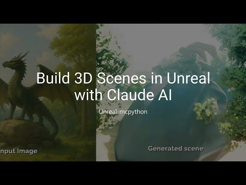
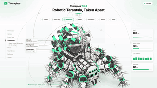
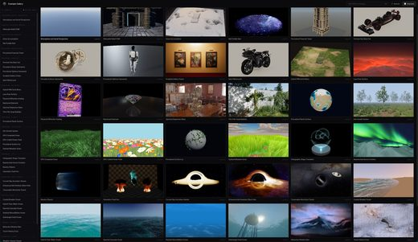

# Awesome 3D Skills

[中文](README.zh-CN.md)

Open-source **MCP servers and skills that let AI agents work in 3D** for Claude Code, Codex, Cursor and other agents: Blender, Unity, Godot and Unreal, CAD tools such as FreeCAD, Three.js for the web, and 3D model generation. 118 repos, each one read and security-graded by [Agent Skills Hub (agentskillshub.top)](https://agentskillshub.top).

Live page with filters: **[https://agentskillshub.top/best/3d-mcp/](https://agentskillshub.top/best/3d-mcp/)** · refreshed every 8 hours

## What these tools make

<table>
<tr>
<td align="center" valign="top" width="33%"><b>🟠 Blender</b> 22 repos   Blender add-ons, MCP servers and skills. <a href="#type-blender"><b>View the list →</b></a></td>
<td align="center" valign="top" width="33%"><b>🎮 Unity</b> 20 repos   For the Unity Editor. <a href="#type-unity"><b>View the list →</b></a></td>
<td align="center" valign="top" width="33%"><b>🤖 Godot</b> 17 repos   For the Godot engine. <a href="#type-godot"><b>View the list →</b></a></td>
</tr>
<tr>
<td align="center" valign="top" width="33%"><b>🏰 Unreal Engine</b> 17 repos   For Unreal Engine. <a href="#type-unreal"><b>View the list →</b></a></td>
<td align="center" valign="top" width="33%"><b>📐 CAD & engineering</b> 18 repos   CAD and engineering: FreeCAD, OpenSCAD, CadQuery, Fusion 360, SolidWorks, KiCad, text-to-CAD. <a href="#type-cad"><b>View the list →</b></a></td>
<td align="center" valign="top" width="33%"><b>🎬 Other 3D apps</b> 2 repos  Maya, Houdini, Cinema 4D, 3ds Max, SketchUp, Rhino and Spline. <a href="#type-dcc"><b>View the list →</b></a></td>
</tr>
<tr>
<td align="center" valign="top" width="33%"><b>🌐 Three.js & web 3D</b> 16 repos   Three.js, React Three Fiber, Babylon.js, WebGL and WebGPU. <a href="#type-web3d"><b>View the list →</b></a></td>
<td align="center" valign="top" width="33%"><b>✨ 3D model generation</b> 6 repos   3D models and scenes from text or images. <a href="#type-gen3d"><b>View the list →</b></a></td>
</tr>
</table>

## Contents

- [🟠 Blender](#type-blender) (22)
- [🎮 Unity](#type-unity) (20)
- [🤖 Godot](#type-godot) (17)
- [🏰 Unreal Engine](#type-unreal) (17)
- [📐 CAD & engineering](#type-cad) (18)
- [🎬 Other 3D apps](#type-dcc) (2)
- [🌐 Three.js & web 3D](#type-web3d) (16)
- [✨ 3D model generation](#type-gen3d) (6)

## How a repo gets on the list

1. It lets an AI coding agent or assistant do 3D work: drive a 3D, CAD or game-engine application, build 3D scenes for the web, or generate 3D models. A 3D app or game with no agent integration, a model's training code, or a tool that only uses 3D as decoration does not count.
2. It is software someone can install or run, not a list of links or a placeholder.
3. It has a README. Without one it cannot be graded.
4. At 50 stars or more it is listed on topic alone. Under 50 it must also clear a README quality bar (shows it working, one-command start, a concrete outcome, complete docs), and have 5 stars.

The questions are answered by a decision model reading each README, not by hand. A repo near a cut-off can land on either side; open an issue if one is misfiled.

## 🟠 Blender

[Open this type on the live page, sorted by stars →](https://agentskillshub.top/best/3d-mcp/#type-blender)

<table><tr>
<td align="center" valign="top"> <a href="https://github.com/ahujasid/mcp-for-blender">ahujasid/mcp-for-blender</a></td>
<td align="center" valign="top"> <a href="https://github.com/arjun988/blender-skills">arjun988/blender-skills</a></td>
<td align="center" valign="top"> <a href="https://github.com/EL4CTEO/blender-skills">EL4CTEO/blender-skills</a></td>
</tr></table>

| Repo | Stars | What it does | Security |
|---|---:|---|---|
| [ahujasid/mcp-for-blender](https://github.com/ahujasid/mcp-for-blender) | 33.5k | Community plugin to control Blender 3D with any LLM of your choice. Not affiliated with the official Blender Foundation. | [SAFE](https://agentskillshub.top/skill/ahujasid/mcp-for-blender/) |
| [arjun988/blender-skills](https://github.com/arjun988/blender-skills) | 2.0k | 94 specialist Blender skills for Cursor, Claude Code, Kiro & Codex -> MCP-powered production pipeline from blockout to engine export. | [SAFE](https://agentskillshub.top/skill/arjun988/blender-skills/) |
| [scenario-labs/blender-plugin](https://github.com/scenario-labs/blender-plugin) | 962 | Scenario for Blender: AI images, video, 3D and PBR materials in the viewport, plus a local MCP server for agents. Blender 5.0+ extension, GPL-3.0-or-… | [SAFE](https://agentskillshub.top/skill/scenario-labs/blender-plugin/) |
| [EL4CTEO/blender-skills](https://github.com/EL4CTEO/blender-skills) | 749 | Professional Blender 5.2 workflows as Agent Skills for Claude Code, Codex, Gemini CLI, Copilot and Cursor: modeling, UVs, PBR, baking, rigging, anima… | [SAFE](https://agentskillshub.top/skill/EL4CTEO/blender-skills/) |
| [Mixar-AI/mixar-app](https://github.com/Mixar-AI/mixar-app) | 590 | AI-powered 3D suite built on Blender, with an integrated agent, moodboard, generation tools and layer-based painting | [SAFE](https://agentskillshub.top/skill/Mixar-AI/mixar-app/) |
| [kevinbadi/blender-skills](https://github.com/kevinbadi/blender-skills) | 251 | Blender Skills for Claude Code - 3D product generation and camera animation workflows | [SAFE](https://agentskillshub.top/skill/kevinbadi/blender-skills/) |
| [HoldMyBeer-gg/blenderwright](https://github.com/HoldMyBeer-gg/blenderwright) | 191 | MCP server for Blender. Hundreds of tools for modeling, materials, rendering and more, driven by Claude, Cursor, Codex, Ollama, llama.cpp, or any MCP… | [SAFE](https://agentskillshub.top/skill/HoldMyBeer-gg/blenderwright/) |
| [majidmanzarpour/blender-game-skills](https://github.com/majidmanzarpour/blender-game-skills) | 174 | Claude Code agent skills for game dev in Blender. Turn concept art into rigged, game-ready 3D assets, measured against your references. | [SAFE](https://agentskillshub.top/skill/majidmanzarpour/blender-game-skills/) |
| [RobLe3/cc-blender-skill](https://github.com/RobLe3/cc-blender-skill) | 146 | Claude Code skill plugin: drive Blender 5.x like a senior 3D artist via natural language. 10 chain-loadable skills (modeling, materials, lighting, ca… | [SAFE](https://agentskillshub.top/skill/RobLe3/cc-blender-skill/) |
| [elithril/blender-kiln](https://github.com/elithril/blender-kiln) | 129 | Claude Code plugin: describe an object or show a photo, and Claude builds a clean 3D model in Blender, for games, the web, AR or 3D printing. It anim… | [SAFE](https://agentskillshub.top/skill/elithril/blender-kiln/) |
| [dhakalnirajan/blender-open-mcp](https://github.com/dhakalnirajan/blender-open-mcp) | 122 | MCP for Blender Using Open Weights Models | [SAFE](https://agentskillshub.top/skill/dhakalnirajan/blender-open-mcp/) |
| [jangtrinh/design-os-3d-blender](https://github.com/jangtrinh/design-os-3d-blender) | 111 | AI agent operating system for Blender 5.2: bpy knowledge base, AGENT_OK execution contract, 3D-print production gate, worked keyboard and desktop-rob… | [SAFE](https://agentskillshub.top/skill/jangtrinh/design-os-3d-blender/) |
| [ifBars/blender-agent-studio](https://github.com/ifBars/blender-agent-studio) | 106 | Free, open-source Blender AI plugin for the tools you already use. Codex and Claude Code installers, local MCP tools, editable .blend files and Pytho… | [SAFE](https://agentskillshub.top/skill/ifBars/blender-agent-studio/) |
| [3DSceneAgent/Vibe3DScene](https://github.com/3DSceneAgent/Vibe3DScene) | 96 | Create your own 3D scene with words anywhere. | [SAFE](https://agentskillshub.top/skill/3DSceneAgent/Vibe3DScene/) |
| [seehiong/blender-mcp-bridge](https://github.com/seehiong/blender-mcp-bridge) | 84 | Automate Blender 3D modeling with AI via MCP — 93 tools for modeling, sculpting, architecture/MEP, materials, and 3D-print prep. Includes Blender Stu… | [SAFE](https://agentskillshub.top/skill/seehiong/blender-mcp-bridge/) |
| [sunxiayi/make-blender-education-video-skill](https://github.com/sunxiayi/make-blender-education-video-skill) | 67 | A Codex and Claude Code skill for creating fact-checked cinematic educational videos with Blender | [SAFE](https://agentskillshub.top/skill/sunxiayi/make-blender-education-video-skill/) |
| [PatrykIti/blender-ai-mcp](https://github.com/PatrykIti/blender-ai-mcp) | 66 | [Project discontinued] Production-shaped MCP server for Blender with goal-first routing, curated tools, deterministic verification, and vision-assist… | [SAFE](https://agentskillshub.top/skill/PatrykIti/blender-ai-mcp/) |
| [sandraschi/blender-mcp](https://github.com/sandraschi/blender-mcp) | 65 | Headless Blender automation via FastMCP — 41 portmanteau tools (150+ ops). Batch mesh/VSE/Grease Pencil, VRM, Gaussian splats; optional live bridge.… | [SAFE](https://agentskillshub.top/skill/sandraschi/blender-mcp/) |
| [dcc-mcp/dcc-mcp-blender](https://github.com/dcc-mcp/dcc-mcp-blender) | 61 | Blender MCP addon for AI agents to model, edit meshes and UVs, rig, build materials and render scenes through typed tools in the DCC-MCP ecosystem. | [SAFE](https://agentskillshub.top/skill/dcc-mcp/dcc-mcp-blender/) |
| [mromidev/claude-blender-skills](https://github.com/mromidev/claude-blender-skills) | 57 | Free Claude skills for realistic Blender animations: full workflows + the real scripts behind my YouTube videos | [SAFE](https://agentskillshub.top/skill/mromidev/claude-blender-skills/) |
| [nocodehack/make-short](https://github.com/nocodehack/make-short) | 26 | Free Claude Code skill: make animated YouTube Shorts (2D characters in a 3D Blender world) with a critic agent. | [SAFE](https://agentskillshub.top/skill/nocodehack/make-short/) |
| [nirholas/blender-mcp](https://github.com/nirholas/blender-mcp) | 5 | Drive the Blender on your machine from any AI agent, headless. Inspect a 3D file, convert between GLB/glTF/FBX/OBJ/STL/PLY/DAE/USD/Alembic/.blend, re… | [SAFE](https://agentskillshub.top/skill/nirholas/blender-mcp/) |

## 🎮 Unity

[Open this type on the live page, sorted by stars →](https://agentskillshub.top/best/3d-mcp/#type-unity)

<table><tr>
<td align="center" valign="top"> <a href="https://github.com/IvanMurzak/Unity-MCP">IvanMurzak/Unity-MCP</a></td>
<td align="center" valign="top"> <a href="https://github.com/CoderGamester/mcp-unity">CoderGamester/mcp-unity</a></td>
<td align="center" valign="top"> <a href="https://github.com/Besty0728/Unity-Skills">Besty0728/Unity-Skills</a></td>
</tr></table>

| Repo | Stars | What it does | Security |
|---|---:|---|---|
| [CoplayDev/unity-mcp](https://github.com/CoplayDev/unity-mcp) | 15.8k | Unity MCP acts as a bridge between AI assistants and your Unity Editor. Give your LLM tools to manage assets, control scenes, edit scripts, and autom… | [SAFE](https://agentskillshub.top/skill/CoplayDev/unity-mcp/) |
| [IvanMurzak/Unity-MCP](https://github.com/IvanMurzak/Unity-MCP) | 4.6k | AI Skills, MCP Tools, and CLI for Unity Engine. Full AI develop and test loop. Use cli for quick setup. Efficient token usage, advanced tools. Any C#… | [SAFE](https://agentskillshub.top/skill/IvanMurzak/Unity-MCP/) |
| [CoderGamester/mcp-unity](https://github.com/CoderGamester/mcp-unity) | 2.0k | Model Context Protocol (MCP) plugin to connect with Unity Editor — designed for Cursor, Claude Code, Codex, Windsurf and other IDEs | [SAFE](https://agentskillshub.top/skill/CoderGamester/mcp-unity/) |
| [Besty0728/Unity-Skills](https://github.com/Besty0728/Unity-Skills) | 1.9k | AI automation skills specifically designed for Unity | [SAFE](https://agentskillshub.top/skill/Besty0728/Unity-Skills/) |
| [Unity-Technologies/skills](https://github.com/Unity-Technologies/skills) | 1.2k | A collection of reusable skills for AI coding agents — prompts, slash commands, and tools built for Unity workflows | [SAFE](https://agentskillshub.top/skill/Unity-Technologies/skills/) |
| [AnkleBreaker-Studio/unity-mcp-server](https://github.com/AnkleBreaker-Studio/unity-mcp-server) | 536 | Unity MCP Server — 268 tools for AI-assisted game development. Connect Claude, Cursor, or any MCP client to Unity Editor & Unity Hub. Scene managemen… | [SAFE](https://agentskillshub.top/skill/AnkleBreaker-Studio/unity-mcp-server/) |
| [isuzu-shiranui/UnityMCP](https://github.com/isuzu-shiranui/UnityMCP) | 340 | Drive the Unity Editor from an AI agent or the terminal. The Editor serves MCP itself over HTTP, so there is no second process to run, and the isuzu-… | [SAFE](https://agentskillshub.top/skill/isuzu-shiranui/UnityMCP/) |
| [FunplayAI/funplay-unity-mcp](https://github.com/FunplayAI/funplay-unity-mcp) | 286 | The Most Advanced MCP Server for Unity Editor with execute_code, prompts/resources, input simulation, screenshots, and play mode automation. | [SAFE](https://agentskillshub.top/skill/FunplayAI/funplay-unity-mcp/) |
| [AnkleBreaker-Studio/unity-mcp-plugin](https://github.com/AnkleBreaker-Studio/unity-mcp-plugin) | 258 | Unity MCP Plugin (UPM) — Editor bridge for AI-assisted game development. Enables Claude, Cursor & MCP-compatible AI to control Unity Editor with 268… | [SAFE](https://agentskillshub.top/skill/AnkleBreaker-Studio/unity-mcp-plugin/) |
| [liyingsong99/AIBridge](https://github.com/liyingsong99/AIBridge) | 227 | AI Unity development harness that combines project-local workflows, AIBridge Skills, CLI and Runtime tools, code indexing, visual validation, input s… | [SAFE](https://agentskillshub.top/skill/liyingsong99/AIBridge/) |
| [Glade-tool/glade-mcp](https://github.com/Glade-tool/glade-mcp) | 201 | Connect any MCP-compatible AI client (Claude Code, Cursor, Windsurf) to Unity or Godot. 275+ granular tools, an editor aware system prompt, game desi… | [SAFE](https://agentskillshub.top/skill/Glade-tool/glade-mcp/) |
| [IvanMurzak/Unity-AI-Animation](https://github.com/IvanMurzak/Unity-AI-Animation) | 121 | MCP Tools for Unity Animation — create and edit clips and animators with AI. | [SAFE](https://agentskillshub.top/skill/IvanMurzak/Unity-AI-Animation/) |
| [TomLeeLive/openclaw-unity-plugin](https://github.com/TomLeeLive/openclaw-unity-plugin) | 107 | 55 MCP tools to drive the Unity Editor from any MCP-compatible AI agent — scenes, GameObjects, prefabs, assets, tests, and builds. OpenClaw gateway i… | [SAFE](https://agentskillshub.top/skill/TomLeeLive/openclaw-unity-plugin/) |
| [MRCalderon3D/everything-game-dev-code](https://github.com/MRCalderon3D/everything-game-dev-code) | 104 | A universal scaffold for AI-assisted game development. 42 agents, 51 commands, 86 skills. Multi-engine (Unity, Unreal, Godot, HTML). Multi-harness (C… | [SAFE](https://agentskillshub.top/skill/MRCalderon3D/everything-game-dev-code/) |
| [codemaestroai/advanced-unity-mcp](https://github.com/codemaestroai/advanced-unity-mcp) | 95 | Public repository for Advanced Unity MCP by Code Maestro (www.code-maestro.com). | [SAFE](https://agentskillshub.top/skill/codemaestroai/advanced-unity-mcp/) |
| [youichi-uda/unity-mcp-pro-plugin](https://github.com/youichi-uda/unity-mcp-pro-plugin) | 83 | 147 AI tools for Unity game development via MCP (Model Context Protocol). Connect Claude, Cursor, and AI assistants to your Unity editor. | [SAFE](https://agentskillshub.top/skill/youichi-uda/unity-mcp-pro-plugin/) |
| [IvanMurzak/Unity-AI-ParticleSystem](https://github.com/IvanMurzak/Unity-AI-ParticleSystem) | 60 | MCP Tools for Unity Particle System — create and edit particle effects with AI. | [SAFE](https://agentskillshub.top/skill/IvanMurzak/Unity-AI-ParticleSystem/) |
| [IvanMurzak/Unity-AI-ProBuilder](https://github.com/IvanMurzak/Unity-AI-ProBuilder) | 58 | MCP Tools for Unity ProBuilder — model and edit meshes with AI. | [SAFE](https://agentskillshub.top/skill/IvanMurzak/Unity-AI-ProBuilder/) |
| [TheArcForge/UniClaude](https://github.com/TheArcForge/UniClaude) | 52 | Claude Code, natively inside Unity Editor. A dockable chat window with full project awareness, 60+ MCP tools, and zero alt-tabbing. | [SAFE](https://agentskillshub.top/skill/TheArcForge/UniClaude/) |
| [MosaicXR-AI/mosaic-bridge](https://github.com/MosaicXR-AI/mosaic-bridge) | 11 | Unity Editor MCP plugin — AI agents drive Unity via Model Context Protocol. Apache 2.0, ~290 domain-specialized tools including procedural generation… | [SAFE](https://agentskillshub.top/skill/MosaicXR-AI/mosaic-bridge/) |

## 🤖 Godot

[Open this type on the live page, sorted by stars →](https://agentskillshub.top/best/3d-mcp/#type-godot)

<table><tr>
<td align="center" valign="top"> <a href="https://github.com/tugcantopaloglu/godot-mcp">tugcantopaloglu/godot-mcp</a></td>
<td align="center" valign="top"> <a href="https://github.com/tomyud1/godot-mcp">tomyud1/godot-mcp</a></td>
<td align="center" valign="top"> <a href="https://github.com/HaD0Yun/Doyunha-Gopeak">HaD0Yun/Doyunha-Gopeak</a></td>
</tr></table>

| Repo | Stars | What it does | Security |
|---|---:|---|---|
| [hi-godot/godot-ai](https://github.com/hi-godot/godot-ai) | 3.4k | Production-grade MCP server and AI tools for the Godot engine. A Snap to install. Totally free and fun. | [SAFE](https://agentskillshub.top/skill/hi-godot/godot-ai/) |
| [jame581/GodotPrompter](https://github.com/jame581/GodotPrompter) | 933 | Agentic skills framework for Godot 4.x. Domain-specific skills for AI coding agents (Claude Code, Copilot, Antigravity, Cursor) | [SAFE](https://agentskillshub.top/skill/jame581/GodotPrompter/) |
| [yurineko73/Godot-MCP-Native](https://github.com/yurineko73/Godot-MCP-Native) | 873 | 一款支持godot开源引擎的的mcp插件，支持常见godot引擎操作，使用Godot原生实现MCPServer，无需安装依赖，开箱即用，支持多种AI工具调用。An MCP plugin that supports the open-source Godot engine, enabling com… | [SAFE](https://agentskillshub.top/skill/yurineko73/Godot-MCP-Native/) |
| [youichi-uda/godot-mcp-pro](https://github.com/youichi-uda/godot-mcp-pro) | 640 | 162 MCP tools for AI-powered Godot 4 development. Scene, animation, 3D, physics, particles, audio, shader, input simulation, runtime analysis, naviga… | [SAFE](https://agentskillshub.top/skill/youichi-uda/godot-mcp-pro/) |
| [ee0pdt/Godot-MCP](https://github.com/ee0pdt/Godot-MCP) | 621 | An MCP for Godot that lets you create and edit games in the Godot game engine with tools like Claude | [SAFE](https://agentskillshub.top/skill/ee0pdt/Godot-MCP/) |
| [DaxianLee/godot-mcp](https://github.com/DaxianLee/godot-mcp) | 552 | 一款支持godot开源引擎的的mcp插件，支持常见godot引擎操作，一键配置服务。This is an MCP plugin that supports the Godot open-source engine, offering support for common Godot engine… | [SAFE](https://agentskillshub.top/skill/DaxianLee/godot-mcp/) |
| [tugcantopaloglu/godot-mcp](https://github.com/tugcantopaloglu/godot-mcp) | 510 | MCP server for full Godot 4.x engine control: 157 tools for AI-driven game development (GDScript and C#/.NET). Tested with Godot 4.7. | [SAFE](https://agentskillshub.top/skill/tugcantopaloglu/godot-mcp/) |
| [tomyud1/godot-mcp](https://github.com/tomyud1/godot-mcp) | 451 | MCP Server and Godot Plugin for AI-assisted game development | [SAFE](https://agentskillshub.top/skill/tomyud1/godot-mcp/) |
| [IvanMurzak/Godot-MCP](https://github.com/IvanMurzak/Godot-MCP) | 326 | Godot-MCP — Model Context Protocol (MCP) integration for the Godot Engine. AI tools for the Godot Editor in C#, with cloud connection to ai-game.dev.… | [SAFE](https://agentskillshub.top/skill/IvanMurzak/Godot-MCP/) |
| [HaD0Yun/Doyunha-Gopeak](https://github.com/HaD0Yun/Doyunha-Gopeak) | 271 | GoPeak — The most comprehensive MCP server for Godot Engine. 95+ tools: scene management, GDScript LSP, DAP debugger, screenshot capture, input injec… | [SAFE](https://agentskillshub.top/skill/HaD0Yun/Doyunha-Gopeak/) |
| [satelliteoflove/godot-mcp](https://github.com/satelliteoflove/godot-mcp) | 184 | Give your AI assistant eyes and hands in the Godot editor: scene editing, input injection, deterministic playtesting, and live game state for agents | [SAFE](https://agentskillshub.top/skill/satelliteoflove/godot-mcp/) |
| [kanaworksai-hue/effekseer-vfx-skill](https://github.com/kanaworksai-hue/effekseer-vfx-skill) | 156 | Agent skills that make real-time game VFX: procedural Effekseer effects, video-model flipbooks, or both, played in Godot and Unity (Claude Code, Code… | [SAFE](https://agentskillshub.top/skill/kanaworksai-hue/effekseer-vfx-skill/) |
| [NPGameDev/godot-mcp-toolkit](https://github.com/NPGameDev/godot-mcp-toolkit) | 108 | A Godot 4.2+ editor plugin that lets AI coding assistants work inside the editor over the Model Context Protocol. Consolidated tools cover 150+ opera… | [SAFE](https://agentskillshub.top/skill/NPGameDev/godot-mcp-toolkit/) |
| [3ddelano/gdai-mcp-plugin-godot](https://github.com/3ddelano/gdai-mcp-plugin-godot) | 103 | A MCP server integration for Godot Engine that allows Claude, Cursor, Windsurf, VSCode, etc to perform actions like creating scenes, resources, scrip… | [SAFE](https://agentskillshub.top/skill/3ddelano/gdai-mcp-plugin-godot/) |
| [Erodenn/godot-mcp-runtime](https://github.com/Erodenn/godot-mcp-runtime) | 96 | A lightweight, zero-footprint TypeScript MCP server that lets AI assistants drive the Godot 4.x game engine. | [SAFE](https://agentskillshub.top/skill/Erodenn/godot-mcp-runtime/) |
| [Dokujaa/Godot-MCP](https://github.com/Dokujaa/Godot-MCP) | 54 | An MCP for Godot that leverages Claude | [SAFE](https://agentskillshub.top/skill/Dokujaa/Godot-MCP/) |
| [FunplayAI/funplay-godot-mcp](https://github.com/FunplayAI/funplay-godot-mcp) | 52 | The Most Advanced MCP Server for Godot Editor with execute_code, prompts/resources, project maps, runtime inspection, asset workflows, and safe AI au… | [SAFE](https://agentskillshub.top/skill/FunplayAI/funplay-godot-mcp/) |

## 🏰 Unreal Engine

[Open this type on the live page, sorted by stars →](https://agentskillshub.top/best/3d-mcp/#type-unreal)

<table><tr>
<td align="center" valign="top"> <a href="https://github.com/ChiR24/Unreal_mcp">ChiR24/Unreal_mcp</a></td>
<td align="center" valign="top"> <a href="https://github.com/db-lyon/ue-mcp">db-lyon/ue-mcp</a></td>
</tr></table>

| Repo | Stars | What it does | Security |
|---|---:|---|---|
| [chongdashu/unreal-mcp](https://github.com/chongdashu/unreal-mcp) | 2.1k | Enable AI assistant clients like Cursor, Windsurf and Claude Desktop to control Unreal Engine through natural language using the Model Context Protoc… | [SAFE](https://agentskillshub.top/skill/chongdashu/unreal-mcp/) |
| [EpicGames/unreal-engine-skills-for-claude-code-plugin](https://github.com/EpicGames/unreal-engine-skills-for-claude-code-plugin) | 1.9k |  | [SAFE](https://agentskillshub.top/skill/EpicGames/unreal-engine-skills-for-claude-code-plugin/) |
| [ChiR24/Unreal_mcp](https://github.com/ChiR24/Unreal_mcp) | 1.0k | A comprehensive Model Context Protocol (MCP) server that enables AI assistants to control Unreal Engine through the native C++ Automation Bridge plug… | [SAFE](https://agentskillshub.top/skill/ChiR24/Unreal_mcp/) |
| [Natfii/UnrealClaude](https://github.com/Natfii/UnrealClaude) | 1.0k | Claude Code CLI integration for Unreal Engine 5.7 - Get AI coding assistance with built-in UE5.7 documentation context directly in the editor. | [CAUTION](https://agentskillshub.top/skill/Natfii/UnrealClaude/) |
| [db-lyon/ue-mcp](https://github.com/db-lyon/ue-mcp) | 480 | Complete Unreal Engine development toolkit exposed as MCP tools. | [SAFE](https://agentskillshub.top/skill/db-lyon/ue-mcp/) |
| [VedantRGosavi/UE5-MCP](https://github.com/VedantRGosavi/UE5-MCP) | 436 | MCP for Unreal Engine 5 | [SAFE](https://agentskillshub.top/skill/VedantRGosavi/UE5-MCP/) |
| [tumourlove/monolith](https://github.com/tumourlove/monolith) | 367 | MCP plugin for Unreal Engine 5.7 & 5.8 — gives AI assistants full read/write access to Blueprints, Materials, Niagara, Animation, Mesh, AI, GAS, Logi… | [SAFE](https://agentskillshub.top/skill/tumourlove/monolith/) |
| [softdaddy-o/soft-ue-cli](https://github.com/softdaddy-o/soft-ue-cli) | 216 | Python CLI + UE plugin that lets Claude Code (AI coding agent) control Unreal Engine in real time. Spawn actors, edit blueprints, call functions, cap… | [SAFE](https://agentskillshub.top/skill/softdaddy-o/soft-ue-cli/) |
| [GenOrca/unreal-mcp](https://github.com/GenOrca/unreal-mcp) | 147 | Unreal Engine MCP Server: Control UE5 with Claude & AI Agents. Supports Python and C++ for custom tool development. | [SAFE](https://agentskillshub.top/skill/GenOrca/unreal-mcp/) |
| [HurtzDonutStudios/ai-forge-mcp](https://github.com/HurtzDonutStudios/ai-forge-mcp) | 101 | 565 AI-callable tools across 16 MCP servers. Full-pipeline AAA game asset production. Controls Blender, Substance Suite, Maya, Houdini, and Unreal En… | [SAFE](https://agentskillshub.top/skill/HurtzDonutStudios/ai-forge-mcp/) |
| [softdaddy-o/yes-ue-mcp](https://github.com/softdaddy-o/yes-ue-mcp) | 88 | Native C++ Model Context Protocol (MCP) plugin for Unreal Engine 5.4+ | [SAFE](https://agentskillshub.top/skill/softdaddy-o/yes-ue-mcp/) |
| [mirno-ehf/ue5-mcp](https://github.com/mirno-ehf/ue5-mcp) | 78 | Let AI edit your Unreal Engine Blueprints. MCP server plugin for Claude Code — describe what you want in plain English. | [SAFE](https://agentskillshub.top/skill/mirno-ehf/ue5-mcp/) |
| [KirChuvakov/uefn-mcp-server](https://github.com/KirChuvakov/uefn-mcp-server) | 72 | MCP server for controlling UEFN (Unreal Editor for Fortnite) from Claude Code — 22 tools for actors, assets, levels, viewport, and Python execution | [SAFE](https://agentskillshub.top/skill/KirChuvakov/uefn-mcp-server/) |
| [Natfii/ue5-mcp-bridge](https://github.com/Natfii/ue5-mcp-bridge) | 66 | MCP server bridging AI assistants to Unreal Engine 5 editor | [SAFE](https://agentskillshub.top/skill/Natfii/ue5-mcp-bridge/) |
| [appleweed/UnrealMCPBridge](https://github.com/appleweed/UnrealMCPBridge) | 64 | An Unreal Engine plugin that implements an MCP server allowing MCP clients to access the UE Editor Python API. | [SAFE](https://agentskillshub.top/skill/appleweed/UnrealMCPBridge/) |
| [IvanMurzak/Unreal-MCP](https://github.com/IvanMurzak/Unreal-MCP) | 57 | AI Game Developer for Unreal Engine — MCP plugin (C++ editor plugin + .NET bridge), unreal-cli, connects Unreal Editor to AI agents via ai-game.dev o… | [SAFE](https://agentskillshub.top/skill/IvanMurzak/Unreal-MCP/) |
| [ABostrom/ushell-skill](https://github.com/ABostrom/ushell-skill) | 13 | A Claude Code skill for driving ushell (Epic's CLI for Unreal Engine) end-to-end — usage, channel authoring, UAT/BuildGraph fluency, and goal-directe… | [SAFE](https://agentskillshub.top/skill/ABostrom/ushell-skill/) |

## 📐 CAD & engineering

[Open this type on the live page, sorted by stars →](https://agentskillshub.top/best/3d-mcp/#type-cad)

<table><tr>
<td align="center" valign="top"> <a href="https://github.com/jingcheng-chen/rhinomcp">jingcheng-chen/rhinomcp</a></td>
<td align="center" valign="top"> <a href="https://github.com/jdilla1277/agentcad">jdilla1277/agentcad</a></td>
<td align="center" valign="top"> <a href="https://github.com/ATOI-Ming/FreeCAD-MCP">ATOI-Ming/FreeCAD-MCP</a></td>
</tr></table>

| Repo | Stars | What it does | Security |
|---|---:|---|---|
| [neka-nat/freecad-mcp](https://github.com/neka-nat/freecad-mcp) | 3.2k | FreeCAD MCP(Model Context Protocol) server | [SAFE](https://agentskillshub.top/skill/neka-nat/freecad-mcp/) |
| [wzyn20051216/solidworks-automation-skill](https://github.com/wzyn20051216/solidworks-automation-skill) | 1.8k | Reliable AI Skill + MCP toolkit for agent-driven desktop CAD automation. | [SAFE](https://agentskillshub.top/skill/wzyn20051216/solidworks-automation-skill/) |
| [jingcheng-chen/rhinomcp](https://github.com/jingcheng-chen/rhinomcp) | 1.2k | RhinoMCP connects Rhino 3D to AI Agent through the Model Context Protocol (MCP) | [SAFE](https://agentskillshub.top/skill/jingcheng-chen/rhinomcp/) |
| [ghbalf/freecad-ai](https://github.com/ghbalf/freecad-ai) | 619 | AI-powered assistant workbench for FreeCAD — generate 3D models from natural language | [SAFE](https://agentskillshub.top/skill/ghbalf/freecad-ai/) |
| [spkane/freecad-addon-robust-mcp-server](https://github.com/spkane/freecad-addon-robust-mcp-server) | 265 | The FreeCAD Robust MCP server and MCP Bridge Workbench/Addon | [SAFE](https://agentskillshub.top/skill/spkane/freecad-addon-robust-mcp-server/) |
| [codeofaxel/Kiln](https://github.com/codeofaxel/Kiln) | 242 | From idea to object, and every version in between. Kiln is the open-source MCP server for 3D printing: AI agents (ChatGPT, Claude, Codex, Cursor, Gem… | [SAFE](https://agentskillshub.top/skill/codeofaxel/Kiln/) |
| [bonninr/freecad_mcp](https://github.com/bonninr/freecad_mcp) | 228 | FreecadMCP connects Freecad to Claude AI and other MCP-ready tools like Cursor through the Model Context Protocol (MCP), allowing Claude to directly… | [SAFE](https://agentskillshub.top/skill/bonninr/freecad_mcp/) |
| [jhacksman/OpenSCAD-MCP-Server](https://github.com/jhacksman/OpenSCAD-MCP-Server) | 215 | Devin's attempt at creating an OpenSCAD MCP Server that takes a user prompt and generates a preview image and 3d file. | [SAFE](https://agentskillshub.top/skill/jhacksman/OpenSCAD-MCP-Server/) |
| [jdilla1277/agentcad](https://github.com/jdilla1277/agentcad) | 206 | CAD CLI and MCP server for AI agents | [SAFE](https://agentskillshub.top/skill/jdilla1277/agentcad/) |
| [ReshefElisha/jarvis-onshape-mcp](https://github.com/ReshefElisha/jarvis-onshape-mcp) | 175 | Jarvis Onshape MCP — Claude Code plugin for driving real Onshape CAD. Vision-decomposition skill + truth-telling + parametric iteration + FeatureScri… | [SAFE](https://agentskillshub.top/skill/ReshefElisha/jarvis-onshape-mcp/) |
| [RobertCoop/openscad-mcp](https://github.com/RobertCoop/openscad-mcp) | 170 | A Model Context Protocol (MCP) server for OpenSCAD 3D modeling and rendering | [SAFE](https://agentskillshub.top/skill/RobertCoop/openscad-mcp/) |
| [pzfreo/build123d-mcp](https://github.com/pzfreo/build123d-mcp) | 143 | MCP server for build123d to improve AI cognition when creating 3D CAD models | [SAFE](https://agentskillshub.top/skill/pzfreo/build123d-mcp/) |
| [ATOI-Ming/FreeCAD-MCP](https://github.com/ATOI-Ming/FreeCAD-MCP) | 101 | FreeCAD plugin for automating model creation and control via Model Contro Protocol (MCP). Provides a MCP server,GUl panel, and client for running mac… | [SAFE](https://agentskillshub.top/skill/ATOI-Ming/FreeCAD-MCP/) |
| [armpro24-blip/cad-cae-copilot](https://github.com/armpro24-blip/cad-cae-copilot) | 89 | CAD/CAE Copilot — an AI-native CAD/CAE/CAX workbench for AI agents. Text-to-CAD, text-to-CAE, real build123d/OpenCASCADE geometry, editable parameter… | [SAFE](https://agentskillshub.top/skill/armpro24-blip/cad-cae-copilot/) |
| [blwfish/freecad-mcp](https://github.com/blwfish/freecad-mcp) | 65 | MCP server for FreeCAD — 32 tools for AI-assisted 3D CAD modeling | [SAFE](https://agentskillshub.top/skill/blwfish/freecad-mcp/) |
| [Misterbra/fusion360-claude-ultimate](https://github.com/Misterbra/fusion360-claude-ultimate) | 60 | 🤖 Control Fusion 360 with natural language through Claude Desktop using MCP (Model Context Protocol). Create, manipulate and modify 3D objects by sim… | [SAFE](https://agentskillshub.top/skill/Misterbra/fusion360-claude-ultimate/) |
| [leandrodaf/3d-new-era-ai](https://github.com/leandrodaf/3d-new-era-ai) | 48 | Open-source home design and floor plan editor in Rust (a Sweet Home 3D alternative) with a built-in MCP server: your AI agent draws walls, furnishes… | [SAFE](https://agentskillshub.top/skill/leandrodaf/3d-new-era-ai/) |
| [EYamanS/chisel](https://github.com/EYamanS/chisel) | 7 | An MCP server that lets AI agents build, edit, render, and export real 3D models from primitives + boolean CSG. Headless, GPU-free. | [SAFE](https://agentskillshub.top/skill/EYamanS/chisel/) |

## 🎬 Other 3D apps

[Open this type on the live page, sorted by stars →](https://agentskillshub.top/best/3d-mcp/#type-dcc)

| Repo | Stars | What it does | Security |
|---|---:|---|---|
| [cl0nazepamm/3dsmax-mcp](https://github.com/cl0nazepamm/3dsmax-mcp) | 368 | 3ds Max MCP server | [SAFE](https://agentskillshub.top/skill/cl0nazepamm/3dsmax-mcp/) |
| [aydinfer/spline-mcp-server](https://github.com/aydinfer/spline-mcp-server) | 85 | An MCP server for working with Spline 3D design tool API | [SAFE](https://agentskillshub.top/skill/aydinfer/spline-mcp-server/) |

## 🌐 Three.js & web 3D

[Open this type on the live page, sorted by stars →](https://agentskillshub.top/best/3d-mcp/#type-web3d)

<table><tr>
<td align="center" valign="top"> <a href="https://github.com/pascalorg/editor">pascalorg/editor</a></td>
<td align="center" valign="top"> <a href="https://github.com/viettranx/3dviz-pro-max">viettranx/3dviz-pro-max</a></td>
<td align="center" valign="top"> <a href="https://github.com/scottstts/Threejs-Awesome-Graphics-Agent-Skills">scottstts/Threejs-Awesome-Graphics-Agent-Skills</a></td>
</tr></table>

| Repo | Stars | What it does | Security |
|---|---:|---|---|
| [pascalorg/editor](https://github.com/pascalorg/editor) | 25.4k | Open-source 3D architectural editor with a local CLI, MCP tools, and practical workflows for humans and AI agents. | [SAFE](https://agentskillshub.top/skill/pascalorg/editor/) |
| [CloudAI-X/threejs-skills](https://github.com/CloudAI-X/threejs-skills) | 4.1k |  | [SAFE](https://agentskillshub.top/skill/CloudAI-X/threejs-skills/) |
| [majidmanzarpour/threejs-game-skills](https://github.com/majidmanzarpour/threejs-game-skills) | 2.7k | Agent skills for building playable, polished Three.js browser games with gameplay, AAA-style graphics, UI, QA, and optional AI-generated 3D, image, a… | [SAFE](https://agentskillshub.top/skill/majidmanzarpour/threejs-game-skills/) |
| [dgreenheck/webgpu-claude-skill](https://github.com/dgreenheck/webgpu-claude-skill) | 1.3k | A Claude skill for developing WebGPU applications with Three.js | [SAFE](https://agentskillshub.top/skill/dgreenheck/webgpu-claude-skill/) |
| [viettranx/3dviz-pro-max](https://github.com/viettranx/3dviz-pro-max) | 1.1k | Agent skill for creative 3D visualization: turn an idea into a Three.js/Blender scene worth exploring. Claude Code + Codex plugin, 223 recipes, 440 k… | [SAFE](https://agentskillshub.top/skill/viettranx/3dviz-pro-max/) |
| [scottstts/Threejs-Awesome-Graphics-Agent-Skills](https://github.com/scottstts/Threejs-Awesome-Graphics-Agent-Skills) | 977 | A three.js agent skills for producing awesome graphics for scenes and games | [SAFE](https://agentskillshub.top/skill/scottstts/Threejs-Awesome-Graphics-Agent-Skills/) |
| [instruktlabs/kiln](https://github.com/instruktlabs/kiln) | 317 | Build and revise procedural 3D assets with your coding agent. Local MCP server, CLI and TypeScript engine with rendered review, editable source and G… | [SAFE](https://agentskillshub.top/skill/instruktlabs/kiln/) |
| [Moh4696/open-3d-skills](https://github.com/Moh4696/open-3d-skills) | 280 | Eight agent skills for 3D and animated websites: three.js scenes from code, scroll films, transparent video, cursor rigs, exploded views, AI motion a… | [SAFE](https://agentskillshub.top/skill/Moh4696/open-3d-skills/) |
| [JDhruv14/ascii-diorama](https://github.com/JDhruv14/ascii-diorama) | 94 | Claude Code skill for tilt-shift ASCII miniature videos rendered with Three.js | [SAFE](https://agentskillshub.top/skill/JDhruv14/ascii-diorama/) |
| [Nyxera0x/cutaway](https://github.com/Nyxera0x/cutaway) | 63 | A Claude Code skill that turns one picture into a 3D object that takes itself apart: built in three.js from code, checked against the picture, filmed… | [SAFE](https://agentskillshub.top/skill/Nyxera0x/cutaway/) |
| [codepawl/67.js](https://github.com/codepawl/67.js) | 49 | A WebGL2 3D engine that AI agents drive | [SAFE](https://agentskillshub.top/skill/codepawl/67.js/) |
| [dennisonbertram/emulsion](https://github.com/dennisonbertram/emulsion) | 12 | 🎞️ Collaborative storyboard blocking for AI filmmaking — a Claude Code skill with its own three.js app. Block shots with Claude live, export motion r… | [SAFE](https://agentskillshub.top/skill/dennisonbertram/emulsion/) |
| [CesiumGS/cesiumjs-ai-starter-app](https://github.com/CesiumGS/cesiumjs-ai-starter-app) | 10 | A starter template for building LLM-powered 3D globe applications with CesiumJS and tool calling. | [SAFE](https://agentskillshub.top/skill/CesiumGS/cesiumjs-ai-starter-app/) |
| [nirholas/3d-scene-mcp](https://github.com/nirholas/3d-scene-mcp) | 10 | Build and manipulate 3D scenes from natural language via AI agents. | [SAFE](https://agentskillshub.top/skill/nirholas/3d-scene-mcp/) |
| [DataArche/SSWorld](https://github.com/DataArche/SSWorld) | 5 | Agent-authored 3D worlds on WebGPU with ray tracing, global illumination (GI), real-time reflections and the Lumen Gallery demo. | [SAFE](https://agentskillshub.top/skill/DataArche/SSWorld/) |
| [czlonkowski/blender-web-3d-skill](https://github.com/czlonkowski/blender-web-3d-skill) | 5 | Claude Code skill: build and publish 3D models with headless Blender + Three.js — managed scripts, GLB export, draw-call optimization, and the debugg… | [SAFE](https://agentskillshub.top/skill/czlonkowski/blender-web-3d-skill/) |

## ✨ 3D model generation

[Open this type on the live page, sorted by stars →](https://agentskillshub.top/best/3d-mcp/#type-gen3d)

<table><tr>
<td align="center" valign="top"> <a href="https://github.com/nirholas/three.ws">nirholas/three.ws</a></td>
</tr></table>

| Repo | Stars | What it does | Security |
|---|---:|---|---|
| [nirholas/three.ws](https://github.com/nirholas/three.ws) | 269 | Give your AI agent a 3D body: text or a photo to a rigged GLB avatar, an LLM brain, a Solana wallet and a one-tag embed. Keyless MCP server for Claud… | [SAFE](https://agentskillshub.top/skill/nirholas/three.ws/) |
| [rtmandreyev/construct](https://github.com/rtmandreyev/construct) | 116 | Describe a thing, get a hologram, a 3D model and its parts: built by any AI agent, honestly. | [SAFE](https://agentskillshub.top/skill/rtmandreyev/construct/) |
| [thrixel/build-world](https://github.com/thrixel/build-world) | 110 | Build interactive 3D worlds with high-quality assets from Thrixel and your AI agent of choice. | [SAFE](https://agentskillshub.top/skill/thrixel/build-world/) |
| [meshy-dev/meshy-mcp-server](https://github.com/meshy-dev/meshy-mcp-server) | 91 | MCP server for Meshy AI 3D generation platform | [SAFE](https://agentskillshub.top/skill/meshy-dev/meshy-mcp-server/) |
| [Rijalmoneyfinder/mcp-game-asset-forge](https://github.com/Rijalmoneyfinder/mcp-game-asset-forge) | 69 | MCP: Python Tools for Turning AI Prompts into Game Assets | [SAFE](https://agentskillshub.top/skill/Rijalmoneyfinder/mcp-game-asset-forge/) |
| [mordor-forge/trident-mcp](https://github.com/mordor-forge/trident-mcp) | 5 | Unofficial MCP server for the Tripo 3D API (v3): text/image/multiview to 3D, P1/P2 low-poly, texturing, retopology, Smart UV, segmentation, rigging,… | [SAFE](https://agentskillshub.top/skill/mordor-forge/trident-mcp/) |

**Security** is the grade of the repo's README and install steps on Agent Skills Hub. *pending* means the catalog has not graded it yet.

Preview images are reduced copies of pictures from each project's own README, included only for projects under a permissive license. Sources and licenses: [assets/previews/NOTICE.md](assets/previews/NOTICE.md). Open an issue to have one removed.

## Related collections

- [zhuyansen/awesome-claude-video-skills](https://github.com/zhuyansen/awesome-claude-video-skills), [zhuyansen/awesome-codex-ppt-skills](https://github.com/zhuyansen/awesome-codex-ppt-skills) — lists built the same way.

## Add a repo

Open an issue with the GitHub URL. It goes through the same review as every entry; the rules above decide, stars do not.

---

Machine-readable copy: [`data/skills.json`](data/skills.json). Generated 2026-11-07.
