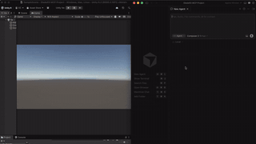
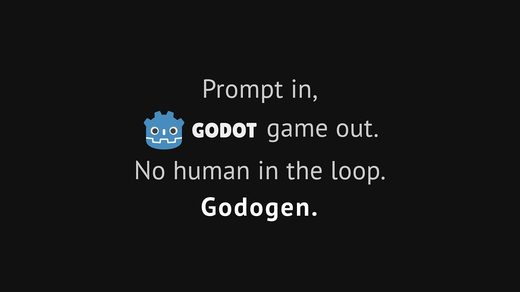

# Awesome 3D Skills

[中文](README.zh-CN.md)

Open-source **MCP servers and skills that let AI agents work in 3D** for Claude Code, Codex, Cursor and other agents: Blender, Unity, Godot and Unreal, CAD tools such as FreeCAD, Three.js for the web, and 3D model generation. 210 repos, each one read and security-graded by [Agent Skills Hub (agentskillshub.top)](https://agentskillshub.top).

Live page with filters: **[https://agentskillshub.top/best/3d-mcp/](https://agentskillshub.top/best/3d-mcp/)** · refreshed every 8 hours

## Which one to use

We ran 25 of these end to end (20 gave a result). This is what we would pick; the [full test](#tested) is below.

- 🥇 **For a Blender scene you keep editing: [mcp-for-blender](https://github.com/ahujasid/mcp-for-blender)**  
  The most starred tool in the test and the fastest, cheapest Blender run: 6.1 minutes and $0.54, every item right, the judge's 5 of 5 for looks. It leaves a .blend file.
- 🥈 **For a scene on a web page, fast: [threejs-skills](https://github.com/CloudAI-X/threejs-skills)**  
  The fastest render in the test: 2.2 minutes and $0.56, every item right, 5 of 5 for looks, in one index.html you open in a browser.
- 🥉 **For a richer web scene: [threejs-game-skills](https://github.com/majidmanzarpour/threejs-game-skills)**  
  Filled in what the brief left open: a window with light falling through, shelves of bread and a gingham cloth in the basket; 10.5 minutes and $1.69, 5 of 5 for looks, saved as a .glb you can reuse.
- - **For a model to 3D print: [OpenSCAD-MCP-Server](https://github.com/jhacksman/OpenSCAD-MCP-Server)**  
  The best-looking CAD render (5 of 5), in 6.3 minutes and $0.50; it saves the OpenSCAD source and an STL.
- - **For a STEP file for engineering CAD: [build123d-mcp](https://github.com/pzfreo/build123d-mcp)**  
  The cheapest render in the test, $0.46 in 6.0 minutes, every item right; it saves the build123d script and a STEP file, the format FreeCAD and Fusion open.

You don't need a 3D tool for a scene this size: Claude Code with no tool wrote Blender Python and got every item right in 12.3 minutes. The tools made it quicker (17 of 20 finished sooner), not more correct (20 of 20 got every item right too). Pick one by the file you want to keep.

*Picked by the file each leaves (a .blend, a web page, a print or CAD file): every item right first, then the judge's looks, then time and cost.*

## What these tools make

<table>
<tr>
<td align="center" valign="top" width="33%"><b>🟠 Blender</b> 59 repos   Blender add-ons, MCP servers and skills. <a href="#type-blender"><b>View the list →</b></a></td>
<td align="center" valign="top" width="33%"><b>🎮 Unity</b> 28 repos   For the Unity Editor. <a href="#type-unity"><b>View the list →</b></a></td>
<td align="center" valign="top" width="33%"><b>🤖 Godot</b> 24 repos   For the Godot engine. <a href="#type-godot"><b>View the list →</b></a></td>
</tr>
<tr>
<td align="center" valign="top" width="33%"><b>🏰 Unreal Engine</b> 26 repos   For Unreal Engine. <a href="#type-unreal"><b>View the list →</b></a></td>
<td align="center" valign="top" width="33%"><b>📐 CAD & engineering</b> 26 repos   CAD and engineering: FreeCAD, OpenSCAD, CadQuery, Fusion 360, SolidWorks, KiCad, text-to-CAD. <a href="#type-cad"><b>View the list →</b></a></td>
<td align="center" valign="top" width="33%"><b>🎬 Other 3D apps</b> 5 repos   Maya, Houdini, Cinema 4D, 3ds Max, SketchUp, Rhino and Spline. <a href="#type-dcc"><b>View the list →</b></a></td>
</tr>
<tr>
<td align="center" valign="top" width="33%"><b>🌐 Three.js & web 3D</b> 32 repos   Three.js, React Three Fiber, Babylon.js, WebGL and WebGPU. <a href="#type-web3d"><b>View the list →</b></a></td>
<td align="center" valign="top" width="33%"><b>✨ 3D model generation</b> 10 repos   3D models and scenes from text or images. <a href="#type-gen3d"><b>View the list →</b></a></td>
</tr>
</table>

## Contents

- [🧪 Tested end to end](#tested)
- [🟠 Blender](#type-blender) (59)
- [🎮 Unity](#type-unity) (28)
- [🤖 Godot](#type-godot) (24)
- [🏰 Unreal Engine](#type-unreal) (26)
- [📐 CAD & engineering](#type-cad) (26)
- [🎬 Other 3D apps](#type-dcc) (5)
- [🌐 Three.js & web 3D](#type-web3d) (32)
- [✨ 3D model generation](#type-gen3d) (10)

## How a repo gets on the list

1. It lets an AI coding agent or assistant do 3D work: drive a 3D, CAD or game-engine application, build 3D scenes for the web, or generate 3D models. A 3D app or game with no agent integration, a model's training code, or a tool that only uses 3D as decoration does not count.
2. It is software someone can install or run, not a list of links or a placeholder.
3. It has a README. Without one it cannot be graded.
4. At 50 stars or more it is listed on topic alone. Under 50 it must also clear a README quality bar (shows it working, one-command start, a concrete outcome, complete docs), and have 5 stars.

The questions are answered by a decision model reading each README, not by hand. A repo near a cut-off can land on either side; open an issue if one is misfiled.

## 🧪 Tested end to end

We gave 25 3D MCP servers and skills the same brief on 2026-11-08: a wooden shop counter with a round loaf and a wicker basket of three croissants, a hanging sign that reads Morning Loaf, warm light from the left, seen from slightly above, rendered at 1600 x 1200. Each ran in a throwaway Linux sandbox with Blender 3.4, OpenSCAD and a headless Chromium, driven by Claude Code (Claude Opus 5.5). The sign was read by OCR, the croissants counted in each scene file, and the rest checked by gpt-6-astra.

**What we found:** Claude Code with no 3D tool built the whole scene in plain Blender Python in 12.3 minutes ($0.87 at API prices), every item right. 20 of the 20 tools that rendered did too: the sign spelled right in every render and three croissants in every scene file. They took 2.2 to 27.4 minutes. The CAD renders are flat previews with fixed light, so their warm light comes only from the colours.

*Every render, the one made with no 3D tool first (outlined): 20 tools.*

| # | Tool and its render | ★ | Result | Sign, as read | Looks (judge) | Time | Cost at API prices | Scene file |  |
|---|---|---|---|---|---|---|---|---|---|
| 1 | [threejs-skills](https://github.com/CloudAI-X/threejs-skills) | 4,066 | All right | Morning Loaf | 5/5 | 2.2 min | $0.56 | index.html | [evidence](https://agentskillshub.top/best-runs/3d/CloudAI-X__threejs-skills.html) |
| 2 | [webgpu-claude-skill](https://github.com/dgreenheck/webgpu-claude-skill) | 1,270 | All right | Morning Loaf | 5/5 | 4.0 min | $0.88 | index.html | [evidence](https://agentskillshub.top/best-runs/3d/dgreenheck__webgpu-claude-skill.html) |
| 3 | [threejs-architecture-effects](https://github.com/lhlGitHub/threejs-architecture-effects) | 712 | All right | Morning Loaf | 5/5 | 5.8 min | $1.10 | morning-loaf/index.html | [evidence](https://agentskillshub.top/best-runs/3d/lhlGitHub__threejs-architecture-effects.html) |
| 4 | [mcp-for-blender](https://github.com/ahujasid/mcp-for-blender) | 33,597 | All right | Morning Loaf | 5/5 | 6.1 min | $0.54 | scene.blend | [evidence](https://agentskillshub.top/best-runs/3d/ahujasid__mcp-for-blender.html) |
| 5 | [OpenSCAD-MCP-Server](https://github.com/jhacksman/OpenSCAD-MCP-Server) | 215 | All right | Morning Loaf | 5/5 | 6.3 min | $0.50 | scene.scad, scene.stl | [evidence](https://agentskillshub.top/best-runs/3d/jhacksman__OpenSCAD-MCP-Server.html) |
| 6 | [blender-skills](https://github.com/EL4CTEO/blender-skills) | 769 | All right | Morning Loaf | 5/5 | 6.5 min | $0.69 | scene.blend | [evidence](https://agentskillshub.top/best-runs/3d/EL4CTEO__blender-skills.html) |
| 7 | [blender-game-skills](https://github.com/majidmanzarpour/blender-game-skills) | 174 | All right | Morning Loaf | 5/5 | 7.2 min | $1.04 | scene.blend | [evidence](https://agentskillshub.top/best-runs/3d/majidmanzarpour__blender-game-skills.html) |
| 8 | [blender-skills](https://github.com/arjun988/blender-skills) | 2,169 | All right | Morning Loaf | 5/5 | 7.8 min | $1.10 | scene.blend | [evidence](https://agentskillshub.top/best-runs/3d/arjun988__blender-skills.html) |
| 9 | [blender-skills](https://github.com/kevinbadi/blender-skills) | 262 | All right | Morning Loaf | 5/5 | 9.9 min | $1.13 | scene.blend | [evidence](https://agentskillshub.top/best-runs/3d/kevinbadi__blender-skills.html) |
| 10 | [threejs-game-skills](https://github.com/majidmanzarpour/threejs-game-skills) | 2,729 | All right | Morning Loaf | 5/5 | 10.5 min | $1.69 | scene.glb | [evidence](https://agentskillshub.top/best-runs/3d/majidmanzarpour__threejs-game-skills.html) |
| 11 | [open-3d-skills](https://github.com/Moh4696/open-3d-skills) | 291 | All right | Morning Loaf | 5/5 | 12.9 min | $1.01 | index.html | [evidence](https://agentskillshub.top/best-runs/3d/Moh4696__open-3d-skills.html) |
| 12 | [blender-kiln](https://github.com/elithril/blender-kiln) | 190 | All right | Morning Loaf | 5/5 | 18.2 min | $2.32 | build_scene.py, scene.blend | [evidence](https://agentskillshub.top/best-runs/3d/elithril__blender-kiln.html) |
| 13 | [openscad-mcp](https://github.com/RobertCoop/openscad-mcp) | 170 | All right | Morning Loaf | 4/5 | 3.5 min | $0.70 | scene.scad | [evidence](https://agentskillshub.top/best-runs/3d/RobertCoop__openscad-mcp.html) |
| 14 | [kiln](https://github.com/instruktlabs/kiln) | 318 | All right | MORNING LOAF | 4/5 | 5.3 min | $1.39 | scene.glb | [evidence](https://agentskillshub.top/best-runs/3d/instruktlabs__kiln.html) |
| 15 | [build123d-mcp](https://github.com/pzfreo/build123d-mcp) | 144 | All right | Morning Loaf | 4/5 | 6.0 min | $0.46 | scene.py, scene.step | [evidence](https://agentskillshub.top/best-runs/3d/pzfreo__build123d-mcp.html) |
| 16 | [Threejs-Awesome-Graphics-Agent-Skills](https://github.com/scottstts/Threejs-Awesome-Graphics-Agent-Skills) | 977 | All right | Morning Loaf | 4/5 | 7.5 min | $1.45 | index.html, render.py | [evidence](https://agentskillshub.top/best-runs/3d/scottstts__Threejs-Awesome-Graphics-Agent-Skills.html) |
| 17 | [blenderwright](https://github.com/HoldMyBeer-gg/blenderwright) | 193 | All right | Morning Loaf | 4/5 | 7.9 min | $1.66 | scene.blend | [evidence](https://agentskillshub.top/best-runs/3d/HoldMyBeer-gg__blenderwright.html) |
| 18 | [3dviz-pro-max](https://github.com/viettranx/3dviz-pro-max) | 1,099 | All right | Morning Loaf | 4/5 | 8.0 min | $0.54 | scene.blend | [evidence](https://agentskillshub.top/best-runs/3d/viettranx__3dviz-pro-max.html) |
| 19 | [agentcad](https://github.com/jdilla1277/agentcad) | 208 | All right | Morning Loaf | 4/5 | 11.5 min | $1.13 | scene.py, scene.step | [evidence](https://agentskillshub.top/best-runs/3d/jdilla1277__agentcad.html) |
| 20 | [blender-mcp-vxai](https://github.com/VxASI/blender-mcp-vxai) | 300 | All right | Morning Loaf | 4/5 | 27.4 min | $0.71 | scene.blend | [evidence](https://agentskillshub.top/best-runs/3d/VxASI__blender-mcp-vxai.html) |

**No render:** blender-plugin (Needs paid Scenario credits (each blockout priced and approved first) and Blender 5.0 or later.); meshgen (Timed out: it runs its own language model inside Blender, and on a CPU each step took minutes.); anyscene (Needs a fal.ai key (its author puts it at about $1.65 a prop) and Blender 5.0 or later.); editor (Timed out: its design_brief tool ran 24 minutes without an answer.); Kiln (Asks you to accept its terms of use before it compiles or renders anything; our agent would not accept them for you, so it left an OpenSCAD file and no render.)

[All results, prompts and scripts](https://github.com/zhuyansen/agent-skills-hub/blob/main/ops/3d-runs/RESULTS.md) · [https://agentskillshub.top/best/3d-mcp/#test-results](https://agentskillshub.top/best/3d-mcp/#test-results)

## 🟠 Blender

[Open this type on the live page, sorted by stars →](https://agentskillshub.top/best/3d-mcp/#type-blender)

<table><tr>
<td align="center" valign="top"> <a href="https://github.com/ahujasid/mcp-for-blender">ahujasid/mcp-for-blender</a></td>
<td align="center" valign="top"> <a href="https://github.com/arjun988/blender-skills">arjun988/blender-skills</a></td>
<td align="center" valign="top"> <a href="https://github.com/EL4CTEO/blender-skills">EL4CTEO/blender-skills</a></td>
</tr></table>

| Repo | Stars | What it does | Security |
|---|---:|---|---|
| [ahujasid/mcp-for-blender](https://github.com/ahujasid/mcp-for-blender) | 34.3k | Community plugin to control Blender 3D with any LLM of your choice. Not affiliated with the official Blender Foundation. | [SAFE](https://agentskillshub.top/skill/ahujasid/mcp-for-blender/) |
| [arjun988/blender-skills](https://github.com/arjun988/blender-skills) | 2.7k | 94 specialist Blender skills for Cursor, Claude Code, Kiro & Codex -> MCP-powered production pipeline from blockout to engine export. | [SAFE](https://agentskillshub.top/skill/arjun988/blender-skills/) |
| [sixtysevenlf/dsh-blender-plugin](https://github.com/sixtysevenlf/dsh-blender-plugin) | 2.1k | DSH × Blender 直连插件 v3.0.6：15 个模型工具让 AI 驱动 GUI Blender（视口 / 自定义视角 / 无头 worker / 作业层 / 事务回滚 / 配方库），34 family / 228 op 契约层；npm 安装 + addon zip，GUI 优先、无头备… | [SAFE](https://agentskillshub.top/skill/sixtysevenlf/dsh-blender-plugin/) |
| [EL4CTEO/blender-skills](https://github.com/EL4CTEO/blender-skills) | 1.0k | Professional Blender 5.3 workflows as Agent Skills for Claude Code, Codex, Gemini CLI, Copilot and Cursor: modeling, UVs, PBR, baking, rigging, anima… | [SAFE](https://agentskillshub.top/skill/EL4CTEO/blender-skills/) |
| [scenario-labs/blender-plugin](https://github.com/scenario-labs/blender-plugin) | 984 | Scenario for Blender: AI images, video, 3D and PBR materials in the viewport, plus a local MCP server for agents. Blender 5.0+ extension, GPL-3.0-or-… | [SAFE](https://agentskillshub.top/skill/scenario-labs/blender-plugin/) |
| [huggingface/meshgen](https://github.com/huggingface/meshgen) | 946 | Use AI Agents directly in Blender. | [SAFE](https://agentskillshub.top/skill/huggingface/meshgen/) |
| [Mixar-AI/mixar-app](https://github.com/Mixar-AI/mixar-app) | 599 | AI-powered 3D suite built on Blender, with an integrated agent, moodboard, generation tools and layer-based painting | [SAFE](https://agentskillshub.top/skill/Mixar-AI/mixar-app/) |
| [squall01337/mixamo-llm-mocap](https://github.com/squall01337/mixamo-llm-mocap) | 439 | Turn any video into a Mixamo-rig animation - GVHMR estimator, spec-driven retarget, FK apply in Blender via MCP. Works with any Mixamo character; bui… | [SAFE](https://agentskillshub.top/skill/squall01337/mixamo-llm-mocap/) |
| [apekshik/anyscene](https://github.com/apekshik/anyscene) | 369 | Photoreal Blender scenes from a one-paragraph brief, built by AI agents: image→3D props on fal, scripted layout, lighting, camera and grade. | [SAFE](https://agentskillshub.top/skill/apekshik/anyscene/) |
| [VxASI/blender-mcp-vxai](https://github.com/VxASI/blender-mcp-vxai) | 301 |  | [SAFE](https://agentskillshub.top/skill/VxASI/blender-mcp-vxai/) |
| [kevinbadi/blender-skills](https://github.com/kevinbadi/blender-skills) | 290 | Blender Skills for Claude Code - 3D product generation and camera animation workflows | [SAFE](https://agentskillshub.top/skill/kevinbadi/blender-skills/) |
| [XliuXjianX/blender-production-skills](https://github.com/XliuXjianX/blender-production-skills) | 286 | 面向 Codex 的 Blender 生产级技能套件，包含原生建模、几何节点、模拟、材质、拓扑与场景验证，以及参考图重建工作流。 | [SAFE](https://agentskillshub.top/skill/XliuXjianX/blender-production-skills/) |
| [elithril/blender-kiln](https://github.com/elithril/blender-kiln) | 216 | Claude Code plugin: describe an object or show a photo, and Claude builds a clean 3D model in Blender, for games, the web, AR or 3D printing. It anim… | [SAFE](https://agentskillshub.top/skill/elithril/blender-kiln/) |
| [S4US/Roqer](https://github.com/S4US/Roqer) | 204 | An open-source AI agent for Roblox Studio. Builds, scripts, and playtests in your place using your ChatGPT/Claude subscription or custom API. | [SAFE](https://agentskillshub.top/skill/S4US/Roqer/) |
| [HoldMyBeer-gg/blenderwright](https://github.com/HoldMyBeer-gg/blenderwright) | 196 | MCP server for Blender. Hundreds of tools for modeling, materials, rendering and more, driven by Claude, Cursor, Codex, Ollama, llama.cpp, or any MCP… | [SAFE](https://agentskillshub.top/skill/HoldMyBeer-gg/blenderwright/) |
| [majidmanzarpour/blender-game-skills](https://github.com/majidmanzarpour/blender-game-skills) | 184 | Claude Code agent skills for game dev in Blender. Turn concept art into rigged, game-ready 3D assets, measured against your references. | [SAFE](https://agentskillshub.top/skill/majidmanzarpour/blender-game-skills/) |
| [samffprice/loopcut](https://github.com/samffprice/loopcut) | 173 | Loopcut: an AI agent that works inside Blender. A fork of Blender (GPL). | [SAFE](https://agentskillshub.top/skill/samffprice/loopcut/) |
| [codepawl/creator-generalist](https://github.com/codepawl/creator-generalist) | 172 | AI agent skills to be professional at 2D and 3D | [SAFE](https://agentskillshub.top/skill/codepawl/creator-generalist/) |
| [RobLe3/cc-blender-skill](https://github.com/RobLe3/cc-blender-skill) | 162 | Claude Code skill plugin: drive Blender 5.x like a senior 3D artist via natural language. 10 chain-loadable skills (modeling, materials, lighting, ca… | [SAFE](https://agentskillshub.top/skill/RobLe3/cc-blender-skill/) |
| [AIGODLIKE/GenesisCore](https://github.com/AIGODLIKE/GenesisCore) | 141 | One click installation! BlenderMCP tool that supports DeepSeek, Claude, and others, fully integrated into Blender! | [SAFE](https://agentskillshub.top/skill/AIGODLIKE/GenesisCore/) |
| [k-telux/OpticalModeler](https://github.com/k-telux/OpticalModeler) | 138 | Evidence-gated Agent Skill for reconstructing 2D photonics schematics as physically auditable Blender optical tables with CAD, beam-path, mechanics,… | [SAFE](https://agentskillshub.top/skill/k-telux/OpticalModeler/) |
| [icesixgod/awesome-astra-blender-characters](https://github.com/icesixgod/awesome-astra-blender-characters) | 129 | An agent skill for Blender character creation and repair, with nine-view references, face and hair workflows, and visual validation. | [SAFE](https://agentskillshub.top/skill/icesixgod/awesome-astra-blender-characters/) |
| [dhakalnirajan/blender-open-mcp](https://github.com/dhakalnirajan/blender-open-mcp) | 123 | MCP for Blender Using Open Weights Models | [SAFE](https://agentskillshub.top/skill/dhakalnirajan/blender-open-mcp/) |
| [hitkeeen/blender-ai-mcp-addon](https://github.com/hitkeeen/blender-ai-mcp-addon) | 118 | AI assistant and MCP server for Blender: visual chat, scene tools, multi-agent workflows. Works with ChatGPT/GPT, Claude, Gemini, Ollama, OpenCode. B… | [SAFE](https://agentskillshub.top/skill/hitkeeen/blender-ai-mcp-addon/) |
| [precygtrucqui1981/blender-ai-copilot-lab](https://github.com/precygtrucqui1981/blender-ai-copilot-lab) | 117 | An AI lab for Blender where manager–worker–reviewer agent teams run multi-step scene briefs as supervised experiments—a live task board, review findi… | [SAFE](https://agentskillshub.top/skill/precygtrucqui1981/blender-ai-copilot-lab/) |
| [jangtrinh/design-os-3d-blender](https://github.com/jangtrinh/design-os-3d-blender) | 116 | AI agent operating system for Blender 5.2: bpy knowledge base, AGENT_OK execution contract, 3D-print production gate, worked keyboard and desktop-rob… | [SAFE](https://agentskillshub.top/skill/jangtrinh/design-os-3d-blender/) |
| [racdeufindurch198812/Blender-AI-MCP-Studio](https://github.com/racdeufindurch198812/Blender-AI-MCP-Studio) | 116 | Blender AI MCP Studio is an AI assistant and built-in Model Context Protocol MCP server for Blender that turns plain-language briefs into inspected,… | [SAFE](https://agentskillshub.top/skill/racdeufindurch198812/Blender-AI-MCP-Studio/) |
| [baiblinocun1986/blender-ai-copilot-hub](https://github.com/baiblinocun1986/blender-ai-copilot-hub) | 114 | A multi-provider AI copilot hub for Blender—bring OpenAI, Anthropic Claude, Google Gemini, OpenRouter, OpenCode Zen, Ollama and custom endpoints into… | [SAFE](https://agentskillshub.top/skill/baiblinocun1986/blender-ai-copilot-hub/) |
| [findavoulot1973/Blender-AI-MCP-Suite](https://github.com/findavoulot1973/Blender-AI-MCP-Suite) | 114 | Blender AI MCP Suite is an AI assistant and built-in Model Context Protocol MCP server for Blender that turns plain-language briefs into inspected, a… | [SAFE](https://agentskillshub.top/skill/findavoulot1973/Blender-AI-MCP-Suite/) |
| [fumbdendade19718/blender-ai-copilot-desk](https://github.com/fumbdendade19718/blender-ai-copilot-desk) | 113 | A visual AI desk for Blender—chat, scene objects, viewport snapshots, approvals and a live task board in one companion window, backed by your choice… | [SAFE](https://agentskillshub.top/skill/fumbdendade19718/blender-ai-copilot-desk/) |
| [ifBars/blender-agent-studio](https://github.com/ifBars/blender-agent-studio) | 113 | Free, open-source Blender AI plugin for the tools you already use. Codex and Claude Code installers, local MCP tools, editable .blend files and Pytho… | [SAFE](https://agentskillshub.top/skill/ifBars/blender-agent-studio/) |
| [tiobeharxi1987/blender-ai-copilot-flow](https://github.com/tiobeharxi1987/blender-ai-copilot-flow) | 113 | A controlled AI workflow for Blender: every copilot edit is a supervised tool call—proposed, approved, executed in sequence, cancellable after the cu… | [SAFE](https://agentskillshub.top/skill/tiobeharxi1987/blender-ai-copilot-flow/) |
| [benzgasfuncring197110/blender-ai-copilot-bridge](https://github.com/benzgasfuncring197110/blender-ai-copilot-bridge) | 111 | An MCP bridge for Blender that exposes 27 supervised scene tools to OpenCode and any compatible client—authenticated Streamable HTTP on a local endpo… | [SAFE](https://agentskillshub.top/skill/benzgasfuncring197110/blender-ai-copilot-bridge/) |
| [credoksopho1984/blender-ai-copilot-studio](https://github.com/credoksopho1984/blender-ai-copilot-studio) | 111 | An AI copilot and MCP server for Blender that turns plain-language briefs into scene operations—inside a visual chat studio with multi-agent teams, y… | [SAFE](https://agentskillshub.top/skill/credoksopho1984/blender-ai-copilot-studio/) |
| [Doug-218/blender-ai-copilot-forge](https://github.com/Doug-218/blender-ai-copilot-forge) | 109 | A scene-forging AI copilot for Blender—describe the layout and watch primitives, cameras, lights, materials and parenting assemble in ordered steps,… | [SAFE](https://agentskillshub.top/skill/Doug-218/blender-ai-copilot-forge/) |
| [zovulrira1974/blender-ai-copilot-assets](https://github.com/zovulrira1974/blender-ai-copilot-assets) | 107 | An asset-savvy AI copilot for Blender—search Poly Haven, Sketchfab and Poly Pizza mid-conversation, check what fits, import after your confirmation,… | [SAFE](https://agentskillshub.top/skill/zovulrira1974/blender-ai-copilot-assets/) |
| [FreedomIntelligence/BlenderLore](https://github.com/FreedomIntelligence/BlenderLore) | 99 | BlenderLore: Learning 3D Coding from Internet Tutorial Videos. | [SAFE](https://agentskillshub.top/skill/FreedomIntelligence/BlenderLore/) |
| [pranav-deshmukh/blender-mcp](https://github.com/pranav-deshmukh/blender-mcp) | 99 |  | [SAFE](https://agentskillshub.top/skill/pranav-deshmukh/blender-mcp/) |
| [bpy-dev/blender-mcp](https://github.com/bpy-dev/blender-mcp) | 97 | Independent enhanced distribution of Blender Lab MCP: standalone bpy, runtime API documentation, and benchmark tooling | [SAFE](https://agentskillshub.top/skill/bpy-dev/blender-mcp/) |
| [3DSceneAgent/Vibe3DScene](https://github.com/3DSceneAgent/Vibe3DScene) | 96 | Create your own 3D scene with words anywhere. | [SAFE](https://agentskillshub.top/skill/3DSceneAgent/Vibe3DScene/) |
| [mromidev/claude-blender-skills](https://github.com/mromidev/claude-blender-skills) | 86 | Free Claude skills for realistic Blender animations: full workflows + the real scripts behind my YouTube videos | [SAFE](https://agentskillshub.top/skill/mromidev/claude-blender-skills/) |
| [ProfRino/Blender-MCP-Assembly-Skill](https://github.com/ProfRino/Blender-MCP-Assembly-Skill) | 85 | Blender Assembly is a geometry-building skill for creating reliable 3D models in Blender via MCP. It helps prevent common modelling errors by plannin… | [SAFE](https://agentskillshub.top/skill/ProfRino/Blender-MCP-Assembly-Skill/) |
| [seehiong/blender-mcp-bridge](https://github.com/seehiong/blender-mcp-bridge) | 84 | Automate Blender 3D modeling with AI via MCP — 93 tools for modeling, sculpting, architecture/MEP, materials, and 3D-print prep. Includes Blender Stu… | [SAFE](https://agentskillshub.top/skill/seehiong/blender-mcp-bridge/) |
| [CheshireJCat/blender](https://github.com/CheshireJCat/blender) | 80 | DeepSeek Harness plugin for complete Blender 3D modeling, reconstruction, rendering, validation, and export workflows | [SAFE](https://agentskillshub.top/skill/CheshireJCat/blender/) |
| [FishWoWater/trellis_blender](https://github.com/FishWoWater/trellis_blender) | 79 | Blender plugin for TRELLIS and TRELLIS.2 (3D AIGC Model, Text-to-3D, Image-to-3D) | [SAFE](https://agentskillshub.top/skill/FishWoWater/trellis_blender/) |
| [mezallastudio/antigravity-blender-mcp](https://github.com/mezallastudio/antigravity-blender-mcp) | 72 | AI-Powered Blender MCP for Antigravity IDE | [SAFE](https://agentskillshub.top/skill/mezallastudio/antigravity-blender-mcp/) |
| [sixtysevenlf/dsh-skill-blender-modeling](https://github.com/sixtysevenlf/dsh-skill-blender-modeling) | 71 | DSH skill v1.0 · Blender 建模与装配流程：多 Agent 分工范式（冻结 spec/写作用域/接口表）、参考图形体还原、六条必踩的坑、十道数值门装配审计；23 条配方；配套插件 dsh-blender-plugin v1.0.0 | [SAFE](https://agentskillshub.top/skill/sixtysevenlf/dsh-skill-blender-modeling/) |
| [Show2Instruct/ifc-bonsai-mcp](https://github.com/Show2Instruct/ifc-bonsai-mcp) | 69 | An MCP server that connects LLMs to IFC-based BIM workflows in Blender using the Bonsai add-on. | [SAFE](https://agentskillshub.top/skill/Show2Instruct/ifc-bonsai-mcp/) |
| [sunxiayi/make-blender-education-video-skill](https://github.com/sunxiayi/make-blender-education-video-skill) | 68 | A Codex and Claude Code skill for creating fact-checked cinematic educational videos with Blender | [SAFE](https://agentskillshub.top/skill/sunxiayi/make-blender-education-video-skill/) |
| [PatrykIti/blender-ai-mcp](https://github.com/PatrykIti/blender-ai-mcp) | 66 | [Project discontinued] Production-shaped MCP server for Blender with goal-first routing, curated tools, deterministic verification, and vision-assist… | [SAFE](https://agentskillshub.top/skill/PatrykIti/blender-ai-mcp/) |
| [nocodehack/make-short](https://github.com/nocodehack/make-short) | 66 | Free Claude Code skill: make animated YouTube Shorts (2D characters in a 3D Blender world) with a critic agent. | [SAFE](https://agentskillshub.top/skill/nocodehack/make-short/) |
| [sandraschi/blender-mcp](https://github.com/sandraschi/blender-mcp) | 65 | Headless Blender automation via FastMCP — 41 portmanteau tools (150+ ops). Batch mesh/VSE/Grease Pencil, VRM, Gaussian splats; optional live bridge.… | [SAFE](https://agentskillshub.top/skill/sandraschi/blender-mcp/) |
| [dcc-mcp/dcc-mcp-blender](https://github.com/dcc-mcp/dcc-mcp-blender) | 62 | Blender MCP addon for AI agents to model, edit meshes and UVs, rig, build materials and render scenes through typed tools in the DCC-MCP ecosystem. | [SAFE](https://agentskillshub.top/skill/dcc-mcp/dcc-mcp-blender/) |
| [WaiGenie/BlenderMCP-AI-AGNO-agent](https://github.com/WaiGenie/BlenderMCP-AI-AGNO-agent) | 60 |  | [SAFE](https://agentskillshub.top/skill/WaiGenie/BlenderMCP-AI-AGNO-agent/) |
| [SamedVossberg/3d-brain-animations](https://github.com/SamedVossberg/3d-brain-animations) | 10 | One-prompt 3D brain-region figures & rotating glow animations from 200+ BrainGlobe atlases (any species), rendered headless in Blender. A low-token C… | [SAFE](https://agentskillshub.top/skill/SamedVossberg/3d-brain-animations/) |
| [ezpeezee/beta-version-toon-studio](https://github.com/ezpeezee/beta-version-toon-studio) | 10 | Turn an idea or your own script into a 9:16 animated cartoon short with Claude Code and Blender. | [SAFE](https://agentskillshub.top/skill/ezpeezee/beta-version-toon-studio/) |
| [Guilherme-M-Mateus/keyframe-coach](https://github.com/Guilherme-M-Mateus/keyframe-coach) | 7 | Claude Code skill that animates in Blender like a game animator: walk cycles, audits, and Unity/Unreal/Godot export. | [SAFE](https://agentskillshub.top/skill/Guilherme-M-Mateus/keyframe-coach/) |
| [ezpeezee/beta-version-blox-studio](https://github.com/ezpeezee/beta-version-blox-studio) | 5 | Turn an idea or your own script into a 9:16 blocky 3D animated short with Claude Code and Blender. | [SAFE](https://agentskillshub.top/skill/ezpeezee/beta-version-blox-studio/) |
| [nirholas/blender-mcp](https://github.com/nirholas/blender-mcp) | 5 | Headless Blender MCP server: inspect, convert, optimize, render and script 3D files, or generate a model from text. | [SAFE](https://agentskillshub.top/skill/nirholas/blender-mcp/) |

## 🎮 Unity

[Open this type on the live page, sorted by stars →](https://agentskillshub.top/best/3d-mcp/#type-unity)

<table><tr>
<td align="center" valign="top"> <a href="https://github.com/CoplayDev/unity-mcp">CoplayDev/unity-mcp</a></td>
<td align="center" valign="top"> <a href="https://github.com/IvanMurzak/Unity-MCP">IvanMurzak/Unity-MCP</a></td>
<td align="center" valign="top"> <a href="https://github.com/CoderGamester/mcp-unity">CoderGamester/mcp-unity</a></td>
</tr></table>

| Repo | Stars | What it does | Security |
|---|---:|---|---|
| [CoplayDev/unity-mcp](https://github.com/CoplayDev/unity-mcp) | 15.9k | Unity MCP acts as a bridge between AI assistants and your Unity Editor. Give your LLM tools to manage assets, control scenes, edit scripts, and autom… | [SAFE](https://agentskillshub.top/skill/CoplayDev/unity-mcp/) |
| [IvanMurzak/Unity-MCP](https://github.com/IvanMurzak/Unity-MCP) | 4.6k | AI Skills, MCP Tools, and CLI for Unity Engine. Full AI develop and test loop. Use cli for quick setup. Efficient token usage, advanced tools. Any C#… | [SAFE](https://agentskillshub.top/skill/IvanMurzak/Unity-MCP/) |
| [CoderGamester/mcp-unity](https://github.com/CoderGamester/mcp-unity) | 2.0k | Model Context Protocol (MCP) plugin to connect with Unity Editor — designed for Cursor, Claude Code, Codex, Windsurf and other IDEs | [SAFE](https://agentskillshub.top/skill/CoderGamester/mcp-unity/) |
| [Besty0728/Unity-Skills](https://github.com/Besty0728/Unity-Skills) | 1.9k | AI automation skills specifically designed for Unity | [SAFE](https://agentskillshub.top/skill/Besty0728/Unity-Skills/) |
| [Unity-Technologies/skills](https://github.com/Unity-Technologies/skills) | 1.2k | A collection of reusable skills for AI coding agents — prompts, slash commands, and tools built for Unity workflows | [SAFE](https://agentskillshub.top/skill/Unity-Technologies/skills/) |
| [r1n7aro/Locus](https://github.com/r1n7aro/Locus) | 762 | The open source Unity Dev Agent | [SAFE](https://agentskillshub.top/skill/r1n7aro/Locus/) |
| [AnkleBreaker-Studio/unity-mcp-server](https://github.com/AnkleBreaker-Studio/unity-mcp-server) | 543 | Unity MCP Server — 268 tools for AI-assisted game development. Connect Claude, Cursor, or any MCP client to Unity Editor & Unity Hub. Scene managemen… | [SAFE](https://agentskillshub.top/skill/AnkleBreaker-Studio/unity-mcp-server/) |
| [jackwrichards/UnityMCP](https://github.com/jackwrichards/UnityMCP) | 527 |  | [SAFE](https://agentskillshub.top/skill/jackwrichards/UnityMCP/) |
| [isuzu-shiranui/UnityMCP](https://github.com/isuzu-shiranui/UnityMCP) | 344 | Drive the Unity Editor from an AI agent or the terminal. The Editor serves MCP itself over HTTP, so there is no second process to run, and the isuzu-… | [SAFE](https://agentskillshub.top/skill/isuzu-shiranui/UnityMCP/) |
| [FunplayAI/funplay-unity-mcp](https://github.com/FunplayAI/funplay-unity-mcp) | 307 | The Most Advanced MCP Server for Unity Editor with execute_code, prompts/resources, input simulation, screenshots, and play mode automation. | [SAFE](https://agentskillshub.top/skill/FunplayAI/funplay-unity-mcp/) |
| [AnkleBreaker-Studio/unity-mcp-plugin](https://github.com/AnkleBreaker-Studio/unity-mcp-plugin) | 257 | Unity MCP Plugin (UPM) — Editor bridge for AI-assisted game development. Enables Claude, Cursor & MCP-compatible AI to control Unity Editor with 268… | [SAFE](https://agentskillshub.top/skill/AnkleBreaker-Studio/unity-mcp-plugin/) |
| [861172923/Unity-Skills](https://github.com/861172923/Unity-Skills) | 227 | Unity Skills | [SAFE](https://agentskillshub.top/skill/861172923/Unity-Skills/) |
| [liyingsong99/AIBridge](https://github.com/liyingsong99/AIBridge) | 227 | AI Unity development harness that combines project-local workflows, AIBridge Skills, CLI and Runtime tools, code indexing, visual validation, input s… | [SAFE](https://agentskillshub.top/skill/liyingsong99/AIBridge/) |
| [Glade-tool/glade-mcp](https://github.com/Glade-tool/glade-mcp) | 204 | Connect any MCP-compatible AI client (Claude Code, Cursor, Windsurf) to Unity or Godot. 275+ granular tools, an editor aware system prompt, game desi… | [SAFE](https://agentskillshub.top/skill/Glade-tool/glade-mcp/) |
| [CoplayDev/coplay-unity-plugin](https://github.com/CoplayDev/coplay-unity-plugin) | 164 | Unity plugin for Coplay | [SAFE](https://agentskillshub.top/skill/CoplayDev/coplay-unity-plugin/) |
| [quazaai/UnityMCPIntegration](https://github.com/quazaai/UnityMCPIntegration) | 155 | Enable AI Agents to Control Unity | [SAFE](https://agentskillshub.top/skill/quazaai/UnityMCPIntegration/) |
| [IvanMurzak/Unity-AI-Animation](https://github.com/IvanMurzak/Unity-AI-Animation) | 121 | MCP Tools for Unity Animation — create and edit clips and animators with AI. | [SAFE](https://agentskillshub.top/skill/IvanMurzak/Unity-AI-Animation/) |
| [MRCalderon3D/everything-game-dev-code](https://github.com/MRCalderon3D/everything-game-dev-code) | 108 | A universal scaffold for AI-assisted game development. 42 agents, 51 commands, 86 skills. Multi-engine (Unity, Unreal, Godot, HTML). Multi-harness (C… | [SAFE](https://agentskillshub.top/skill/MRCalderon3D/everything-game-dev-code/) |
| [TomLeeLive/openclaw-unity-plugin](https://github.com/TomLeeLive/openclaw-unity-plugin) | 107 | 55 MCP tools to drive the Unity Editor from any MCP-compatible AI agent — scenes, GameObjects, prefabs, assets, tests, and builds. OpenClaw gateway i… | [SAFE](https://agentskillshub.top/skill/TomLeeLive/openclaw-unity-plugin/) |
| [codemaestroai/advanced-unity-mcp](https://github.com/codemaestroai/advanced-unity-mcp) | 95 | Public repository for Advanced Unity MCP by Code Maestro (www.code-maestro.com). | [SAFE](https://agentskillshub.top/skill/codemaestroai/advanced-unity-mcp/) |
| [killop/puerts-unity-mcp](https://github.com/killop/puerts-unity-mcp) | 82 | unity-mcp driven by tencent puerts , invoke js/ts call c# in your cell phone and unity editor | [SAFE](https://agentskillshub.top/skill/killop/puerts-unity-mcp/) |
| [youichi-uda/unity-mcp-pro-plugin](https://github.com/youichi-uda/unity-mcp-pro-plugin) | 82 | 147 AI tools for Unity game development via MCP (Model Context Protocol). Connect Claude, Cursor, and AI assistants to your Unity editor. | [SAFE](https://agentskillshub.top/skill/youichi-uda/unity-mcp-pro-plugin/) |
| [IvanMurzak/Unity-AI-ParticleSystem](https://github.com/IvanMurzak/Unity-AI-ParticleSystem) | 60 | MCP Tools for Unity Particle System — create and edit particle effects with AI. | [SAFE](https://agentskillshub.top/skill/IvanMurzak/Unity-AI-ParticleSystem/) |
| [IvanMurzak/Unity-AI-ProBuilder](https://github.com/IvanMurzak/Unity-AI-ProBuilder) | 58 | MCP Tools for Unity ProBuilder — model and edit meshes with AI. | [SAFE](https://agentskillshub.top/skill/IvanMurzak/Unity-AI-ProBuilder/) |
| [LiShengYang-yiyi/YIUI-UnityMCP](https://github.com/LiShengYang-yiyi/YIUI-UnityMCP) | 58 |  | [SAFE](https://agentskillshub.top/skill/LiShengYang-yiyi/YIUI-UnityMCP/) |
| [TheArcForge/UniClaude](https://github.com/TheArcForge/UniClaude) | 52 | Claude Code, natively inside Unity Editor. A dockable chat window with full project awareness, 60+ MCP tools, and zero alt-tabbing. | [SAFE](https://agentskillshub.top/skill/TheArcForge/UniClaude/) |
| [MosaicXR-AI/mosaic-bridge](https://github.com/MosaicXR-AI/mosaic-bridge) | 11 | Unity Editor MCP plugin — AI agents drive Unity via Model Context Protocol. Apache 2.0, ~290 domain-specialized tools including procedural generation… | [SAFE](https://agentskillshub.top/skill/MosaicXR-AI/mosaic-bridge/) |
| [radif/unity-prefabs-claude-code-skill](https://github.com/radif/unity-prefabs-claude-code-skill) | 6 | A Claude Code skill for generating and editing Unity `.prefab` files using the Claude Code Opus model. The skill provides comprehensive YAML referenc… | [SAFE](https://agentskillshub.top/skill/radif/unity-prefabs-claude-code-skill/) |

## 🤖 Godot

[Open this type on the live page, sorted by stars →](https://agentskillshub.top/best/3d-mcp/#type-godot)

<table><tr>
<td align="center" valign="top"> <a href="https://github.com/htdt/godogen">htdt/godogen</a></td>
<td align="center" valign="top"> <a href="https://github.com/tugcantopaloglu/godot-mcp">tugcantopaloglu/godot-mcp</a></td>
<td align="center" valign="top"> <a href="https://github.com/tomyud1/godot-mcp">tomyud1/godot-mcp</a></td>
</tr></table>

| Repo | Stars | What it does | Security |
|---|---:|---|---|
| [htdt/godogen](https://github.com/htdt/godogen) | 7.3k | Autonomous game development with Claude Code and Codex | [SAFE](https://agentskillshub.top/skill/htdt/godogen/) |
| [hi-godot/godot-ai](https://github.com/hi-godot/godot-ai) | 3.5k | Production-grade MCP server and AI tools for the Godot engine. A Snap to install. Totally free and fun. | [SAFE](https://agentskillshub.top/skill/hi-godot/godot-ai/) |
| [jame581/GodotPrompter](https://github.com/jame581/GodotPrompter) | 962 | Agentic skills framework for Godot 4.x. Domain-specific skills for AI coding agents (Claude Code, Copilot, Antigravity, Cursor) | [SAFE](https://agentskillshub.top/skill/jame581/GodotPrompter/) |
| [yurineko73/Godot-MCP-Native](https://github.com/yurineko73/Godot-MCP-Native) | 874 | 一款支持godot开源引擎的的mcp插件，支持常见godot引擎操作，使用Godot原生实现MCPServer，无需安装依赖，开箱即用，支持多种AI工具调用。An MCP plugin that supports the open-source Godot engine, enabling com… | [SAFE](https://agentskillshub.top/skill/yurineko73/Godot-MCP-Native/) |
| [youichi-uda/godot-mcp-pro](https://github.com/youichi-uda/godot-mcp-pro) | 642 | 162 MCP tools for AI-powered Godot 4 development. Scene, animation, 3D, physics, particles, audio, shader, input simulation, runtime analysis, naviga… | [SAFE](https://agentskillshub.top/skill/youichi-uda/godot-mcp-pro/) |
| [ee0pdt/Godot-MCP](https://github.com/ee0pdt/Godot-MCP) | 622 | An MCP for Godot that lets you create and edit games in the Godot game engine with tools like Claude | [SAFE](https://agentskillshub.top/skill/ee0pdt/Godot-MCP/) |
| [DaxianLee/godot-mcp](https://github.com/DaxianLee/godot-mcp) | 554 | 一款支持godot开源引擎的的mcp插件，支持常见godot引擎操作，一键配置服务。This is an MCP plugin that supports the Godot open-source engine, offering support for common Godot engine… | [SAFE](https://agentskillshub.top/skill/DaxianLee/godot-mcp/) |
| [tugcantopaloglu/godot-mcp](https://github.com/tugcantopaloglu/godot-mcp) | 512 | MCP server for full Godot 4.x engine control: 157 tools for AI-driven game development (GDScript and C#/.NET). Tested with Godot 4.7. | [SAFE](https://agentskillshub.top/skill/tugcantopaloglu/godot-mcp/) |
| [tomyud1/godot-mcp](https://github.com/tomyud1/godot-mcp) | 454 | MCP Server and Godot Plugin for AI-assisted game development | [SAFE](https://agentskillshub.top/skill/tomyud1/godot-mcp/) |
| [IvanMurzak/Godot-MCP](https://github.com/IvanMurzak/Godot-MCP) | 341 | Godot-MCP — Model Context Protocol (MCP) integration for the Godot Engine. AI tools for the Godot Editor in C#, with cloud connection to ai-game.dev.… | [SAFE](https://agentskillshub.top/skill/IvanMurzak/Godot-MCP/) |
| [HaD0Yun/Doyunha-Gopeak](https://github.com/HaD0Yun/Doyunha-Gopeak) | 273 | GoPeak — The most comprehensive MCP server for Godot Engine. 95+ tools: scene management, GDScript LSP, DAP debugger, screenshot capture, input injec… | [SAFE](https://agentskillshub.top/skill/HaD0Yun/Doyunha-Gopeak/) |
| [satelliteoflove/godot-mcp](https://github.com/satelliteoflove/godot-mcp) | 184 | Give your AI assistant eyes and hands in the Godot editor: scene editing, input injection, deterministic playtesting, and live game state for agents | [SAFE](https://agentskillshub.top/skill/satelliteoflove/godot-mcp/) |
| [kanaworksai-hue/effekseer-vfx-skill](https://github.com/kanaworksai-hue/effekseer-vfx-skill) | 165 | Agent skills that make real-time game VFX: procedural Effekseer effects, video-model flipbooks, or both, played in Godot and Unity (Claude Code, Code… | [SAFE](https://agentskillshub.top/skill/kanaworksai-hue/effekseer-vfx-skill/) |
| [NPGameDev/godot-mcp-toolkit](https://github.com/NPGameDev/godot-mcp-toolkit) | 131 | A Godot 4.2+ editor plugin that lets AI coding assistants work inside the editor over the Model Context Protocol. Consolidated tools cover 150+ opera… | [SAFE](https://agentskillshub.top/skill/NPGameDev/godot-mcp-toolkit/) |
| [3ddelano/gdai-mcp-plugin-godot](https://github.com/3ddelano/gdai-mcp-plugin-godot) | 103 | A MCP server integration for Godot Engine that allows Claude, Cursor, Windsurf, VSCode, etc to perform actions like creating scenes, resources, scrip… | [SAFE](https://agentskillshub.top/skill/3ddelano/gdai-mcp-plugin-godot/) |
| [Erodenn/godot-mcp-runtime](https://github.com/Erodenn/godot-mcp-runtime) | 98 | A lightweight, zero-footprint TypeScript MCP server that lets AI assistants drive the Godot 4.x game engine. | [SAFE](https://agentskillshub.top/skill/Erodenn/godot-mcp-runtime/) |
| [bradypp/godot-mcp](https://github.com/bradypp/godot-mcp) | 90 | A Model Context Protocol (MCP) server for interacting with the Godot game engine. | [SAFE](https://agentskillshub.top/skill/bradypp/godot-mcp/) |
| [hybridindie/godot-mcp](https://github.com/hybridindie/godot-mcp) | 59 | Combination of Godot Addon and MCP server for AI driven development — drive a live Godot editor from an AI agent | [SAFE](https://agentskillshub.top/skill/hybridindie/godot-mcp/) |
| [Derfirm/godot-mcp](https://github.com/Derfirm/godot-mcp) | 55 |  | [SAFE](https://agentskillshub.top/skill/Derfirm/godot-mcp/) |
| [salvo10f/godotiq](https://github.com/salvo10f/godotiq) | 55 | The intelligent MCP server for AI-assisted Godot 4 development. 35 tools for spatial intelligence, code understanding, flow tracing, and visual debug… | [SAFE](https://agentskillshub.top/skill/salvo10f/godotiq/) |
| [Dokujaa/Godot-MCP](https://github.com/Dokujaa/Godot-MCP) | 54 | An MCP for Godot that leverages Claude | [SAFE](https://agentskillshub.top/skill/Dokujaa/Godot-MCP/) |
| [FunplayAI/funplay-godot-mcp](https://github.com/FunplayAI/funplay-godot-mcp) | 54 | The Most Advanced MCP Server for Godot Editor with execute_code, prompts/resources, project maps, runtime inspection, asset workflows, and safe AI au… | [SAFE](https://agentskillshub.top/skill/FunplayAI/funplay-godot-mcp/) |
| [undeadpickle/image-to-3d-rebuild](https://github.com/undeadpickle/image-to-3d-rebuild) | 6 | Claude Code skill: turn an image into a polished, animated 3D asset (AI scan as reference, clean Godot rebuild, baked paint, web viewer) | [SAFE](https://agentskillshub.top/skill/undeadpickle/image-to-3d-rebuild/) |
| [TheMarco/godot-game-skills](https://github.com/TheMarco/godot-game-skills) | 5 | Practical agent skills for building, debugging, and verifying Godot games. | [SAFE](https://agentskillshub.top/skill/TheMarco/godot-game-skills/) |

## 🏰 Unreal Engine

[Open this type on the live page, sorted by stars →](https://agentskillshub.top/best/3d-mcp/#type-unreal)

<table><tr>
<td align="center" valign="top"> <a href="https://github.com/ChiR24/Unreal_mcp">ChiR24/Unreal_mcp</a></td>
<td align="center" valign="top"> <a href="https://github.com/db-lyon/ue-mcp">db-lyon/ue-mcp</a></td>
<td align="center" valign="top"> <a href="https://github.com/wellingfeng/UltraGameStudio">wellingfeng/UltraGameStudio</a></td>
</tr></table>

| Repo | Stars | What it does | Security |
|---|---:|---|---|
| [chongdashu/unreal-mcp](https://github.com/chongdashu/unreal-mcp) | 2.1k | Enable AI assistant clients like Cursor, Windsurf and Claude Desktop to control Unreal Engine through natural language using the Model Context Protoc… | [SAFE](https://agentskillshub.top/skill/chongdashu/unreal-mcp/) |
| [EpicGames/unreal-engine-skills-for-claude-code-plugin](https://github.com/EpicGames/unreal-engine-skills-for-claude-code-plugin) | 2.0k |  | [SAFE](https://agentskillshub.top/skill/EpicGames/unreal-engine-skills-for-claude-code-plugin/) |
| [flopperam/unreal-engine-mcp](https://github.com/flopperam/unreal-engine-mcp) | 1.1k | This MCP is now owned by Aura! Please try out the most intelligent AI agent for Unreal Engine at https://www.tryaura.dev/?utm_source=youtube&utm_medi… | [SAFE](https://agentskillshub.top/skill/flopperam/unreal-engine-mcp/) |
| [ChiR24/Unreal_mcp](https://github.com/ChiR24/Unreal_mcp) | 1.0k | A comprehensive Model Context Protocol (MCP) server that enables AI assistants to control Unreal Engine through the native C++ Automation Bridge plug… | [SAFE](https://agentskillshub.top/skill/ChiR24/Unreal_mcp/) |
| [Natfii/UnrealClaude](https://github.com/Natfii/UnrealClaude) | 1.0k | Claude Code CLI integration for Unreal Engine 5.7 - Get AI coding assistance with built-in UE5.7 documentation context directly in the editor. | [CAUTION](https://agentskillshub.top/skill/Natfii/UnrealClaude/) |
| [kevinpbuckley/VibeUE](https://github.com/kevinpbuckley/VibeUE) | 833 | Unreal Engine Vibe Coding tool | [SAFE](https://agentskillshub.top/skill/kevinpbuckley/VibeUE/) |
| [kvick-games/UnrealMCP](https://github.com/kvick-games/UnrealMCP) | 615 | MCP to allow AI agents to control Unreal | [SAFE](https://agentskillshub.top/skill/kvick-games/UnrealMCP/) |
| [db-lyon/ue-mcp](https://github.com/db-lyon/ue-mcp) | 497 | Complete Unreal Engine development toolkit exposed as MCP tools. | [SAFE](https://agentskillshub.top/skill/db-lyon/ue-mcp/) |
| [VedantRGosavi/UE5-MCP](https://github.com/VedantRGosavi/UE5-MCP) | 436 | MCP for Unreal Engine 5 | [SAFE](https://agentskillshub.top/skill/VedantRGosavi/UE5-MCP/) |
| [tumourlove/monolith](https://github.com/tumourlove/monolith) | 371 | MCP plugin for Unreal Engine 5.7 & 5.8 — gives AI assistants full read/write access to Blueprints, Materials, Niagara, Animation, Mesh, AI, GAS, Logi… | [SAFE](https://agentskillshub.top/skill/tumourlove/monolith/) |
| [wellingfeng/UltraGameStudio](https://github.com/wellingfeng/UltraGameStudio) | 341 | UltraGameStudio - AI coding agent for game development: engine workflows, gameplay code, and asset generation. | [SAFE](https://agentskillshub.top/skill/wellingfeng/UltraGameStudio/) |
| [softdaddy-o/soft-ue-cli](https://github.com/softdaddy-o/soft-ue-cli) | 216 | Python CLI + UE plugin that lets Claude Code (AI coding agent) control Unreal Engine in real time. Spawn actors, edit blueprints, call functions, cap… | [SAFE](https://agentskillshub.top/skill/softdaddy-o/soft-ue-cli/) |
| [per-simmons/unreal-agent-harness](https://github.com/per-simmons/unreal-agent-harness) | 211 | AI agents building cities in Unreal Engine 5.8 via the Unreal MCP — free City Sample base + PCG + custom Blender facade kits. Glass city, Paris, Art-… | [SAFE](https://agentskillshub.top/skill/per-simmons/unreal-agent-harness/) |
| [GenOrca/unreal-mcp](https://github.com/GenOrca/unreal-mcp) | 149 | Unreal Engine MCP Server: Control UE5 with Claude & AI Agents. Supports Python and C++ for custom tool development. | [SAFE](https://agentskillshub.top/skill/GenOrca/unreal-mcp/) |
| [believer-oss/Claireon](https://github.com/believer-oss/Claireon) | 147 | MCP server for Unreal Editor | [SAFE](https://agentskillshub.top/skill/believer-oss/Claireon/) |
| [runreal/unreal-mcp](https://github.com/runreal/unreal-mcp) | 121 | MCP server for Unreal Engine that uses Unreal Python Remote Execution | [SAFE](https://agentskillshub.top/skill/runreal/unreal-mcp/) |
| [ColtonWilley/ue-llm-toolkit](https://github.com/ColtonWilley/ue-llm-toolkit) | 104 | A set of tools allowing LLMs to see inside Unreal Engine 5 projects. | [SAFE](https://agentskillshub.top/skill/ColtonWilley/ue-llm-toolkit/) |
| [HurtzDonutStudios/ai-forge-mcp](https://github.com/HurtzDonutStudios/ai-forge-mcp) | 101 | 565 AI-callable tools across 16 MCP servers. Full-pipeline AAA game asset production. Controls Blender, Substance Suite, Maya, Houdini, and Unreal En… | [SAFE](https://agentskillshub.top/skill/HurtzDonutStudios/ai-forge-mcp/) |
| [softdaddy-o/yes-ue-mcp](https://github.com/softdaddy-o/yes-ue-mcp) | 87 | Native C++ Model Context Protocol (MCP) plugin for Unreal Engine 5.4+ | [SAFE](https://agentskillshub.top/skill/softdaddy-o/yes-ue-mcp/) |
| [remiphilippe/mcp-unreal](https://github.com/remiphilippe/mcp-unreal) | 82 | MCP server that gives AI coding agents (Claude Code, Cursor, etc.) full control over Unreal Engine 5.7 projects — headless builds & tests, Blueprint… | [SAFE](https://agentskillshub.top/skill/remiphilippe/mcp-unreal/) |
| [mirno-ehf/ue5-mcp](https://github.com/mirno-ehf/ue5-mcp) | 79 | Let AI edit your Unreal Engine Blueprints. MCP server plugin for Claude Code — describe what you want in plain English. | [SAFE](https://agentskillshub.top/skill/mirno-ehf/ue5-mcp/) |
| [KirChuvakov/uefn-mcp-server](https://github.com/KirChuvakov/uefn-mcp-server) | 72 | MCP server for controlling UEFN (Unreal Editor for Fortnite) from Claude Code — 22 tools for actors, assets, levels, viewport, and Python execution | [SAFE](https://agentskillshub.top/skill/KirChuvakov/uefn-mcp-server/) |
| [Natfii/ue5-mcp-bridge](https://github.com/Natfii/ue5-mcp-bridge) | 66 | MCP server bridging AI assistants to Unreal Engine 5 editor | [SAFE](https://agentskillshub.top/skill/Natfii/ue5-mcp-bridge/) |
| [appleweed/UnrealMCPBridge](https://github.com/appleweed/UnrealMCPBridge) | 64 | An Unreal Engine plugin that implements an MCP server allowing MCP clients to access the UE Editor Python API. | [SAFE](https://agentskillshub.top/skill/appleweed/UnrealMCPBridge/) |
| [IvanMurzak/Unreal-MCP](https://github.com/IvanMurzak/Unreal-MCP) | 60 | AI Game Developer for Unreal Engine — MCP plugin (C++ editor plugin + .NET bridge), unreal-cli, connects Unreal Editor to AI agents via ai-game.dev o… | [SAFE](https://agentskillshub.top/skill/IvanMurzak/Unreal-MCP/) |
| [ABostrom/ushell-skill](https://github.com/ABostrom/ushell-skill) | 13 | A Claude Code skill for driving ushell (Epic's CLI for Unreal Engine) end-to-end — usage, channel authoring, UAT/BuildGraph fluency, and goal-directe… | [SAFE](https://agentskillshub.top/skill/ABostrom/ushell-skill/) |

## 📐 CAD & engineering

[Open this type on the live page, sorted by stars →](https://agentskillshub.top/best/3d-mcp/#type-cad)

<table><tr>
<td align="center" valign="top"> <a href="https://github.com/jingcheng-chen/rhinomcp">jingcheng-chen/rhinomcp</a></td>
<td align="center" valign="top"> <a href="https://github.com/SpatiaOS/Procedura">SpatiaOS/Procedura</a></td>
<td align="center" valign="top"> <a href="https://github.com/jdilla1277/agentcad">jdilla1277/agentcad</a></td>
</tr></table>

| Repo | Stars | What it does | Security |
|---|---:|---|---|
| [neka-nat/freecad-mcp](https://github.com/neka-nat/freecad-mcp) | 3.3k | FreeCAD MCP(Model Context Protocol) server | [SAFE](https://agentskillshub.top/skill/neka-nat/freecad-mcp/) |
| [wzyn20051216/solidworks-automation-skill](https://github.com/wzyn20051216/solidworks-automation-skill) | 2.0k | Reliable AI Skill + MCP toolkit for agent-driven desktop CAD automation. | [SAFE](https://agentskillshub.top/skill/wzyn20051216/solidworks-automation-skill/) |
| [jingcheng-chen/rhinomcp](https://github.com/jingcheng-chen/rhinomcp) | 1.2k | RhinoMCP connects Rhino 3D to AI Agent through the Model Context Protocol (MCP) | [SAFE](https://agentskillshub.top/skill/jingcheng-chen/rhinomcp/) |
| [ghbalf/freecad-ai](https://github.com/ghbalf/freecad-ai) | 627 | AI-powered assistant workbench for FreeCAD — generate 3D models from natural language | [SAFE](https://agentskillshub.top/skill/ghbalf/freecad-ai/) |
| [anteloc/ldraw-nova](https://github.com/anteloc/ldraw-nova) | 545 | Agent tooling for generative LEGO models building, built with Astra and Opus 5.5, powered by Jev | [SAFE](https://agentskillshub.top/skill/anteloc/ldraw-nova/) |
| [Kai-Jungsthoefel/SOMA](https://github.com/Kai-Jungsthoefel/SOMA) | 476 | Desktop app for designing parametric 3D models in CadQuery together with the coding agent of your choice | [SAFE](https://agentskillshub.top/skill/Kai-Jungsthoefel/SOMA/) |
| [SpatiaOS/Procedura](https://github.com/SpatiaOS/Procedura) | 475 | Agentic 3D Modeling with Procedural Control — turns a text prompt into an editable parametric program, with optional per-part materials and articulat… | [SAFE](https://agentskillshub.top/skill/SpatiaOS/Procedura/) |
| [spkane/freecad-addon-robust-mcp-server](https://github.com/spkane/freecad-addon-robust-mcp-server) | 269 | The FreeCAD Robust MCP server and MCP Bridge Workbench/Addon | [SAFE](https://agentskillshub.top/skill/spkane/freecad-addon-robust-mcp-server/) |
| [codeofaxel/Kiln](https://github.com/codeofaxel/Kiln) | 245 | From idea to object, and every version in between. Kiln is the open-source MCP server for 3D printing: AI agents (ChatGPT, Claude, Gemini, GitHub Cop… | [SAFE](https://agentskillshub.top/skill/codeofaxel/Kiln/) |
| [bonninr/freecad_mcp](https://github.com/bonninr/freecad_mcp) | 230 | FreecadMCP connects Freecad to Claude AI and other MCP-ready tools like Cursor through the Model Context Protocol (MCP), allowing Claude to directly… | [SAFE](https://agentskillshub.top/skill/bonninr/freecad_mcp/) |
| [jhacksman/OpenSCAD-MCP-Server](https://github.com/jhacksman/OpenSCAD-MCP-Server) | 216 | Devin's attempt at creating an OpenSCAD MCP Server that takes a user prompt and generates a preview image and 3d file. | [SAFE](https://agentskillshub.top/skill/jhacksman/OpenSCAD-MCP-Server/) |
| [jdilla1277/agentcad](https://github.com/jdilla1277/agentcad) | 214 | CAD CLI and MCP server for AI agents | [SAFE](https://agentskillshub.top/skill/jdilla1277/agentcad/) |
| [ReshefElisha/jarvis-onshape-mcp](https://github.com/ReshefElisha/jarvis-onshape-mcp) | 176 | Jarvis Onshape MCP — Claude Code plugin for driving real Onshape CAD. Vision-decomposition skill + truth-telling + parametric iteration + FeatureScri… | [SAFE](https://agentskillshub.top/skill/ReshefElisha/jarvis-onshape-mcp/) |
| [RobertCoop/openscad-mcp](https://github.com/RobertCoop/openscad-mcp) | 171 | A Model Context Protocol (MCP) server for OpenSCAD 3D modeling and rendering | [SAFE](https://agentskillshub.top/skill/RobertCoop/openscad-mcp/) |
| [pzfreo/build123d-mcp](https://github.com/pzfreo/build123d-mcp) | 151 | MCP server for build123d to improve AI cognition when creating 3D CAD models | [SAFE](https://agentskillshub.top/skill/pzfreo/build123d-mcp/) |
| [Cai-aa/CAD-Agent-Hub](https://github.com/Cai-aa/CAD-Agent-Hub) | 149 | MCP servers and automation bridges for CATIA, SolidWorks, Siemens NX, and Autodesk Fusion | [SAFE](https://agentskillshub.top/skill/Cai-aa/CAD-Agent-Hub/) |
| [contextform/freecad-mcp](https://github.com/contextform/freecad-mcp) | 139 | FreeCAD MCP - Open-source Model Context Protocol server for FreeCAD automation | [SAFE](https://agentskillshub.top/skill/contextform/freecad-mcp/) |
| [ATOI-Ming/FreeCAD-MCP](https://github.com/ATOI-Ming/FreeCAD-MCP) | 102 | FreeCAD plugin for automating model creation and control via Model Contro Protocol (MCP). Provides a MCP server,GUl panel, and client for running mac… | [SAFE](https://agentskillshub.top/skill/ATOI-Ming/FreeCAD-MCP/) |
| [armpro24-blip/cad-cae-copilot](https://github.com/armpro24-blip/cad-cae-copilot) | 93 | CAD/CAE Copilot — an AI-native CAD/CAE/CAX workbench for AI agents. Text-to-CAD, text-to-CAE, real build123d/OpenCASCADE geometry, editable parameter… | [SAFE](https://agentskillshub.top/skill/armpro24-blip/cad-cae-copilot/) |
| [blwfish/freecad-mcp](https://github.com/blwfish/freecad-mcp) | 66 | MCP server for FreeCAD — 32 tools for AI-assisted 3D CAD modeling | [SAFE](https://agentskillshub.top/skill/blwfish/freecad-mcp/) |
| [Misterbra/fusion360-claude-ultimate](https://github.com/Misterbra/fusion360-claude-ultimate) | 61 | 🤖 Control Fusion 360 with natural language through Claude Desktop using MCP (Model Context Protocol). Create, manipulate and modify 3D objects by sim… | [SAFE](https://agentskillshub.top/skill/Misterbra/fusion360-claude-ultimate/) |
| [Svetlana-DAO-LLC/cad-agent](https://github.com/Svetlana-DAO-LLC/cad-agent) | 59 | AI-driven CAD modeling for 3D printing (build123d + MCP) | [SAFE](https://agentskillshub.top/skill/Svetlana-DAO-LLC/cad-agent/) |
| [leandrodaf/3d-new-era-ai](https://github.com/leandrodaf/3d-new-era-ai) | 54 | Open-source home design and floor plan editor in Rust (a Sweet Home 3D alternative) with a built-in MCP server: your AI agent draws walls, furnishes… | [SAFE](https://agentskillshub.top/skill/leandrodaf/3d-new-era-ai/) |
| [NeonGlay/inventor-mcp](https://github.com/NeonGlay/inventor-mcp) | 53 | MCP server for parametric 3D modeling in Autodesk Inventor - drive Inventor with AI in natural language. Includes Agent Skills and undocumented Inven… | [SAFE](https://agentskillshub.top/skill/NeonGlay/inventor-mcp/) |
| [SmartAI/Chamfer](https://github.com/SmartAI/Chamfer) | 10 | A reliable text/image to CAD Agent harness that supports different MCPs and LLMs | [SAFE](https://agentskillshub.top/skill/SmartAI/Chamfer/) |
| [EYamanS/chisel](https://github.com/EYamanS/chisel) | 7 | An MCP server that lets AI agents build, edit, render, and export real 3D models from primitives + boolean CSG. Headless, GPU-free. | [SAFE](https://agentskillshub.top/skill/EYamanS/chisel/) |

## 🎬 Other 3D apps

[Open this type on the live page, sorted by stars →](https://agentskillshub.top/best/3d-mcp/#type-dcc)

| Repo | Stars | What it does | Security |
|---|---:|---|---|
| [cl0nazepamm/3dsmax-mcp](https://github.com/cl0nazepamm/3dsmax-mcp) | 386 | 3ds Max MCP server | [SAFE](https://agentskillshub.top/skill/cl0nazepamm/3dsmax-mcp/) |
| [ttiimmaacc/cinema4d-mcp](https://github.com/ttiimmaacc/cinema4d-mcp) | 137 | Cinema 4D plugin integrating Claude AI for prompt-driven 3D modeling, scene creation, and manipulation. | [SAFE](https://agentskillshub.top/skill/ttiimmaacc/cinema4d-mcp/) |
| [aydinfer/spline-mcp-server](https://github.com/aydinfer/spline-mcp-server) | 85 | An MCP server for working with Spline 3D design tool API | [SAFE](https://agentskillshub.top/skill/aydinfer/spline-mcp-server/) |
| [dcc-mcp/dcc-mcp-core](https://github.com/dcc-mcp/dcc-mcp-core) | 73 | MCP and REST control plane for AI agents to operate creative software: shared Rust/Python runtime, multi-instance gateway, CLI, skill discovery, and… | [SAFE](https://agentskillshub.top/skill/dcc-mcp/dcc-mcp-core/) |
| [always-tinkering/rhinoMcpServer](https://github.com/always-tinkering/rhinoMcpServer) | 57 | RhinoMCP connects Rhino to Claude AI through the Model Context Protocol (MCP), enabling AI-assisted 3D modeling and architectural design. | [SAFE](https://agentskillshub.top/skill/always-tinkering/rhinoMcpServer/) |

## 🌐 Three.js & web 3D

[Open this type on the live page, sorted by stars →](https://agentskillshub.top/best/3d-mcp/#type-web3d)

<table><tr>
<td align="center" valign="top"> <a href="https://github.com/pascalorg/editor">pascalorg/editor</a></td>
<td align="center" valign="top"> <a href="https://github.com/vinhhien112/img2obj">vinhhien112/img2obj</a></td>
<td align="center" valign="top"> <a href="https://github.com/viettranx/3dviz-pro-max">viettranx/3dviz-pro-max</a></td>
</tr></table>

| Repo | Stars | What it does | Security |
|---|---:|---|---|
| [pascalorg/editor](https://github.com/pascalorg/editor) | 25.5k | Open-source 3D architecture software for AECO, scan-to-BIM. Agent-friendly, browser-first, MCP, CLI. | [SAFE](https://agentskillshub.top/skill/pascalorg/editor/) |
| [img2threejs/img2threejs](https://github.com/img2threejs/img2threejs) | 21.3k | Rebuild the object in a reference image as a code-only, procedural, quality-gated, animation-ready Three.js model. Token-efficient image-to-3D. | [SAFE](https://agentskillshub.top/skill/img2threejs/img2threejs/) |
| [CloudAI-X/threejs-skills](https://github.com/CloudAI-X/threejs-skills) | 4.2k |  | [SAFE](https://agentskillshub.top/skill/CloudAI-X/threejs-skills/) |
| [majidmanzarpour/threejs-game-skills](https://github.com/majidmanzarpour/threejs-game-skills) | 2.8k | Agent skills for building playable, polished Three.js browser games with gameplay, AAA-style graphics, UI, QA, and optional AI-generated 3D, image, a… | [SAFE](https://agentskillshub.top/skill/majidmanzarpour/threejs-game-skills/) |
| [achimala/dream-loop](https://github.com/achimala/dream-loop) | 2.0k | Agent skill for impressive 3D visuals using Blender + image gen + subagent critic | [SAFE](https://agentskillshub.top/skill/achimala/dream-loop/) |
| [vinhhien112/img2obj](https://github.com/vinhhien112/img2obj) | 1.7k | Codex plugin that turns attached object images into code-only, animation-ready procedural Three.js models. | [SAFE](https://agentskillshub.top/skill/vinhhien112/img2obj/) |
| [dgreenheck/webgpu-claude-skill](https://github.com/dgreenheck/webgpu-claude-skill) | 1.3k | A Claude skill for developing WebGPU applications with Three.js | [SAFE](https://agentskillshub.top/skill/dgreenheck/webgpu-claude-skill/) |
| [viettranx/3dviz-pro-max](https://github.com/viettranx/3dviz-pro-max) | 1.3k | Agent skill for creative 3D visualization: turn an idea into a Three.js/Blender scene worth exploring. Claude Code + Codex plugin, 223 recipes, 440 k… | [SAFE](https://agentskillshub.top/skill/viettranx/3dviz-pro-max/) |
| [scottstts/Threejs-Awesome-Graphics-Agent-Skills](https://github.com/scottstts/Threejs-Awesome-Graphics-Agent-Skills) | 990 | A three.js agent skills for producing awesome graphics for scenes and games | [SAFE](https://agentskillshub.top/skill/scottstts/Threejs-Awesome-Graphics-Agent-Skills/) |
| [lhlGitHub/threejs-architecture-effects](https://github.com/lhlGitHub/threejs-architecture-effects) | 729 | An Agent Skill for building interactive, self-assembling 3D architecture with Three.js. 一个用 Three.js 生成可交互、可动态建造 3D 建筑的 Agent Skill。 | [SAFE](https://agentskillshub.top/skill/lhlGitHub/threejs-architecture-effects/) |
| [AirsupHQ/machine-skill](https://github.com/AirsupHQ/machine-skill) | 656 | Describe any machine in one line. Claude builds a photoreal, physics based, interactive simulation of it in one HTML file, plus the film to post it.… | [SAFE](https://agentskillshub.top/skill/AirsupHQ/machine-skill/) |
| [codepawl/67.js](https://github.com/codepawl/67.js) | 600 | 3D engine that AI agents drive | [SAFE](https://agentskillshub.top/skill/codepawl/67.js/) |
| [sloemo01/diorama](https://github.com/sloemo01/diorama) | 455 | Playbook and Three.js code kit for detailed dioramas: classic pixel art, stroked toon or pixel + stroke; two intake gates for look and model sourcing… | [SAFE](https://agentskillshub.top/skill/sloemo01/diorama/) |
| [Moh4696/open-3d-skills](https://github.com/Moh4696/open-3d-skills) | 363 | Eight agent skills for 3D and animated websites: three.js scenes from code, scroll films, transparent video, cursor rigs, exploded views, AI motion a… | [SAFE](https://agentskillshub.top/skill/Moh4696/open-3d-skills/) |
| [instruktlabs/kiln](https://github.com/instruktlabs/kiln) | 327 | Build and revise procedural 3D assets with your coding agent. Local MCP server, CLI and TypeScript engine with rendered review, editable source and G… | [SAFE](https://agentskillshub.top/skill/instruktlabs/kiln/) |
| [op7418/guizang-game-skill](https://github.com/op7418/guizang-game-skill) | 301 | 歸藏 Game Skill：让 AI 从零做出能在浏览器里玩的 3D 动作游戏，附可玩演示《雾锁山门》。Agent skill for Claude Code / Codex that builds a playable browser 3D action game with AI-generat… | [SAFE](https://agentskillshub.top/skill/op7418/guizang-game-skill/) |
| [Nyxera0x/cutaway](https://github.com/Nyxera0x/cutaway) | 189 | A Claude Code skill that turns one picture into a 3D object that takes itself apart: built in three.js from code, checked against the picture, filmed… | [SAFE](https://agentskillshub.top/skill/Nyxera0x/cutaway/) |
| [codepawl/viz3d](https://github.com/codepawl/viz3d) | 179 | An AI agent skill that turns any subject into a 3D film or app | [SAFE](https://agentskillshub.top/skill/codepawl/viz3d/) |
| [DmitriyGolub/threejs-devtools-mcp](https://github.com/DmitriyGolub/threejs-devtools-mcp) | 130 | Three.js MCP server — inspect and edit scenes, materials, shaders, lights in real time from any AI agent | [SAFE](https://agentskillshub.top/skill/DmitriyGolub/threejs-devtools-mcp/) |
| [mintdotgg/mint-threejs-skills](https://github.com/mintdotgg/mint-threejs-skills) | 126 | Agent guidance for building polished Three.js apps and games with Mint MCP | [SAFE](https://agentskillshub.top/skill/mintdotgg/mint-threejs-skills/) |
| [JDhruv14/ascii-diorama](https://github.com/JDhruv14/ascii-diorama) | 103 | Claude Code skill for tilt-shift ASCII miniature videos rendered with Three.js | [SAFE](https://agentskillshub.top/skill/JDhruv14/ascii-diorama/) |
| [icejyzy0430/open-model-workbench](https://github.com/icejyzy0430/open-model-workbench) | 70 | 开箱即用的 3D 模型构图工作台 Codex Skill。 | [SAFE](https://agentskillshub.top/skill/icejyzy0430/open-model-workbench/) |
| [chongdashu/threejs-capacitor-ios-game](https://github.com/chongdashu/threejs-capacitor-ios-game) | 62 | A vibe coded mobile point and click adventure game using agent skills. | [SAFE](https://agentskillshub.top/skill/chongdashu/threejs-capacitor-ios-game/) |
| [iart-ai/webgl-animation-skills](https://github.com/iart-ai/webgl-animation-skills) | 55 | 3D motion / WebGL skills for Claude Code — Three.js, GLSL shaders, particle systems, GPU render troubleshooting, and AI video direction, off the core… | [SAFE](https://agentskillshub.top/skill/iart-ai/webgl-animation-skills/) |
| [tsogjavklann/awwwards-3d](https://github.com/tsogjavklann/awwwards-3d) | 36 | Awwwards-style scroll-driven 3D website skill for Claude Code (Three.js r170 + GSAP + Lenis) | [SAFE](https://agentskillshub.top/skill/tsogjavklann/awwwards-3d/) |
| [dennisonbertram/emulsion](https://github.com/dennisonbertram/emulsion) | 14 | 🎞️ Collaborative storyboard blocking for AI filmmaking — a Claude Code skill with its own three.js app. Block shots with Claude live, export motion r… | [SAFE](https://agentskillshub.top/skill/dennisonbertram/emulsion/) |
| [CesiumGS/cesiumjs-ai-starter-app](https://github.com/CesiumGS/cesiumjs-ai-starter-app) | 10 | A starter template for building LLM-powered 3D globe applications with CesiumJS and tool calling. | [SAFE](https://agentskillshub.top/skill/CesiumGS/cesiumjs-ai-starter-app/) |
| [nirholas/3d-scene-mcp](https://github.com/nirholas/3d-scene-mcp) | 10 | MCP server that composes a placed 3D diorama plan from one sentence and browses saved scenes. | [SAFE](https://agentskillshub.top/skill/nirholas/3d-scene-mcp/) |
| [LumosLab-Innovation/3D-lab-skills](https://github.com/LumosLab-Innovation/3D-lab-skills) | 8 | Image-approved, interactive 3D for AI coding agents. Author models in Three.js or Blender MCP; animate both with Three.js. One-command skills for Cod… | [SAFE](https://agentskillshub.top/skill/LumosLab-Innovation/3D-lab-skills/) |
| [czlonkowski/blender-web-3d-skill](https://github.com/czlonkowski/blender-web-3d-skill) | 6 | Claude Code skill: build and publish 3D models with headless Blender + Three.js — managed scripts, GLB export, draw-call optimization, and the debugg… | [SAFE](https://agentskillshub.top/skill/czlonkowski/blender-web-3d-skill/) |
| [DataArche/SSWorld](https://github.com/DataArche/SSWorld) | 5 | Agent-authored 3D worlds on WebGPU with ray tracing, global illumination (GI), real-time reflections and the Lumen Gallery demo. | [SAFE](https://agentskillshub.top/skill/DataArche/SSWorld/) |
| [wolffe/three.js-skills](https://github.com/wolffe/three.js-skills) | 5 | Specialist Three.js skills for Cursor, Claude Code, Codex. Geometry, shaders, materials, particles, fluids, and more. | [SAFE](https://agentskillshub.top/skill/wolffe/three.js-skills/) |

## ✨ 3D model generation

[Open this type on the live page, sorted by stars →](https://agentskillshub.top/best/3d-mcp/#type-gen3d)

<table><tr>
<td align="center" valign="top"> <a href="https://github.com/nirholas/three.ws">nirholas/three.ws</a></td>
<td align="center" valign="top"> <a href="https://github.com/zorrobyte/asset-studio">zorrobyte/asset-studio</a></td>
<td align="center" valign="top"> <a href="https://github.com/hypersniper05/MCP_Image_to_3D">hypersniper05/MCP_Image_to_3D</a></td>
</tr></table>

| Repo | Stars | What it does | Security |
|---|---:|---|---|
| [nirholas/three.ws](https://github.com/nirholas/three.ws) | 278 | Give your AI agent a 3D body: rigged GLB avatars from text or a photo, an LLM brain, a Solana wallet, a one-tag embed. | [SAFE](https://agentskillshub.top/skill/nirholas/three.ws/) |
| [sato942/game-asset-mcp](https://github.com/sato942/game-asset-mcp) | 166 | An MCP server for creating 2D/3D game assets from text using Hugging Face AI models. | [SAFE](https://agentskillshub.top/skill/sato942/game-asset-mcp/) |
| [rtmandreyev/construct](https://github.com/rtmandreyev/construct) | 121 | Persistent, editable objects for AI agents: researched part by part, honest about what is known, and carried into worlds, film, web, games, CAD and p… | [SAFE](https://agentskillshub.top/skill/rtmandreyev/construct/) |
| [thrixel/build-world](https://github.com/thrixel/build-world) | 115 | Build interactive 3D worlds with high-quality assets from Thrixel and your AI agent of choice. | [SAFE](https://agentskillshub.top/skill/thrixel/build-world/) |
| [meshy-dev/meshy-mcp-server](https://github.com/meshy-dev/meshy-mcp-server) | 93 | MCP server for Meshy AI 3D generation platform | [SAFE](https://agentskillshub.top/skill/meshy-dev/meshy-mcp-server/) |
| [Rijalmoneyfinder/mcp-game-asset-forge](https://github.com/Rijalmoneyfinder/mcp-game-asset-forge) | 69 | MCP: Python Tools for Turning AI Prompts into Game Assets | [UNSAFE](https://agentskillshub.top/skill/Rijalmoneyfinder/mcp-game-asset-forge/) |
| [zorrobyte/asset-studio](https://github.com/zorrobyte/asset-studio) | 69 | Fully local, agent-callable text-to-3D game asset pipeline: Qwen-Image-2512 -> Pixal3D (TRELLIS.2) -> Blender/meshoptimizer, FastAPI + CLI + MCP, Doc… | [SAFE](https://agentskillshub.top/skill/zorrobyte/asset-studio/) |
| [matthieuhuguet/substance-designer-mcp](https://github.com/matthieuhuguet/substance-designer-mcp) | 63 | The first MCP (Model Context Protocol) integration for Adobe Substance 3D Designer. Control SD from Claude, Cursor, or any MCP client. | [SAFE](https://agentskillshub.top/skill/matthieuhuguet/substance-designer-mcp/) |
| [hypersniper05/MCP_Image_to_3D](https://github.com/hypersniper05/MCP_Image_to_3D) | 22 | One image in, one 3D Gaussian-splat .ply out. Self-hosted Docker service with a web gallery, 3D viewer, HTTP API and MCP server. | [SAFE](https://agentskillshub.top/skill/hypersniper05/MCP_Image_to_3D/) |
| [mordor-forge/trident-mcp](https://github.com/mordor-forge/trident-mcp) | 5 | Unofficial MCP server for the Tripo 3D API (v3): text/image/multiview to 3D, P1/P2 low-poly, texturing, retopology, Smart UV, segmentation, rigging,… | [SAFE](https://agentskillshub.top/skill/mordor-forge/trident-mcp/) |

**Security** is the grade of the repo's README and install steps on Agent Skills Hub. *pending* means the catalog has not graded it yet.

Preview images are reduced copies of pictures from each project's own README, included only for projects under a permissive license. Sources and licenses: [assets/previews/NOTICE.md](assets/previews/NOTICE.md). Open an issue to have one removed.

## Related collections

- [zhuyansen/awesome-claude-video-skills](https://github.com/zhuyansen/awesome-claude-video-skills), [zhuyansen/awesome-codex-ppt-skills](https://github.com/zhuyansen/awesome-codex-ppt-skills) — lists built the same way.

## Add a repo

Open an issue with the GitHub URL. It goes through the same review as every entry; the rules above decide, stars do not.

---

Machine-readable copy: [`data/skills.json`](data/skills.json). Generated 2026-11-13.
