# Awesome 3D Skills

[English](README.md)

让 AI agent **做 3D** 的开源 MCP 服务和 skill,给 Claude Code、Codex、Cursor 等 agent 用:Blender、Unity、Godot、Unreal,FreeCAD 等 CAD 工具,网页 3D 的 Three.js,以及 3D 模型生成。共 183 个仓库,每个都由 [Agent Skills Hub (agentskillshub.top)](https://agentskillshub.top) 读过 README 并做了安全评级。

带类型筛选的在线页面:**[https://agentskillshub.top/best/3d-mcp/](https://agentskillshub.top/best/3d-mcp/)** · 每 8 小时刷新

## 用哪个

我们实跑了其中 25 个(20 个出了结果),结论如下。[完整实测结果](#tested)在下面。

- 🥇 **要能继续在 Blender 里改的场景: [mcp-for-blender](https://github.com/ahujasid/mcp-for-blender)**  
  这次实测里星最多的工具，也是最快、最省的 Blender 一组：6.1 分钟、$0.54，全对，评审观感 5/5。留下 .blend 文件。
- 🥈 **要快速做成网页里的场景: [threejs-skills](https://github.com/CloudAI-X/threejs-skills)**  
  出图的里面最快：2.2 分钟、$0.56，全对，观感 5/5，一个 index.html，浏览器直接打开。
- 🥉 **要更丰富的网页场景: [threejs-game-skills](https://github.com/majidmanzarpour/threejs-game-skills)**  
  把测试题没说的也补上了：一扇透光的窗、摆着面包的搁板、篮子里垫着格子布；10.5 分钟、$1.69，观感 5/5，存成可复用的 .glb。
- - **要能 3D 打印的模型: [OpenSCAD-MCP-Server](https://github.com/jhacksman/OpenSCAD-MCP-Server)**  
  CAD 里观感最好（5/5），6.3 分钟、$0.50；留下 OpenSCAD 源文件和 STL。
- - **要工程 CAD 用的 STEP 文件: [build123d-mcp](https://github.com/pzfreo/build123d-mcp)**  
  出图的里面最省，$0.46、6.0 分钟，全对；留下 build123d 脚本和 STEP 文件，FreeCAD、Fusion 都能打开。

这么大的场景不需要 3D 工具：不装工具的 Claude Code 自己写 Blender Python，12.3 分钟就全做对了。工具让它更快（20 个里 17 个比它快），但没有更对（20 个里 20 个也全对）。按你要留下的文件来挑。

*按留下的文件类型挑（.blend、网页、打印或 CAD 文件）：先看是否全对，再看评审观感，最后看时间和花费。*

## 这些工具能做出什么

<table>
<tr>
<td align="center" valign="top" width="33%"><b>🟠 Blender</b> 42 个仓库  <a href="https://github.com/huggingface/meshgen">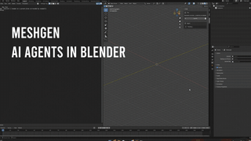</a> Blender 的插件、MCP 服务和 skill。 <a href="#type-blender"><b>查看列表 →</b></a></td>
<td align="center" valign="top" width="33%"><b>🎮 Unity</b> 27 个仓库  <a href="https://github.com/CoplayDev/unity-mcp">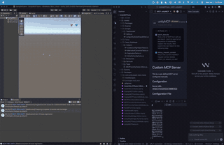</a> 给 Unity 编辑器用。 <a href="#type-unity"><b>查看列表 →</b></a></td>
<td align="center" valign="top" width="33%"><b>🤖 Godot</b> 22 个仓库  <a href="https://github.com/hi-godot/godot-ai">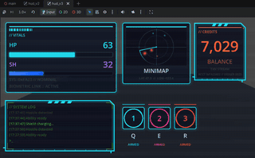</a> 给 Godot 引擎用。 <a href="#type-godot"><b>查看列表 →</b></a></td>
</tr>
<tr>
<td align="center" valign="top" width="33%"><b>🏰 Unreal 引擎</b> 25 个仓库  <a href="https://github.com/runreal/unreal-mcp">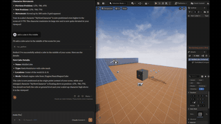</a> 给 Unreal 引擎用。 <a href="#type-unreal"><b>查看列表 →</b></a></td>
<td align="center" valign="top" width="33%"><b>📐 CAD 与工程设计</b> 25 个仓库   CAD 与工程设计:FreeCAD、OpenSCAD、CadQuery、Fusion 360、SolidWorks、KiCad、文字生成 CAD。 <a href="#type-cad"><b>查看列表 →</b></a></td>
<td align="center" valign="top" width="33%"><b>🎬 其他 3D 软件</b> 5 个仓库  <a href="https://github.com/dcc-mcp/dcc-mcp-core">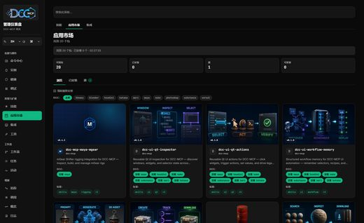</a> Maya、Houdini、Cinema 4D、3ds Max、SketchUp、Rhino 和 Spline。 <a href="#type-dcc"><b>查看列表 →</b></a></td>
</tr>
<tr>
<td align="center" valign="top" width="33%"><b>🌐 Three.js 与网页 3D</b> 27 个仓库  <a href="https://github.com/achimala/dream-loop">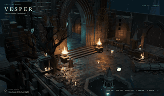</a> Three.js、React Three Fiber、Babylon.js、WebGL 与 WebGPU。 <a href="#type-web3d"><b>查看列表 →</b></a></td>
<td align="center" valign="top" width="33%"><b>✨ 3D 模型生成</b> 10 个仓库  <a href="https://github.com/rtmandreyev/construct">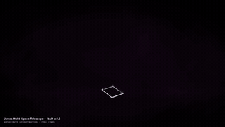</a> 用文字或图片生成 3D 模型和场景。 <a href="#type-gen3d"><b>查看列表 →</b></a></td>
</tr>
</table>

## 目录

- [🧪 端到端实测](#tested)
- [🟠 Blender](#type-blender) (42)
- [🎮 Unity](#type-unity) (27)
- [🤖 Godot](#type-godot) (22)
- [🏰 Unreal 引擎](#type-unreal) (25)
- [📐 CAD 与工程设计](#type-cad) (25)
- [🎬 其他 3D 软件](#type-dcc) (5)
- [🌐 Three.js 与网页 3D](#type-web3d) (27)
- [✨ 3D 模型生成](#type-gen3d) (10)

## 什么样的仓库能上榜

1. 它让 AI 编程 agent 或助手做 3D 的事:操作 3D、CAD 软件或游戏引擎,做网页 3D 场景,或生成 3D 模型。没有 agent 集成的 3D 软件或游戏、模型本身的训练代码、只把 3D 当装饰的工具不算。
2. 它是能安装或运行的软件,不是链接合集或空仓库。
3. 它有 README。没有 README 就没法评级。
4. 50 星及以上只看是否切题;50 星以下还要过 README 质量线(展示效果、一条命令上手、说清产出、文档完整),并且至少 5 星。

这些问题由决策模型逐个读 README 回答,不是人工挑选。卡在线上的仓库可能判到任一边,归错了请提 issue。

## 🧪 端到端实测

2026-11-08，我们给 25 个 3D MCP 和 skill 同一份测试题：一个木制店铺柜台，上面一个圆面包和一个装着三个可颂的藤编篮，后面挂一块写着 Morning Loaf 的牌子，左侧暖光，略高的斜侧视角，渲染成 1600 × 1200。每个在用完即删的 Linux 沙箱里（Blender 3.4、OpenSCAD、无界面 Chromium）由 Claude Code（Claude Opus 5.5）调用。招牌文字用 OCR 读，可颂在场景文件里数，其余由 gpt-6-astra 逐项核对。

**发现:** 不装 3D 工具的 Claude Code 只用 Blender 自带的 Python，12.3 分钟（按 API 价 $0.87）就把整个场景做对了。出了图的 20 个工具里 20 个也全对：每张图的招牌都拼对了，每个场景文件里都正好三个可颂。用时 2.2 到 27.4 分钟。CAD 工具的渲染是固定光源的平面预览，暖光只能靠颜色。

*所有渲染图，第一张（描边）是不装 3D 工具做的；共 20 个工具。*

| # | 工具和它的渲染图 | ★ | 结果 | 招牌上读到的字 | 观感（评审） | 耗时 | 按 API 价 | 场景文件 |  |
|---|---|---|---|---|---|---|---|---|---|
| 1 | [threejs-skills](https://github.com/CloudAI-X/threejs-skills) | 4,066 | 全对 | Morning Loaf | 5/5 | 2.2 分钟 | $0.56 | index.html | [证据](https://agentskillshub.top/best-runs/3d/CloudAI-X__threejs-skills.html) |
| 2 | [webgpu-claude-skill](https://github.com/dgreenheck/webgpu-claude-skill) | 1,270 | 全对 | Morning Loaf | 5/5 | 4.0 分钟 | $0.88 | index.html | [证据](https://agentskillshub.top/best-runs/3d/dgreenheck__webgpu-claude-skill.html) |
| 3 | [threejs-architecture-effects](https://github.com/lhlGitHub/threejs-architecture-effects) | 712 | 全对 | Morning Loaf | 5/5 | 5.8 分钟 | $1.10 | morning-loaf/index.html | [证据](https://agentskillshub.top/best-runs/3d/lhlGitHub__threejs-architecture-effects.html) |
| 4 | [mcp-for-blender](https://github.com/ahujasid/mcp-for-blender) | 33,597 | 全对 | Morning Loaf | 5/5 | 6.1 分钟 | $0.54 | scene.blend | [证据](https://agentskillshub.top/best-runs/3d/ahujasid__mcp-for-blender.html) |
| 5 | [OpenSCAD-MCP-Server](https://github.com/jhacksman/OpenSCAD-MCP-Server) | 215 | 全对 | Morning Loaf | 5/5 | 6.3 分钟 | $0.50 | scene.scad, scene.stl | [证据](https://agentskillshub.top/best-runs/3d/jhacksman__OpenSCAD-MCP-Server.html) |
| 6 | [blender-skills](https://github.com/EL4CTEO/blender-skills) | 769 | 全对 | Morning Loaf | 5/5 | 6.5 分钟 | $0.69 | scene.blend | [证据](https://agentskillshub.top/best-runs/3d/EL4CTEO__blender-skills.html) |
| 7 | [blender-game-skills](https://github.com/majidmanzarpour/blender-game-skills) | 174 | 全对 | Morning Loaf | 5/5 | 7.2 分钟 | $1.04 | scene.blend | [证据](https://agentskillshub.top/best-runs/3d/majidmanzarpour__blender-game-skills.html) |
| 8 | [blender-skills](https://github.com/arjun988/blender-skills) | 2,169 | 全对 | Morning Loaf | 5/5 | 7.8 分钟 | $1.10 | scene.blend | [证据](https://agentskillshub.top/best-runs/3d/arjun988__blender-skills.html) |
| 9 | [blender-skills](https://github.com/kevinbadi/blender-skills) | 262 | 全对 | Morning Loaf | 5/5 | 9.9 分钟 | $1.13 | scene.blend | [证据](https://agentskillshub.top/best-runs/3d/kevinbadi__blender-skills.html) |
| 10 | [threejs-game-skills](https://github.com/majidmanzarpour/threejs-game-skills) | 2,729 | 全对 | Morning Loaf | 5/5 | 10.5 分钟 | $1.69 | scene.glb | [证据](https://agentskillshub.top/best-runs/3d/majidmanzarpour__threejs-game-skills.html) |
| 11 | [open-3d-skills](https://github.com/Moh4696/open-3d-skills) | 291 | 全对 | Morning Loaf | 5/5 | 12.9 分钟 | $1.01 | index.html | [证据](https://agentskillshub.top/best-runs/3d/Moh4696__open-3d-skills.html) |
| 12 | [blender-kiln](https://github.com/elithril/blender-kiln) | 190 | 全对 | Morning Loaf | 5/5 | 18.2 分钟 | $2.32 | build_scene.py, scene.blend | [证据](https://agentskillshub.top/best-runs/3d/elithril__blender-kiln.html) |
| 13 | [openscad-mcp](https://github.com/RobertCoop/openscad-mcp) | 170 | 全对 | Morning Loaf | 4/5 | 3.5 分钟 | $0.70 | scene.scad | [证据](https://agentskillshub.top/best-runs/3d/RobertCoop__openscad-mcp.html) |
| 14 | [kiln](https://github.com/instruktlabs/kiln) | 318 | 全对 | MORNING LOAF | 4/5 | 5.3 分钟 | $1.39 | scene.glb | [证据](https://agentskillshub.top/best-runs/3d/instruktlabs__kiln.html) |
| 15 | [build123d-mcp](https://github.com/pzfreo/build123d-mcp) | 144 | 全对 | Morning Loaf | 4/5 | 6.0 分钟 | $0.46 | scene.py, scene.step | [证据](https://agentskillshub.top/best-runs/3d/pzfreo__build123d-mcp.html) |
| 16 | [Threejs-Awesome-Graphics-Agent-Skills](https://github.com/scottstts/Threejs-Awesome-Graphics-Agent-Skills) | 977 | 全对 | Morning Loaf | 4/5 | 7.5 分钟 | $1.45 | index.html, render.py | [证据](https://agentskillshub.top/best-runs/3d/scottstts__Threejs-Awesome-Graphics-Agent-Skills.html) |
| 17 | [blenderwright](https://github.com/HoldMyBeer-gg/blenderwright) | 193 | 全对 | Morning Loaf | 4/5 | 7.9 分钟 | $1.66 | scene.blend | [证据](https://agentskillshub.top/best-runs/3d/HoldMyBeer-gg__blenderwright.html) |
| 18 | [3dviz-pro-max](https://github.com/viettranx/3dviz-pro-max) | 1,099 | 全对 | Morning Loaf | 4/5 | 8.0 分钟 | $0.54 | scene.blend | [证据](https://agentskillshub.top/best-runs/3d/viettranx__3dviz-pro-max.html) |
| 19 | [agentcad](https://github.com/jdilla1277/agentcad) | 208 | 全对 | Morning Loaf | 4/5 | 11.5 分钟 | $1.13 | scene.py, scene.step | [证据](https://agentskillshub.top/best-runs/3d/jdilla1277__agentcad.html) |
| 20 | [blender-mcp-vxai](https://github.com/VxASI/blender-mcp-vxai) | 300 | 全对 | Morning Loaf | 4/5 | 27.4 分钟 | $0.71 | scene.blend | [证据](https://agentskillshub.top/best-runs/3d/VxASI__blender-mcp-vxai.html) |

**没出图:** blender-plugin (要付费的 Scenario 额度（每个白模先报价再确认），还要 Blender 5.0 以上。); meshgen (超时：它在 Blender 里跑自己的语言模型，CPU 上每一步都要几分钟。); anyscene (要 fal.ai 的 key（按作者说法每个道具约 1.65 美元），还要 Blender 5.0 以上。); editor (超时：它的 design_brief 工具跑了 24 分钟没有返回。); Kiln (要你先接受它的使用条款才会编译和渲染；我们的 agent 没替你接受，所以只留下一个 OpenSCAD 文件、没有渲染图。)

[全部结果、提示词和脚本](https://github.com/zhuyansen/agent-skills-hub/blob/main/ops/3d-runs/RESULTS.md) · [https://agentskillshub.top/best/3d-mcp/#test-results](https://agentskillshub.top/best/3d-mcp/#test-results)

## 🟠 Blender

[在在线页面打开这一类,按星数排序 →](https://agentskillshub.top/best/3d-mcp/#type-blender)

<table><tr>
<td align="center" valign="top"><a href="https://github.com/ahujasid/mcp-for-blender">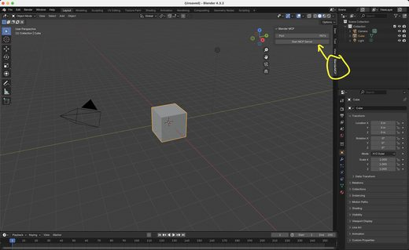</a> <a href="https://github.com/ahujasid/mcp-for-blender">ahujasid/mcp-for-blender</a></td>
<td align="center" valign="top"><a href="https://github.com/arjun988/blender-skills">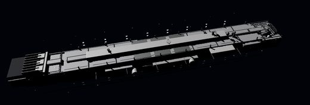</a> <a href="https://github.com/arjun988/blender-skills">arjun988/blender-skills</a></td>
<td align="center" valign="top"><a href="https://github.com/EL4CTEO/blender-skills">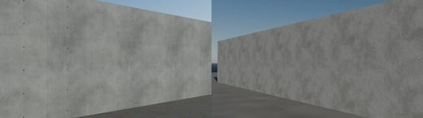</a> <a href="https://github.com/EL4CTEO/blender-skills">EL4CTEO/blender-skills</a></td>
</tr></table>

| 仓库 | 星数 | 做什么 | 安全评级 |
|---|---:|---|---|
| [ahujasid/mcp-for-blender](https://github.com/ahujasid/mcp-for-blender) | 33.8k | 社区插件，可用任意 LLM 控制 Blender 3D。与官方 Blender 基金会无关。 | [SAFE](https://agentskillshub.top/skill/ahujasid/mcp-for-blender/) |
| [arjun988/blender-skills](https://github.com/arjun988/blender-skills) | 2.3k | 94 个 Blender 专业 skill，适用于 Cursor、Claude Code、Kiro 和 Codex，借助 MCP 实现从初步搭建到引擎导出的生… | [SAFE](https://agentskillshub.top/skill/arjun988/blender-skills/) |
| [scenario-labs/blender-plugin](https://github.com/scenario-labs/blender-plugin) | 967 | Blender场景：视口中的AI图像、视频、3D和PBR材质，以及供agent使用的本地MCP服务器。Blender 5.0+扩展，GPL-3.0-or-la… | [SAFE](https://agentskillshub.top/skill/scenario-labs/blender-plugin/) |
| [huggingface/meshgen](https://github.com/huggingface/meshgen) | 945 | 在 Blender 中直接使用 AI Agents。 | [SAFE](https://agentskillshub.top/skill/huggingface/meshgen/) |
| [EL4CTEO/blender-skills](https://github.com/EL4CTEO/blender-skills) | 833 | Claude Code/Codex/Gemini CLI/Copilot/Cursor Blender 5.2：建模/UV/PBR/烘焙/绑定/动画/导出/QA | [SAFE](https://agentskillshub.top/skill/EL4CTEO/blender-skills/) |
| [Mixar-AI/mixar-app](https://github.com/Mixar-AI/mixar-app) | 595 | 基于 Blender 的 AI 3D 工具套件，集成 agent、情绪板、生成工具和分层绘画 | [SAFE](https://agentskillshub.top/skill/Mixar-AI/mixar-app/) |
| [squall01337/mixamo-llm-mocap](https://github.com/squall01337/mixamo-llm-mocap) | 436 | 将视频转为 Mixamo 绑定动画：GVHMR 估计、规范驱动重定向，MCP 在 Blender 中应用 FK。支持任意 Mixamo 角色，可由 AI ag… | [SAFE](https://agentskillshub.top/skill/squall01337/mixamo-llm-mocap/) |
| [apekshik/anyscene](https://github.com/apekshik/anyscene) | 351 | AI agents根据一段话生成照片级Blender场景：fal图像转3D道具，脚本化布局、灯光、镜头和调色 | [SAFE](https://agentskillshub.top/skill/apekshik/anyscene/) |
| [VxASI/blender-mcp-vxai](https://github.com/VxASI/blender-mcp-vxai) | 301 | Blender MCP VXAI 通过 MCP Client 用自然语言创建和修改3D模型、动画与场景。 | [SAFE](https://agentskillshub.top/skill/VxASI/blender-mcp-vxai/) |
| [XliuXjianX/blender-production-skills](https://github.com/XliuXjianX/blender-production-skills) | 282 | Codex 的 Blender 生产级技能套件：建模、几何节点、模拟、材质、拓扑、场景验证与参考图重建。 | [SAFE](https://agentskillshub.top/skill/XliuXjianX/blender-production-skills/) |
| [kevinbadi/blender-skills](https://github.com/kevinbadi/blender-skills) | 271 | Claude Code 的 Blender skill：3D 产品生成与摄像机动画工作流 | [SAFE](https://agentskillshub.top/skill/kevinbadi/blender-skills/) |
| [elithril/blender-kiln](https://github.com/elithril/blender-kiln) | 202 | Claude Code：描述物体或照片，在 Blender 做3D模型、角色动画，用于游戏、网页、AR、打印。3.0：Kiln Studio 本地查看检查修复… | [SAFE](https://agentskillshub.top/skill/elithril/blender-kiln/) |
| [S4US/Roqer](https://github.com/S4US/Roqer) | 197 | 面向 Roblox Studio 的开源 AI agent，使用 ChatGPT/Claude 订阅或自定义 API 代你构建、编写脚本和测试。 | [SAFE](https://agentskillshub.top/skill/S4US/Roqer/) |
| [HoldMyBeer-gg/blenderwright](https://github.com/HoldMyBeer-gg/blenderwright) | 194 | Blender 的 MCP server，提供建模、材质、渲染等数百种工具，由 Claude、Cursor、Codex、Ollama、llama.cpp 或任… | [SAFE](https://agentskillshub.top/skill/HoldMyBeer-gg/blenderwright/) |
| [majidmanzarpour/blender-game-skills](https://github.com/majidmanzarpour/blender-game-skills) | 174 | Blender 游戏开发的 Claude Code agent skills：将概念图转为带绑定的游戏可用 3D 资产，并对照参考图测量。 | [SAFE](https://agentskillshub.top/skill/majidmanzarpour/blender-game-skills/) |
| [samffprice/loopcut](https://github.com/samffprice/loopcut) | 170 | Loopcut：在 Blender 内运行的 AI agent，Blender 的一个 fork（GPL）。 | [SAFE](https://agentskillshub.top/skill/samffprice/loopcut/) |
| [RobLe3/cc-blender-skill](https://github.com/RobLe3/cc-blender-skill) | 152 | Claude Code skill：用自然语言驱动 Blender 5.x，含10个可链式加载 skill，覆盖建模、材质、灯光等，已验证6类场景。 | [SAFE](https://agentskillshub.top/skill/RobLe3/cc-blender-skill/) |
| [AIGODLIKE/GenesisCore](https://github.com/AIGODLIKE/GenesisCore) | 141 | 支持 DeepSeek、Claude 等模型的 BlenderMCP 工具，集成到 Blender | [SAFE](https://agentskillshub.top/skill/AIGODLIKE/GenesisCore/) |
| [icesixgod/awesome-astra-blender-characters](https://github.com/icesixgod/awesome-astra-blender-characters) | 126 | 用于 Blender 角色创建与修复的 agent skill，支持九视图参考、面部与头发工作流及视觉验证。 | [SAFE](https://agentskillshub.top/skill/icesixgod/awesome-astra-blender-characters/) |
| [dhakalnirajan/blender-open-mcp](https://github.com/dhakalnirajan/blender-open-mcp) | 123 | 使用开放权重模型的 Blender MCP | [SAFE](https://agentskillshub.top/skill/dhakalnirajan/blender-open-mcp/) |
| [jangtrinh/design-os-3d-blender](https://github.com/jangtrinh/design-os-3d-blender) | 113 | Blender 5.2 的 AI agent 操作系统：bpy 知识库、AGENT_OK 执行契约、3D 打印生产门槛，以及键盘和桌面机器人实战构建。 | [SAFE](https://agentskillshub.top/skill/jangtrinh/design-os-3d-blender/) |
| [ifBars/blender-agent-studio](https://github.com/ifBars/blender-agent-studio) | 110 | 免费开源的 Blender AI 插件，支持 Codex、Claude Code 安装器、本地 MCP 工具、可编辑 .blend 文件和 Python 源码。 | [SAFE](https://agentskillshub.top/skill/ifBars/blender-agent-studio/) |
| [pranav-deshmukh/blender-mcp](https://github.com/pranav-deshmukh/blender-mcp) | 98 | Blender MCP：通过TCP上的JSON命令让LLM实时控制Blender的服务器。 | [SAFE](https://agentskillshub.top/skill/pranav-deshmukh/blender-mcp/) |
| [bpy-dev/blender-mcp](https://github.com/bpy-dev/blender-mcp) | 97 | Blender Lab MCP 的独立增强版：独立 bpy、运行时 API 文档和基准测试工具 | [SAFE](https://agentskillshub.top/skill/bpy-dev/blender-mcp/) |
| [3DSceneAgent/Vibe3DScene](https://github.com/3DSceneAgent/Vibe3DScene) | 96 | 创建自己的 3D 场景，将文字放置在任意位置。 | [SAFE](https://agentskillshub.top/skill/3DSceneAgent/Vibe3DScene/) |
| [ProfRino/Blender-MCP-Assembly-Skill](https://github.com/ProfRino/Blender-MCP-Assembly-Skill) | 85 | Blender Assembly 是通过 MCP 在 Blender 中创建可靠 3D 模型的 skill，可规划连接、正确缩放基础体、避免圆柱体旋转错误、验… | [SAFE](https://agentskillshub.top/skill/ProfRino/Blender-MCP-Assembly-Skill/) |
| [seehiong/blender-mcp-bridge](https://github.com/seehiong/blender-mcp-bridge) | 84 | MCP驱动Blender AI建模，含93个工具；Blender Studio含录放编辑器，支持Claude、Gemini、OpenRouter。 | [SAFE](https://agentskillshub.top/skill/seehiong/blender-mcp-bridge/) |
| [FishWoWater/trellis_blender](https://github.com/FishWoWater/trellis_blender) | 78 | TRELLIS 和 TRELLIS.2 的 Blender 插件（3D AIGC 模型、文本生成3D、图像生成3D） | [SAFE](https://agentskillshub.top/skill/FishWoWater/trellis_blender/) |
| [sixtysevenlf/dsh-skill-blender-modeling](https://github.com/sixtysevenlf/dsh-skill-blender-modeling) | 71 | DSH skill v1.0：Blender装配，多 Agent、参考图还原、六坑、十道数值审计、23配方；dsh-blender-plugin v1.0.0 | [SAFE](https://agentskillshub.top/skill/sixtysevenlf/dsh-skill-blender-modeling/) |
| [Show2Instruct/ifc-bonsai-mcp](https://github.com/Show2Instruct/ifc-bonsai-mcp) | 68 | 通过 Bonsai 插件将 LLM 连接到 Blender 中基于 IFC 的 BIM 工作流的 MCP server。 | [SAFE](https://agentskillshub.top/skill/Show2Instruct/ifc-bonsai-mcp/) |
| [mezallastudio/antigravity-blender-mcp](https://github.com/mezallastudio/antigravity-blender-mcp) | 68 | AI 驱动的 Blender MCP，适用于 Antigravity IDE | [SAFE](https://agentskillshub.top/skill/mezallastudio/antigravity-blender-mcp/) |
| [sunxiayi/make-blender-education-video-skill](https://github.com/sunxiayi/make-blender-education-video-skill) | 67 | 用 Blender 制作经事实核查的电影感教学视频的 Codex 和 Claude Code skill | [SAFE](https://agentskillshub.top/skill/sunxiayi/make-blender-education-video-skill/) |
| [PatrykIti/blender-ai-mcp](https://github.com/PatrykIti/blender-ai-mcp) | 66 | 项目已停止维护：面向生产的 Blender MCP 服务器，支持目标优先路由、精选工具、确定性验证和视觉辅助 3D 建模工作流。 | [SAFE](https://agentskillshub.top/skill/PatrykIti/blender-ai-mcp/) |
| [mromidev/claude-blender-skills](https://github.com/mromidev/claude-blender-skills) | 65 | Claude skill：逼真 Blender 动画的完整工作流及 YouTube 视频背后的实际脚本 | [SAFE](https://agentskillshub.top/skill/mromidev/claude-blender-skills/) |
| [sandraschi/blender-mcp](https://github.com/sandraschi/blender-mcp) | 65 | FastMCP驱动无头Blender：41工具、150+操作，支持网格/VSE/Grease Pencil、VRM、Gaussian splats。 | [SAFE](https://agentskillshub.top/skill/sandraschi/blender-mcp/) |
| [dcc-mcp/dcc-mcp-blender](https://github.com/dcc-mcp/dcc-mcp-blender) | 62 | Blender MCP 插件，供 AI agent 通过类型化工具建模、编辑网格与 UV、绑定骨骼、制作材质并渲染场景。 | [SAFE](https://agentskillshub.top/skill/dcc-mcp/dcc-mcp-blender/) |
| [WaiGenie/BlenderMCP-AI-AGNO-agent](https://github.com/WaiGenie/BlenderMCP-AI-AGNO-agent) | 59 | Blender MCP + AI AGNO多智能体制作系统，基于Google Gemini管理17个agent完成3D流程 | [SAFE](https://agentskillshub.top/skill/WaiGenie/BlenderMCP-AI-AGNO-agent/) |
| [nocodehack/make-short](https://github.com/nocodehack/make-short) | 50 | Claude Code skill：制作动画 YouTube Shorts（3D Blender 世界中的 2D 角色），含 critic agent | [SAFE](https://agentskillshub.top/skill/nocodehack/make-short/) |
| [SamedVossberg/3d-brain-animations](https://github.com/SamedVossberg/3d-brain-animations) | 10 | 单提示词调用 200+ BrainGlobe 图谱（任意物种），输出 3D 脑区图和旋转发光动画；Blender 无头渲染，Claude Code skill。 | [SAFE](https://agentskillshub.top/skill/SamedVossberg/3d-brain-animations/) |
| [Guilherme-M-Mateus/keyframe-coach](https://github.com/Guilherme-M-Mateus/keyframe-coach) | 7 | 在 Blender 中制作游戏动画的 Claude Code skill：行走循环、检查及 Unity/Unreal/Godot 导出。 | [SAFE](https://agentskillshub.top/skill/Guilherme-M-Mateus/keyframe-coach/) |
| [ezpeezee/beta-version-toon-studio](https://github.com/ezpeezee/beta-version-toon-studio) | 5 | 用 Claude Code 和 Blender 将创意或自有脚本制作成 9:16 动画短片。 | [SAFE](https://agentskillshub.top/skill/ezpeezee/beta-version-toon-studio/) |
| [nirholas/blender-mcp](https://github.com/nirholas/blender-mcp) | 5 | 无头驱动本机 Blender，支持 AI agent 检查、转换3D文件、内联预览、运行 bpy 脚本，并用 three.ws Forge 文生模型；支持 M… | [SAFE](https://agentskillshub.top/skill/nirholas/blender-mcp/) |

## 🎮 Unity

[在在线页面打开这一类,按星数排序 →](https://agentskillshub.top/best/3d-mcp/#type-unity)

<table><tr>
<td align="center" valign="top"> <a href="https://github.com/IvanMurzak/Unity-MCP">IvanMurzak/Unity-MCP</a></td>
<td align="center" valign="top"><a href="https://github.com/CoderGamester/mcp-unity">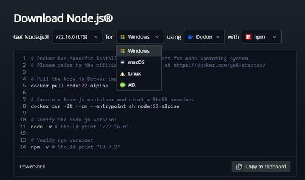</a> <a href="https://github.com/CoderGamester/mcp-unity">CoderGamester/mcp-unity</a></td>
<td align="center" valign="top"><a href="https://github.com/Besty0728/Unity-Skills">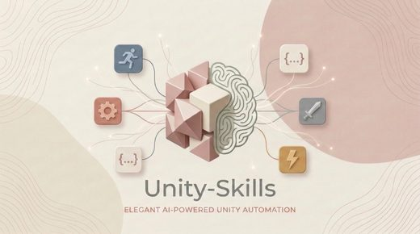</a> <a href="https://github.com/Besty0728/Unity-Skills">Besty0728/Unity-Skills</a></td>
</tr></table>

| 仓库 | 星数 | 做什么 | 安全评级 |
|---|---:|---|---|
| [CoplayDev/unity-mcp](https://github.com/CoplayDev/unity-mcp) | 15.8k | Unity MCP 连接 AI 助手与 Unity Editor，管理资源、场景、脚本并自动化任务。 | [SAFE](https://agentskillshub.top/skill/CoplayDev/unity-mcp/) |
| [IvanMurzak/Unity-MCP](https://github.com/IvanMurzak/Unity-MCP) | 4.6k | Unity Engine：AI、MCP Tools、CLI；C# 方法可转为 tool。支持 Claude Code、Gemini、Copilot、Cursor | [SAFE](https://agentskillshub.top/skill/IvanMurzak/Unity-MCP/) |
| [CoderGamester/mcp-unity](https://github.com/CoderGamester/mcp-unity) | 2.0k | 连接 Unity Editor 的 Model Context Protocol (MCP) plugin，支持 Cursor、Claude Code、Cod… | [SAFE](https://agentskillshub.top/skill/CoderGamester/mcp-unity/) |
| [Besty0728/Unity-Skills](https://github.com/Besty0728/Unity-Skills) | 1.9k | 专为 Unity 设计的 AI 自动化 skill | [SAFE](https://agentskillshub.top/skill/Besty0728/Unity-Skills/) |
| [Unity-Technologies/skills](https://github.com/Unity-Technologies/skills) | 1.2k | 面向 Unity 工作流的 AI coding agents 可复用 skills 集合，包含 prompts、slash commands 和 tools | [SAFE](https://agentskillshub.top/skill/Unity-Technologies/skills/) |
| [r1n7aro/Locus](https://github.com/r1n7aro/Locus) | 759 | 开源 Unity Dev Agent | [SAFE](https://agentskillshub.top/skill/r1n7aro/Locus/) |
| [AnkleBreaker-Studio/unity-mcp-server](https://github.com/AnkleBreaker-Studio/unity-mcp-server) | 541 | Unity MCP Server：268 个工具，连接 Claude、Cursor 与 Unity Editor、Unity Hub，支持场景、组件、构建、性… | [SAFE](https://agentskillshub.top/skill/AnkleBreaker-Studio/unity-mcp-server/) |
| [jackwrichards/UnityMCP](https://github.com/jackwrichards/UnityMCP) | 526 | UnityMCP：Unity 编辑器插件，实现 MCP，支持 AI 助手集成、状态监控、远程命令和日志。 | [SAFE](https://agentskillshub.top/skill/jackwrichards/UnityMCP/) |
| [isuzu-shiranui/UnityMCP](https://github.com/isuzu-shiranui/UnityMCP) | 342 | 通过 AI agent 或终端驱动 Unity Editor。Editor 通过 HTTP 提供 MCP，无需第二个进程，isuzu-unity-cli 无需… | [SAFE](https://agentskillshub.top/skill/isuzu-shiranui/UnityMCP/) |
| [FunplayAI/funplay-unity-mcp](https://github.com/FunplayAI/funplay-unity-mcp) | 287 | 面向 Unity Editor 的 MCP Server，支持 execute_code、prompts/resources、输入模拟、截图和 play mo… | [SAFE](https://agentskillshub.top/skill/FunplayAI/funplay-unity-mcp/) |
| [AnkleBreaker-Studio/unity-mcp-plugin](https://github.com/AnkleBreaker-Studio/unity-mcp-plugin) | 257 | Unity MCP Plugin (UPM)：连接 AI 与 Unity Editor，提供268个工具，支持场景、组件、构建和性能分析。开源。 | [SAFE](https://agentskillshub.top/skill/AnkleBreaker-Studio/unity-mcp-plugin/) |
| [861172923/Unity-Skills](https://github.com/861172923/Unity-Skills) | 228 | Unity 技能 | [SAFE](https://agentskillshub.top/skill/861172923/Unity-Skills/) |
| [liyingsong99/AIBridge](https://github.com/liyingsong99/AIBridge) | 227 | Unity 项目开发工具，整合本地工作流、AIBridge Skills、CLI 与 Runtime 工具、代码索引、视觉验证、输入模拟、Player 调试及… | [SAFE](https://agentskillshub.top/skill/liyingsong99/AIBridge/) |
| [Glade-tool/glade-mcp](https://github.com/Glade-tool/glade-mcp) | 201 | MCP连接Claude Code、Cursor、Windsurf至Unity/Godot，含275+工具、编辑器提示词、项目上下文、脚本语义搜索和skill校… | [SAFE](https://agentskillshub.top/skill/Glade-tool/glade-mcp/) |
| [quazaai/UnityMCPIntegration](https://github.com/quazaai/UnityMCPIntegration) | 155 | 让 AI Agent 控制 Unity | [SAFE](https://agentskillshub.top/skill/quazaai/UnityMCPIntegration/) |
| [IvanMurzak/Unity-AI-Animation](https://github.com/IvanMurzak/Unity-AI-Animation) | 121 | Unity Animation 的 MCP 工具：用 AI 创建和编辑动画片段与 Animator。 | [SAFE](https://agentskillshub.top/skill/IvanMurzak/Unity-AI-Animation/) |
| [TomLeeLive/openclaw-unity-plugin](https://github.com/TomLeeLive/openclaw-unity-plugin) | 107 | 55 个 MCP 工具供 MCP AI agent 控制 Unity Editor，管理场景、对象、资源、测试和构建；含 OpenClaw 网关，支持远程聊天。 | [SAFE](https://agentskillshub.top/skill/TomLeeLive/openclaw-unity-plugin/) |
| [MRCalderon3D/everything-game-dev-code](https://github.com/MRCalderon3D/everything-game-dev-code) | 106 | 开发脚手架：42代理、51命令、86技能；UnityUnrealGodotHTML；Claude Code、Codex、Cursor、OpenCode、Kiro | [SAFE](https://agentskillshub.top/skill/MRCalderon3D/everything-game-dev-code/) |
| [codemaestroai/advanced-unity-mcp](https://github.com/codemaestroai/advanced-unity-mcp) | 95 | Code Maestro 的 Advanced Unity MCP 公共仓库。 | [SAFE](https://agentskillshub.top/skill/codemaestroai/advanced-unity-mcp/) |
| [youichi-uda/unity-mcp-pro-plugin](https://github.com/youichi-uda/unity-mcp-pro-plugin) | 83 | 通过 MCP 提供 147 个 Unity 游戏开发 AI 工具，连接 Claude、Cursor 和 AI 助手与 Unity 编辑器。 | [SAFE](https://agentskillshub.top/skill/youichi-uda/unity-mcp-pro-plugin/) |
| [killop/puerts-unity-mcp](https://github.com/killop/puerts-unity-mcp) | 81 | 基于 tencent puerts 的 unity-mcp，在手机和 Unity 编辑器中用 JS/TS 调用 C# | [SAFE](https://agentskillshub.top/skill/killop/puerts-unity-mcp/) |
| [IvanMurzak/Unity-AI-ParticleSystem](https://github.com/IvanMurzak/Unity-AI-ParticleSystem) | 60 | 用于 Unity Particle System 的 MCP 工具：用 AI 创建和编辑粒子效果 | [SAFE](https://agentskillshub.top/skill/IvanMurzak/Unity-AI-ParticleSystem/) |
| [IvanMurzak/Unity-AI-ProBuilder](https://github.com/IvanMurzak/Unity-AI-ProBuilder) | 58 | Unity ProBuilder 的 MCP 工具——用 AI 建模和编辑网格。 | [SAFE](https://agentskillshub.top/skill/IvanMurzak/Unity-AI-ProBuilder/) |
| [LiShengYang-yiyi/YIUI-UnityMCP](https://github.com/LiShengYang-yiyi/YIUI-UnityMCP) | 58 | YIUIMCP 是 Unity 本地 AI 编排插件，以 CLI flow 串联工具，支持编译、日志、菜单命令及 Domain Reload 后续流程。 | [SAFE](https://agentskillshub.top/skill/LiShengYang-yiyi/YIUI-UnityMCP/) |
| [TheArcForge/UniClaude](https://github.com/TheArcForge/UniClaude) | 52 | Claude Code 原生集成 Unity Editor：可停靠聊天窗口，了解完整项目，支持 60+ MCP 工具，无需切换窗口。 | [SAFE](https://agentskillshub.top/skill/TheArcForge/UniClaude/) |
| [MosaicXR-AI/mosaic-bridge](https://github.com/MosaicXR-AI/mosaic-bridge) | 11 | Unity Editor MCP 插件：AI agents 通过 MCP 驱动 Unity。Apache 2.0，约290个工具涵盖生成、仿真、物理、渲染和… | [SAFE](https://agentskillshub.top/skill/MosaicXR-AI/mosaic-bridge/) |
| [radif/unity-prefabs-claude-code-skill](https://github.com/radif/unity-prefabs-claude-code-skill) | 6 | 使用 Claude Code Opus 模型生成和编辑 Unity `.prefab` 的 skill，涵盖 YAML 结构、组件连接、嵌套 prefab 和… | [SAFE](https://agentskillshub.top/skill/radif/unity-prefabs-claude-code-skill/) |

## 🤖 Godot

[在在线页面打开这一类,按星数排序 →](https://agentskillshub.top/best/3d-mcp/#type-godot)

<table><tr>
<td align="center" valign="top"><a href="https://github.com/tugcantopaloglu/godot-mcp">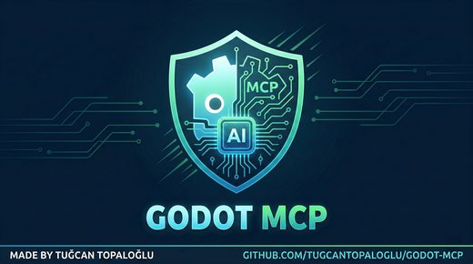</a> <a href="https://github.com/tugcantopaloglu/godot-mcp">tugcantopaloglu/godot-mcp</a></td>
<td align="center" valign="top"><a href="https://github.com/tomyud1/godot-mcp">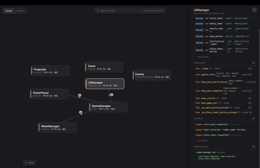</a> <a href="https://github.com/tomyud1/godot-mcp">tomyud1/godot-mcp</a></td>
<td align="center" valign="top"> <a href="https://github.com/HaD0Yun/Doyunha-Gopeak">HaD0Yun/Doyunha-Gopeak</a></td>
</tr></table>

| 仓库 | 星数 | 做什么 | 安全评级 |
|---|---:|---|---|
| [hi-godot/godot-ai](https://github.com/hi-godot/godot-ai) | 3.5k | Godot 引擎的 MCP 服务器和 AI 工具，支持 Snap 安装。 | [SAFE](https://agentskillshub.top/skill/hi-godot/godot-ai/) |
| [jame581/GodotPrompter](https://github.com/jame581/GodotPrompter) | 943 | 面向 Godot 4.x 的 agent skill 框架，为 AI coding agents 提供领域专用 skill（Claude Code、Copil… | [SAFE](https://agentskillshub.top/skill/jame581/GodotPrompter/) |
| [yurineko73/Godot-MCP-Native](https://github.com/yurineko73/Godot-MCP-Native) | 873 | 支持 Godot 的 MCP 插件，使用原生 HTTP 实现 MCP Server，支持常见操作和多种 AI 工具调用 | [SAFE](https://agentskillshub.top/skill/yurineko73/Godot-MCP-Native/) |
| [youichi-uda/godot-mcp-pro](https://github.com/youichi-uda/godot-mcp-pro) | 640 | 162 个 MCP 工具用于 AI 驱动的 Godot 4 开发：场景、动画、3D、物理、粒子、音频、着色器、输入、分析、导航、测试等。一次性 $15。 | [SAFE](https://agentskillshub.top/skill/youichi-uda/godot-mcp-pro/) |
| [ee0pdt/Godot-MCP](https://github.com/ee0pdt/Godot-MCP) | 621 | 用于 Godot 的 MCP，可借助 Claude 等工具创建和编辑游戏 | [SAFE](https://agentskillshub.top/skill/ee0pdt/Godot-MCP/) |
| [DaxianLee/godot-mcp](https://github.com/DaxianLee/godot-mcp) | 553 | 支持 Godot 开源引擎的 MCP 插件，提供常见操作和一键服务配置 | [SAFE](https://agentskillshub.top/skill/DaxianLee/godot-mcp/) |
| [tugcantopaloglu/godot-mcp](https://github.com/tugcantopaloglu/godot-mcp) | 510 | 用于完整控制 Godot 4.x 引擎的 MCP server：157 个工具，支持 AI 游戏开发（GDScript 和 C#/.NET）。已在 Godot… | [SAFE](https://agentskillshub.top/skill/tugcantopaloglu/godot-mcp/) |
| [tomyud1/godot-mcp](https://github.com/tomyud1/godot-mcp) | 452 | 用于 AI 辅助游戏开发的 MCP 服务器和 Godot 插件 | [SAFE](https://agentskillshub.top/skill/tomyud1/godot-mcp/) |
| [IvanMurzak/Godot-MCP](https://github.com/IvanMurzak/Godot-MCP) | 335 | Godot-MCP——为 Godot Engine 集成 Model Context Protocol (MCP)，提供 C# Godot Editor AI… | [SAFE](https://agentskillshub.top/skill/IvanMurzak/Godot-MCP/) |
| [HaD0Yun/Doyunha-Gopeak](https://github.com/HaD0Yun/Doyunha-Gopeak) | 272 | GoPeak：Godot Engine MCP server，含95+工具：场景管理、GDScript LSP、DAP调试、截图、输入注入、ClassDB检查… | [SAFE](https://agentskillshub.top/skill/HaD0Yun/Doyunha-Gopeak/) |
| [satelliteoflove/godot-mcp](https://github.com/satelliteoflove/godot-mcp) | 184 | 让 AI 助手在 Godot 编辑器中拥有视觉和操作能力：场景编辑、输入注入、确定性测试及实时游戏状态 | [SAFE](https://agentskillshub.top/skill/satelliteoflove/godot-mcp/) |
| [kanaworksai-hue/effekseer-vfx-skill](https://github.com/kanaworksai-hue/effekseer-vfx-skill) | 160 | 实时游戏 VFX Agent skills：程序化 Effekseer 特效、视频模型 flipbook，或两者兼有，适用于 Godot、Unity（Clau… | [SAFE](https://agentskillshub.top/skill/kanaworksai-hue/effekseer-vfx-skill/) |
| [NPGameDev/godot-mcp-toolkit](https://github.com/NPGameDev/godot-mcp-toolkit) | 122 | Godot 4.2+ 编辑器插件，支持 AI coding assistants 通过 MCP 操作场景、脚本、节点和 playtests，覆盖150+项操作… | [SAFE](https://agentskillshub.top/skill/NPGameDev/godot-mcp-toolkit/) |
| [3ddelano/gdai-mcp-plugin-godot](https://github.com/3ddelano/gdai-mcp-plugin-godot) | 103 | Godot Engine 的 MCP server 集成，支持 Claude、Cursor、Windsurf、VSCode 等创建场景、资源、脚本并读取错误。 | [SAFE](https://agentskillshub.top/skill/3ddelano/gdai-mcp-plugin-godot/) |
| [Erodenn/godot-mcp-runtime](https://github.com/Erodenn/godot-mcp-runtime) | 97 | 轻量级 TypeScript MCP 服务器，让 AI 助手驱动 Godot 4.x 游戏引擎。 | [SAFE](https://agentskillshub.top/skill/Erodenn/godot-mcp-runtime/) |
| [bradypp/godot-mcp](https://github.com/bradypp/godot-mcp) | 90 | 用于与 Godot 游戏引擎交互的 Model Context Protocol（MCP）服务器。 | [SAFE](https://agentskillshub.top/skill/bradypp/godot-mcp/) |
| [Derfirm/godot-mcp](https://github.com/Derfirm/godot-mcp) | 55 | 用于与 Godot 游戏引擎交互的 MCP 服务器，可启动编辑器、运行项目、捕获调试输出并控制项目执行。 | [SAFE](https://agentskillshub.top/skill/Derfirm/godot-mcp/) |
| [hybridindie/godot-mcp](https://github.com/hybridindie/godot-mcp) | 55 | Godot 插件与 MCP 服务器结合，用于 AI 驱动开发，通过 AI agent 操控 Godot 编辑器 | [SAFE](https://agentskillshub.top/skill/hybridindie/godot-mcp/) |
| [salvo10f/godotiq](https://github.com/salvo10f/godotiq) | 55 | 用于 AI 辅助 Godot 4 开发的 MCP 服务器，提供 35 个工具，支持空间分析、代码理解、流程追踪和可视化调试。 | [SAFE](https://agentskillshub.top/skill/salvo10f/godotiq/) |
| [Dokujaa/Godot-MCP](https://github.com/Dokujaa/Godot-MCP) | 54 | 利用 Claude 的 Godot MCP | [SAFE](https://agentskillshub.top/skill/Dokujaa/Godot-MCP/) |
| [FunplayAI/funplay-godot-mcp](https://github.com/FunplayAI/funplay-godot-mcp) | 53 | Godot Editor MCP 服务，支持 execute_code、prompts/resources、项目地图、运行时检查、资源流程、安全AI自动化。 | [SAFE](https://agentskillshub.top/skill/FunplayAI/funplay-godot-mcp/) |
| [TheMarco/godot-game-skills](https://github.com/TheMarco/godot-game-skills) | 5 | 用于构建、调试和验证 Godot 游戏的实用 agent 技能。 | [SAFE](https://agentskillshub.top/skill/TheMarco/godot-game-skills/) |

## 🏰 Unreal 引擎

[在在线页面打开这一类,按星数排序 →](https://agentskillshub.top/best/3d-mcp/#type-unreal)

<table><tr>
<td align="center" valign="top"><a href="https://github.com/ChiR24/Unreal_mcp">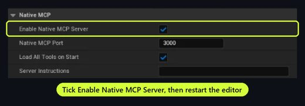</a> <a href="https://github.com/ChiR24/Unreal_mcp">ChiR24/Unreal_mcp</a></td>
<td align="center" valign="top"><a href="https://github.com/db-lyon/ue-mcp">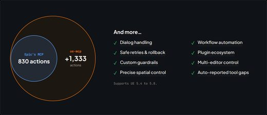</a> <a href="https://github.com/db-lyon/ue-mcp">db-lyon/ue-mcp</a></td>
<td align="center" valign="top"> <a href="https://github.com/wellingfeng/UltraGameStudio">wellingfeng/UltraGameStudio</a></td>
</tr></table>

| 仓库 | 星数 | 做什么 | 安全评级 |
|---|---:|---|---|
| [chongdashu/unreal-mcp](https://github.com/chongdashu/unreal-mcp) | 2.1k | 通过 MCP，让 Cursor、Windsurf 和 Claude Desktop 等 AI 助手客户端用自然语言控制 Unreal Engine。 | [SAFE](https://agentskillshub.top/skill/chongdashu/unreal-mcp/) |
| [EpicGames/unreal-engine-skills-for-claude-code-plugin](https://github.com/EpicGames/unreal-engine-skills-for-claude-code-plugin) | 1.9k | 通过 MCP 让 Claude Code 直接控制 Unreal Editor，支持 Unreal Engine 工作流和自动化测试。 | [SAFE](https://agentskillshub.top/skill/EpicGames/unreal-engine-skills-for-claude-code-plugin/) |
| [flopperam/unreal-engine-mcp](https://github.com/flopperam/unreal-engine-mcp) | 1.1k | 此 MCP 现由 Aura 所有！试用 Unreal Engine 的 AI agent：https://www.tryaura.dev/ | [SAFE](https://agentskillshub.top/skill/flopperam/unreal-engine-mcp/) |
| [ChiR24/Unreal_mcp](https://github.com/ChiR24/Unreal_mcp) | 1.0k | 基于原生 C++ Automation Bridge 插件，让 AI 助手通过 MCP 控制 Unreal Engine 的服务器。 | [SAFE](https://agentskillshub.top/skill/ChiR24/Unreal_mcp/) |
| [Natfii/UnrealClaude](https://github.com/Natfii/UnrealClaude) | 1.0k | Unreal Engine 5.7 的 Claude Code CLI 集成，在编辑器中结合内置 UE5.7 文档提供 AI 编程辅助。 | [CAUTION](https://agentskillshub.top/skill/Natfii/UnrealClaude/) |
| [kevinpbuckley/VibeUE](https://github.com/kevinpbuckley/VibeUE) | 823 | Unreal Engine Vibe Coding 工具 | [SAFE](https://agentskillshub.top/skill/kevinpbuckley/VibeUE/) |
| [kvick-games/UnrealMCP](https://github.com/kvick-games/UnrealMCP) | 615 | MCP，让 AI agent 控制 Unreal | [SAFE](https://agentskillshub.top/skill/kvick-games/UnrealMCP/) |
| [db-lyon/ue-mcp](https://github.com/db-lyon/ue-mcp) | 486 | 完整的 Unreal Engine 开发工具包，以 MCP 工具形式提供。 | [SAFE](https://agentskillshub.top/skill/db-lyon/ue-mcp/) |
| [VedantRGosavi/UE5-MCP](https://github.com/VedantRGosavi/UE5-MCP) | 436 | 用于 Unreal Engine 5 的 MCP | [SAFE](https://agentskillshub.top/skill/VedantRGosavi/UE5-MCP/) |
| [tumourlove/monolith](https://github.com/tumourlove/monolith) | 368 | Unreal Engine 5.7/5.8 MCP：AI读写资源，含Reflection Intelligence；C++，无Python。 | [SAFE](https://agentskillshub.top/skill/tumourlove/monolith/) |
| [wellingfeng/UltraGameStudio](https://github.com/wellingfeng/UltraGameStudio) | 337 | UltraGameStudio - 用于游戏开发的 AI 编程 agent：引擎工作流、玩法代码和资源生成。 | [SAFE](https://agentskillshub.top/skill/wellingfeng/UltraGameStudio/) |
| [softdaddy-o/soft-ue-cli](https://github.com/softdaddy-o/soft-ue-cli) | 216 | Python CLI/UE 插件让 Claude Code 控制 Unreal Engine：生成 actor、编辑蓝图、调用函数、截图；进程内 HTTP b… | [SAFE](https://agentskillshub.top/skill/softdaddy-o/soft-ue-cli/) |
| [per-simmons/unreal-agent-harness](https://github.com/per-simmons/unreal-agent-harness) | 210 | Unreal MCP 在 Unreal Engine 5.8 构建城市：PCG/Blender，含玻璃城、Art-Deco、Cesium 纽约。 | [SAFE](https://agentskillshub.top/skill/per-simmons/unreal-agent-harness/) |
| [GenOrca/unreal-mcp](https://github.com/GenOrca/unreal-mcp) | 147 | Unreal Engine MCP Server：用 Claude 和 AI agents 控制 UE5，支持 Python 和 C++ 开发自定义工具。 | [SAFE](https://agentskillshub.top/skill/GenOrca/unreal-mcp/) |
| [believer-oss/Claireon](https://github.com/believer-oss/Claireon) | 146 | 用于 Unreal Editor 的 MCP 服务器 | [SAFE](https://agentskillshub.top/skill/believer-oss/Claireon/) |
| [runreal/unreal-mcp](https://github.com/runreal/unreal-mcp) | 121 | 使用 Unreal Python Remote Execution 的 Unreal Engine MCP 服务器 | [SAFE](https://agentskillshub.top/skill/runreal/unreal-mcp/) |
| [HurtzDonutStudios/ai-forge-mcp](https://github.com/HurtzDonutStudios/ai-forge-mcp) | 101 | 565个AI工具、50个agent经16个MCP服务器控制Blender等工具和Unreal Engine 5，生成游戏资产。 | [SAFE](https://agentskillshub.top/skill/HurtzDonutStudios/ai-forge-mcp/) |
| [softdaddy-o/yes-ue-mcp](https://github.com/softdaddy-o/yes-ue-mcp) | 87 | Unreal Engine 5.4+ 原生 C++ Model Context Protocol (MCP) 插件 | [SAFE](https://agentskillshub.top/skill/softdaddy-o/yes-ue-mcp/) |
| [remiphilippe/mcp-unreal](https://github.com/remiphilippe/mcp-unreal) | 81 | MCP server，控制 Unreal Engine 5.7 项目：无头构建测试、Blueprint编辑、actor操作、程序化网格生成、UE API查询 | [SAFE](https://agentskillshub.top/skill/remiphilippe/mcp-unreal/) |
| [mirno-ehf/ue5-mcp](https://github.com/mirno-ehf/ue5-mcp) | 78 | 让 AI 编辑 Unreal Engine Blueprints；Claude Code 的 MCP 服务器插件，用自然语言描述需求 | [SAFE](https://agentskillshub.top/skill/mirno-ehf/ue5-mcp/) |
| [KirChuvakov/uefn-mcp-server](https://github.com/KirChuvakov/uefn-mcp-server) | 72 | 用于通过 Claude Code 控制 UEFN 的 MCP 服务器，提供22个用于演员、资产、关卡、视口和 Python 执行的工具 | [SAFE](https://agentskillshub.top/skill/KirChuvakov/uefn-mcp-server/) |
| [Natfii/ue5-mcp-bridge](https://github.com/Natfii/ue5-mcp-bridge) | 66 | 连接 AI 助手与 Unreal Engine 5 编辑器的 MCP 服务器 | [SAFE](https://agentskillshub.top/skill/Natfii/ue5-mcp-bridge/) |
| [appleweed/UnrealMCPBridge](https://github.com/appleweed/UnrealMCPBridge) | 64 | 实现 MCP 服务器的 Unreal Engine 插件，让 MCP 客户端访问 UE Editor Python API。 | [SAFE](https://agentskillshub.top/skill/appleweed/UnrealMCPBridge/) |
| [IvanMurzak/Unreal-MCP](https://github.com/IvanMurzak/Unreal-MCP) | 58 | Unreal Engine AI 游戏开发：MCP plugin（C++/.NET）、unreal-cli，连接 Unreal Editor 与 ai-gam… | [SAFE](https://agentskillshub.top/skill/IvanMurzak/Unreal-MCP/) |
| [ABostrom/ushell-skill](https://github.com/ABostrom/ushell-skill) | 13 | 用于端到端驱动 ushell（Epic 的 Unreal Engine CLI）的 Claude Code skill，涵盖使用、通道编写、UAT/Build… | [SAFE](https://agentskillshub.top/skill/ABostrom/ushell-skill/) |

## 📐 CAD 与工程设计

[在在线页面打开这一类,按星数排序 →](https://agentskillshub.top/best/3d-mcp/#type-cad)

<table><tr>
<td align="center" valign="top"><a href="https://github.com/jingcheng-chen/rhinomcp">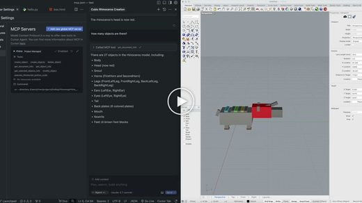</a> <a href="https://github.com/jingcheng-chen/rhinomcp">jingcheng-chen/rhinomcp</a></td>
<td align="center" valign="top"><a href="https://github.com/jdilla1277/agentcad">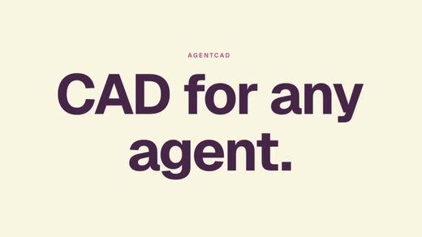</a> <a href="https://github.com/jdilla1277/agentcad">jdilla1277/agentcad</a></td>
<td align="center" valign="top"><a href="https://github.com/ATOI-Ming/FreeCAD-MCP">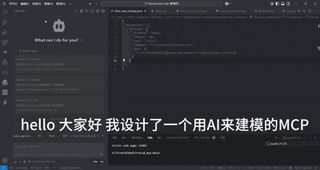</a> <a href="https://github.com/ATOI-Ming/FreeCAD-MCP">ATOI-Ming/FreeCAD-MCP</a></td>
</tr></table>

| 仓库 | 星数 | 做什么 | 安全评级 |
|---|---:|---|---|
| [neka-nat/freecad-mcp](https://github.com/neka-nat/freecad-mcp) | 3.3k | FreeCAD MCP（Model Context Protocol）服务器 | [SAFE](https://agentskillshub.top/skill/neka-nat/freecad-mcp/) |
| [wzyn20051216/solidworks-automation-skill](https://github.com/wzyn20051216/solidworks-automation-skill) | 1.9k | 用于 agent 驱动桌面 CAD 自动化的 AI skill + MCP 工具包。 | [SAFE](https://agentskillshub.top/skill/wzyn20051216/solidworks-automation-skill/) |
| [jingcheng-chen/rhinomcp](https://github.com/jingcheng-chen/rhinomcp) | 1.2k | RhinoMCP 通过 Model Context Protocol（MCP）将 Rhino 3D 连接到 AI Agent | [SAFE](https://agentskillshub.top/skill/jingcheng-chen/rhinomcp/) |
| [ghbalf/freecad-ai](https://github.com/ghbalf/freecad-ai) | 622 | FreeCAD 的 AI 助手工作台，用自然语言生成 3D 模型 | [SAFE](https://agentskillshub.top/skill/ghbalf/freecad-ai/) |
| [anteloc/ldraw-nova](https://github.com/anteloc/ldraw-nova) | 531 | 用于生成式 LEGO 模型构建的 agent 工具，基于 Astra 和 Opus 5.5，由 Jev 驱动 | [SAFE](https://agentskillshub.top/skill/anteloc/ldraw-nova/) |
| [Kai-Jungsthoefel/SOMA](https://github.com/Kai-Jungsthoefel/SOMA) | 468 | 使用 CadQuery 与任意编程 agent 设计参数化 3D 模型的桌面应用 | [SAFE](https://agentskillshub.top/skill/Kai-Jungsthoefel/SOMA/) |
| [spkane/freecad-addon-robust-mcp-server](https://github.com/spkane/freecad-addon-robust-mcp-server) | 267 | FreeCAD Robust MCP 服务器及 MCP Bridge Workbench/Addon | [SAFE](https://agentskillshub.top/skill/spkane/freecad-addon-robust-mcp-server/) |
| [codeofaxel/Kiln](https://github.com/codeofaxel/Kiln) | 242 | Kiln 是开源 3D 打印 MCP server，供 ChatGPT、Claude、Codex 等 AI agents 设计、切片和打印；支持 Git 式分… | [SAFE](https://agentskillshub.top/skill/codeofaxel/Kiln/) |
| [bonninr/freecad_mcp](https://github.com/bonninr/freecad_mcp) | 229 | FreecadMCP 通过 MCP 连接 Freecad、Claude AI 和 Cursor，支持提示词辅助 CAD 3D 设计。 | [SAFE](https://agentskillshub.top/skill/bonninr/freecad_mcp/) |
| [jhacksman/OpenSCAD-MCP-Server](https://github.com/jhacksman/OpenSCAD-MCP-Server) | 215 | Devin 尝试创建 OpenSCAD MCP Server，根据用户提示生成预览图和 3D 文件。 | [SAFE](https://agentskillshub.top/skill/jhacksman/OpenSCAD-MCP-Server/) |
| [jdilla1277/agentcad](https://github.com/jdilla1277/agentcad) | 212 | 用于 AI agents 的 CAD CLI 和 MCP 服务器 | [SAFE](https://agentskillshub.top/skill/jdilla1277/agentcad/) |
| [ReshefElisha/jarvis-onshape-mcp](https://github.com/ReshefElisha/jarvis-onshape-mcp) | 175 | Jarvis Onshape MCP——驱动真实 Onshape CAD 的 Claude Code 插件，含视觉分解 skill、如实反馈、参数化迭代与 F… | [SAFE](https://agentskillshub.top/skill/ReshefElisha/jarvis-onshape-mcp/) |
| [RobertCoop/openscad-mcp](https://github.com/RobertCoop/openscad-mcp) | 170 | 用于 OpenSCAD 三维建模和渲染的模型上下文协议（MCP）服务器 | [SAFE](https://agentskillshub.top/skill/RobertCoop/openscad-mcp/) |
| [pzfreo/build123d-mcp](https://github.com/pzfreo/build123d-mcp) | 145 | 用于 build123d 的 MCP server，帮助 AI 创建 3D CAD 模型 | [SAFE](https://agentskillshub.top/skill/pzfreo/build123d-mcp/) |
| [Cai-aa/CAD-Agent-Hub](https://github.com/Cai-aa/CAD-Agent-Hub) | 140 | CATIA、SolidWorks、Siemens NX 和 Autodesk Fusion 的 MCP 服务器与自动化桥接工具 | [SAFE](https://agentskillshub.top/skill/Cai-aa/CAD-Agent-Hub/) |
| [contextform/freecad-mcp](https://github.com/contextform/freecad-mcp) | 139 | FreeCAD MCP - 开源的 Model Context Protocol 服务器，用于自动化 FreeCAD | [SAFE](https://agentskillshub.top/skill/contextform/freecad-mcp/) |
| [ATOI-Ming/FreeCAD-MCP](https://github.com/ATOI-Ming/FreeCAD-MCP) | 101 | FreeCAD 插件：通过 Model Contro Protocol (MCP) 自动创建和控制模型，提供 MCP 服务器、GUI 面板和客户端，用于运行宏… | [SAFE](https://agentskillshub.top/skill/ATOI-Ming/FreeCAD-MCP/) |
| [armpro24-blip/cad-cae-copilot](https://github.com/armpro24-blip/cad-cae-copilot) | 93 | CAD/CAE Copilot：AI agent 工作台，支持文本生成 CAD/CAE、build123d/OpenCASCADE 几何、稳定拓扑和 MCP工… | [SAFE](https://agentskillshub.top/skill/armpro24-blip/cad-cae-copilot/) |
| [blwfish/freecad-mcp](https://github.com/blwfish/freecad-mcp) | 65 | FreeCAD 的 MCP server，提供 32 个工具辅助 AI 进行 3D CAD 建模 | [SAFE](https://agentskillshub.top/skill/blwfish/freecad-mcp/) |
| [Misterbra/fusion360-claude-ultimate](https://github.com/Misterbra/fusion360-claude-ultimate) | 60 | 通过 Claude Desktop 使用 MCP（Model Context Protocol）用自然语言控制 Fusion 360，创建、操作和修改 3D… | [SAFE](https://agentskillshub.top/skill/Misterbra/fusion360-claude-ultimate/) |
| [Svetlana-DAO-LLC/cad-agent](https://github.com/Svetlana-DAO-LLC/cad-agent) | 57 | AI驱动的3D打印CAD建模（build123d + MCP） | [SAFE](https://agentskillshub.top/skill/Svetlana-DAO-LLC/cad-agent/) |
| [NeonGlay/inventor-mcp](https://github.com/NeonGlay/inventor-mcp) | 52 | Autodesk Inventor 参数化 3D 建模 MCP server，用自然语言驱动 Inventor，包含 Agent Skills 和未公开的 I… | [SAFE](https://agentskillshub.top/skill/NeonGlay/inventor-mcp/) |
| [leandrodaf/3d-new-era-ai](https://github.com/leandrodaf/3d-new-era-ai) | 52 | Rust 开源家居设计与户型图编辑器（Sweet Home 3D 替代品），内置 MCP：AI agent 可在本机实时绘墙、布置房间、检查采光和人体工学并渲… | [SAFE](https://agentskillshub.top/skill/leandrodaf/3d-new-era-ai/) |
| [SmartAI/Chamfer](https://github.com/SmartAI/Chamfer) | 10 | 可靠的文本/图像转 CAD Agent 框架，支持不同 MCP 和 LLM | [SAFE](https://agentskillshub.top/skill/SmartAI/Chamfer/) |
| [EYamanS/chisel](https://github.com/EYamanS/chisel) | 7 | 支持 AI agents 从基本体和布尔 CSG 构建、编辑、渲染并导出真实 3D 模型的 MCP server。无头、无需 GPU。 | [SAFE](https://agentskillshub.top/skill/EYamanS/chisel/) |

## 🎬 其他 3D 软件

[在在线页面打开这一类,按星数排序 →](https://agentskillshub.top/best/3d-mcp/#type-dcc)

| 仓库 | 星数 | 做什么 | 安全评级 |
|---|---:|---|---|
| [cl0nazepamm/3dsmax-mcp](https://github.com/cl0nazepamm/3dsmax-mcp) | 375 | 3ds Max MCP 服务器 | [SAFE](https://agentskillshub.top/skill/cl0nazepamm/3dsmax-mcp/) |
| [ttiimmaacc/cinema4d-mcp](https://github.com/ttiimmaacc/cinema4d-mcp) | 137 | Cinema 4D 插件，集成 Claude AI，通过提示词进行 3D 建模、场景创建和操作。 | [SAFE](https://agentskillshub.top/skill/ttiimmaacc/cinema4d-mcp/) |
| [aydinfer/spline-mcp-server](https://github.com/aydinfer/spline-mcp-server) | 85 | 用于操作 Spline 3D 设计工具 API 的 MCP 服务器 | [SAFE](https://agentskillshub.top/skill/aydinfer/spline-mcp-server/) |
| [dcc-mcp/dcc-mcp-core](https://github.com/dcc-mcp/dcc-mcp-core) | 73 | 面向AI agents操作创意软件的MCP和REST控制平面：共享Rust/Python运行时、多实例网关、CLI、skill发现及DCC-MCP工作室工作流… | [SAFE](https://agentskillshub.top/skill/dcc-mcp/dcc-mcp-core/) |
| [always-tinkering/rhinoMcpServer](https://github.com/always-tinkering/rhinoMcpServer) | 57 | RhinoMCP 通过 Model Context Protocol（MCP）连接 Rhino 与 Claude AI，支持 AI 辅助三维建模和建筑设计。 | [SAFE](https://agentskillshub.top/skill/always-tinkering/rhinoMcpServer/) |

## 🌐 Three.js 与网页 3D

[在在线页面打开这一类,按星数排序 →](https://agentskillshub.top/best/3d-mcp/#type-web3d)

<table><tr>
<td align="center" valign="top"><a href="https://github.com/pascalorg/editor">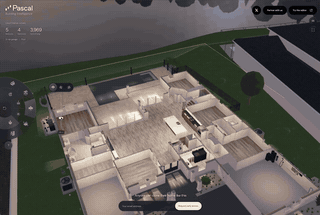</a> <a href="https://github.com/pascalorg/editor">pascalorg/editor</a></td>
<td align="center" valign="top"><a href="https://github.com/vinhhien112/img2obj">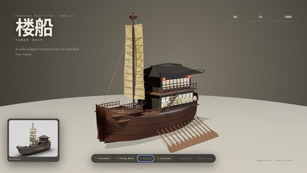</a> <a href="https://github.com/vinhhien112/img2obj">vinhhien112/img2obj</a></td>
<td align="center" valign="top"><a href="https://github.com/viettranx/3dviz-pro-max">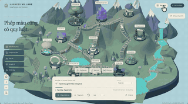</a> <a href="https://github.com/viettranx/3dviz-pro-max">viettranx/3dviz-pro-max</a></td>
</tr></table>

| 仓库 | 星数 | 做什么 | 安全评级 |
|---|---:|---|---|
| [pascalorg/editor](https://github.com/pascalorg/editor) | 25.4k | 开源 3D 建筑编辑器，提供本地 CLI、MCP 工具及实用工作流，支持人类和 AI agent。 | [SAFE](https://agentskillshub.top/skill/pascalorg/editor/) |
| [img2threejs/img2threejs](https://github.com/img2threejs/img2threejs) | 21.0k | 用纯代码重建参考图中的物体，制作经质量检查、适合动画的 Three.js 模型，高效实现图像转3D。 | [SAFE](https://agentskillshub.top/skill/img2threejs/img2threejs/) |
| [CloudAI-X/threejs-skills](https://github.com/CloudAI-X/threejs-skills) | 4.1k | 为 Claude Code 提供 three.js r186、React Three Fiber 9.8 和 gltf-transform 4.5 的已验证知… | [SAFE](https://agentskillshub.top/skill/CloudAI-X/threejs-skills/) |
| [majidmanzarpour/threejs-game-skills](https://github.com/majidmanzarpour/threejs-game-skills) | 2.8k | 用于构建可玩、精致的 Three.js 浏览器游戏的 agent skills，涵盖玩法、AAA 风格图形、UI、QA，以及可选的 AI 生成 3D、图像和音… | [SAFE](https://agentskillshub.top/skill/majidmanzarpour/threejs-game-skills/) |
| [achimala/dream-loop](https://github.com/achimala/dream-loop) | 1.9k | 使用 Blender、image gen 和 subagent critic 制作 3D 视觉效果的 agent skill | [SAFE](https://agentskillshub.top/skill/achimala/dream-loop/) |
| [vinhhien112/img2obj](https://github.com/vinhhien112/img2obj) | 1.7k | 将附加物体图像转换为仅代码、可制作动画的程序化 Three.js 模型的 Codex 插件。 | [SAFE](https://agentskillshub.top/skill/vinhhien112/img2obj/) |
| [dgreenheck/webgpu-claude-skill](https://github.com/dgreenheck/webgpu-claude-skill) | 1.3k | 用于使用 Three.js 开发 WebGPU 应用的 Claude skill | [SAFE](https://agentskillshub.top/skill/dgreenheck/webgpu-claude-skill/) |
| [viettranx/3dviz-pro-max](https://github.com/viettranx/3dviz-pro-max) | 1.2k | 创意3D可视化agent skill：将想法转为Three.js/Blender场景。Claude Code+Codex插件，含223个配方、440条知识记录… | [SAFE](https://agentskillshub.top/skill/viettranx/3dviz-pro-max/) |
| [scottstts/Threejs-Awesome-Graphics-Agent-Skills](https://github.com/scottstts/Threejs-Awesome-Graphics-Agent-Skills) | 981 | 用于为场景和游戏制作图形的 three.js agent skill | [SAFE](https://agentskillshub.top/skill/scottstts/Threejs-Awesome-Graphics-Agent-Skills/) |
| [lhlGitHub/threejs-architecture-effects](https://github.com/lhlGitHub/threejs-architecture-effects) | 714 | 使用 Three.js 构建可交互、自组装 3D 建筑的 Agent Skill | [SAFE](https://agentskillshub.top/skill/lhlGitHub/threejs-architecture-effects/) |
| [sloemo01/diorama](https://github.com/sloemo01/diorama) | 357 | 立体场景 Playbook 与 Three.js 套件：像素画、描边卡通或像素+描边；外观与模型双入口；自由环绕、调色板吸附、墨线；玩具角色动画；逐实体帧级质… | [SAFE](https://agentskillshub.top/skill/sloemo01/diorama/) |
| [instruktlabs/kiln](https://github.com/instruktlabs/kiln) | 322 | 用 coding agent 构建和修改程序化 3D 资产，提供本地 MCP server、CLI、TypeScript engine、渲染审阅、可编辑源文件… | [SAFE](https://agentskillshub.top/skill/instruktlabs/kiln/) |
| [codepawl/67.js](https://github.com/codepawl/67.js) | 319 | 由 AI agent 驱动的 WebGL2 3D 引擎 | [SAFE](https://agentskillshub.top/skill/codepawl/67.js/) |
| [Moh4696/open-3d-skills](https://github.com/Moh4696/open-3d-skills) | 316 | 8个3D/动画网站agent skill，适用于Claude Code、Codex、Cursor、Gemini CLI。 | [SAFE](https://agentskillshub.top/skill/Moh4696/open-3d-skills/) |
| [codepawl/viz3d](https://github.com/codepawl/viz3d) | 156 | 将任意主题转为 3D 影片或应用的 AI agent skill | [SAFE](https://agentskillshub.top/skill/codepawl/viz3d/) |
| [Nyxera0x/cutaway](https://github.com/Nyxera0x/cutaway) | 143 | Claude Code skill：将图片变成会自行拆解的3D对象，用three.js构建并校验，配合同步配乐以60fps拍摄。 | [SAFE](https://agentskillshub.top/skill/Nyxera0x/cutaway/) |
| [mintdotgg/mint-threejs-skills](https://github.com/mintdotgg/mint-threejs-skills) | 126 | 使用 Mint MCP 构建 Three.js 应用和游戏的 agent 指南 | [SAFE](https://agentskillshub.top/skill/mintdotgg/mint-threejs-skills/) |
| [JDhruv14/ascii-diorama](https://github.com/JDhruv14/ascii-diorama) | 96 | 用于使用 Three.js 渲染移轴 ASCII 微缩视频的 Claude Code skill | [SAFE](https://agentskillshub.top/skill/JDhruv14/ascii-diorama/) |
| [chongdashu/threejs-capacitor-ios-game](https://github.com/chongdashu/threejs-capacitor-ios-game) | 62 | 使用 agent skills 编写的移动端点击冒险游戏 | [SAFE](https://agentskillshub.top/skill/chongdashu/threejs-capacitor-ios-game/) |
| [iart-ai/webgl-animation-skills](https://github.com/iart-ai/webgl-animation-skills) | 52 | Claude Code 的 3D 动效/WebGL skill：Three.js、GLSL 着色器、粒子系统、GPU 渲染排障和 AI 视频指导，涵盖核心 2… | [SAFE](https://agentskillshub.top/skill/iart-ai/webgl-animation-skills/) |
| [tsogjavklann/awwwards-3d](https://github.com/tsogjavklann/awwwards-3d) | 36 | Awwwards 风格的滚动驱动 3D 网站 skill，适用于 Claude Code（Three.js r170 + GSAP + Lenis） | [SAFE](https://agentskillshub.top/skill/tsogjavklann/awwwards-3d/) |
| [dennisonbertram/emulsion](https://github.com/dennisonbertram/emulsion) | 12 | 协作式AI电影分镜预演——带有 three.js 应用的 Claude Code skill。用 Claude 实时规划镜头，导出运动参考，生成影片。 | [SAFE](https://agentskillshub.top/skill/dennisonbertram/emulsion/) |
| [CesiumGS/cesiumjs-ai-starter-app](https://github.com/CesiumGS/cesiumjs-ai-starter-app) | 10 | 使用 CesiumJS 和工具调用构建 LLM 驱动的 3D 地球应用入门模板。 | [SAFE](https://agentskillshub.top/skill/CesiumGS/cesiumjs-ai-starter-app/) |
| [nirholas/3d-scene-mcp](https://github.com/nirholas/3d-scene-mcp) | 10 | 通过自然语言让 AI agent 构建和操控 3D 场景。 | [SAFE](https://agentskillshub.top/skill/nirholas/3d-scene-mcp/) |
| [LumosLab-Innovation/3D-lab-skills](https://github.com/LumosLab-Innovation/3D-lab-skills) | 7 | 面向 AI coding agents 的交互式 3D，支持 Three.js、Blender MCP 及多平台一键 skill。 | [SAFE](https://agentskillshub.top/skill/LumosLab-Innovation/3D-lab-skills/) |
| [DataArche/SSWorld](https://github.com/DataArche/SSWorld) | 5 | Agent 创建的 WebGPU 3D 世界，支持光线追踪、全局光照、实时反射和 Lumen Gallery 演示。 | [SAFE](https://agentskillshub.top/skill/DataArche/SSWorld/) |
| [czlonkowski/blender-web-3d-skill](https://github.com/czlonkowski/blender-web-3d-skill) | 5 | Claude Code skill：用无头 Blender + Three.js 构建发布 3D 模型，管理脚本、GLB 导出、draw-call 优化与调试… | [SAFE](https://agentskillshub.top/skill/czlonkowski/blender-web-3d-skill/) |

## ✨ 3D 模型生成

[在在线页面打开这一类,按星数排序 →](https://agentskillshub.top/best/3d-mcp/#type-gen3d)

<table><tr>
<td align="center" valign="top"><a href="https://github.com/nirholas/three.ws">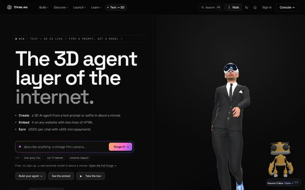</a> <a href="https://github.com/nirholas/three.ws">nirholas/three.ws</a></td>
<td align="center" valign="top"><a href="https://github.com/zorrobyte/asset-studio">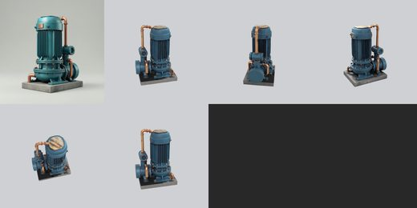</a> <a href="https://github.com/zorrobyte/asset-studio">zorrobyte/asset-studio</a></td>
<td align="center" valign="top"><a href="https://github.com/hypersniper05/MCP_Image_to_3D">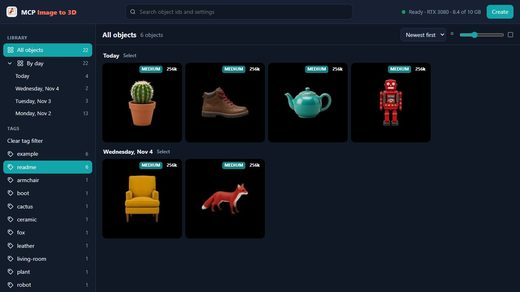</a> <a href="https://github.com/hypersniper05/MCP_Image_to_3D">hypersniper05/MCP_Image_to_3D</a></td>
</tr></table>

| 仓库 | 星数 | 做什么 | 安全评级 |
|---|---:|---|---|
| [nirholas/three.ws](https://github.com/nirholas/three.ws) | 272 | 为 AI agent 提供 3D 身体：文本或照片生成带绑定的 GLB avatar，配备 LLM、Solana wallet 和单标签嵌入。无密钥 MCP… | [SAFE](https://agentskillshub.top/skill/nirholas/three.ws/) |
| [sato942/game-asset-mcp](https://github.com/sato942/game-asset-mcp) | 166 | 使用 Hugging Face AI 模型通过文本创建 2D/3D 游戏素材的 MCP 服务器。 | [SAFE](https://agentskillshub.top/skill/sato942/game-asset-mcp/) |
| [rtmandreyev/construct](https://github.com/rtmandreyev/construct) | 119 | 描述一个物体，获得全息图、3D模型及其部件：由任意AI agent构建。 | [SAFE](https://agentskillshub.top/skill/rtmandreyev/construct/) |
| [thrixel/build-world](https://github.com/thrixel/build-world) | 111 | 使用 Thrixel 的高质量资产和任意 AI agent 构建交互式 3D 世界。 | [SAFE](https://agentskillshub.top/skill/thrixel/build-world/) |
| [meshy-dev/meshy-mcp-server](https://github.com/meshy-dev/meshy-mcp-server) | 91 | Meshy AI 3D 生成平台的 MCP 服务器 | [SAFE](https://agentskillshub.top/skill/meshy-dev/meshy-mcp-server/) |
| [Rijalmoneyfinder/mcp-game-asset-forge](https://github.com/Rijalmoneyfinder/mcp-game-asset-forge) | 69 | MCP：用 Python 工具将 AI 提示词转换为游戏资产 | [UNSAFE](https://agentskillshub.top/skill/Rijalmoneyfinder/mcp-game-asset-forge/) |
| [zorrobyte/asset-studio](https://github.com/zorrobyte/asset-studio) | 67 | 本地文本转3D游戏资产流水线，支持 agent 调用：Qwen-Image-2512 → Pixal3D（TRELLIS.2）→ Blender/meshop… | [SAFE](https://agentskillshub.top/skill/zorrobyte/asset-studio/) |
| [matthieuhuguet/substance-designer-mcp](https://github.com/matthieuhuguet/substance-designer-mcp) | 63 | Adobe Substance 3D Designer 的 MCP（Model Context Protocol）集成，可从 Claude、Cursor 或任… | [SAFE](https://agentskillshub.top/skill/matthieuhuguet/substance-designer-mcp/) |
| [hypersniper05/MCP_Image_to_3D](https://github.com/hypersniper05/MCP_Image_to_3D) | 19 | 输入一张图，输出一个 3D Gaussian-splat .ply 文件。自托管 Docker 服务，提供网页图库、3D 查看器、HTTP API 和 MCP… | [SAFE](https://agentskillshub.top/skill/hypersniper05/MCP_Image_to_3D/) |
| [mordor-forge/trident-mcp](https://github.com/mordor-forge/trident-mcp) | 5 | Tripo 3D API v3 非官方 MCP server：文本/图像/多视图生成3D，P1/P2低模、纹理、重拓扑、Smart UV、分割、绑定、动画、格… | [SAFE](https://agentskillshub.top/skill/mordor-forge/trident-mcp/) |

**安全评级**是 Agent Skills Hub 对仓库 README 和安装步骤的评级。*待评级*表示目录还没评到它。

预览图是各项目 README 里图片的缩小副本,只收录采用宽松许可证的项目,版权归原作者所有。来源和许可证见 [assets/previews/NOTICE.md](assets/previews/NOTICE.md)。如需移除请提 issue。

## 相关合集

- [zhuyansen/awesome-claude-video-skills](https://github.com/zhuyansen/awesome-claude-video-skills), [zhuyansen/awesome-codex-ppt-skills](https://github.com/zhuyansen/awesome-codex-ppt-skills) —— 同样做法的合集。

## 推荐仓库

提一个 issue 附上 GitHub 链接。它会走和每个条目一样的评审;决定上不上榜的是上面的规则,不是星数。

---

机器可读版本:[`data/skills.json`](data/skills.json)。生成于 2026-11-09。
